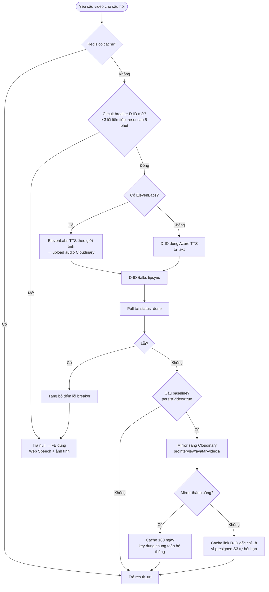
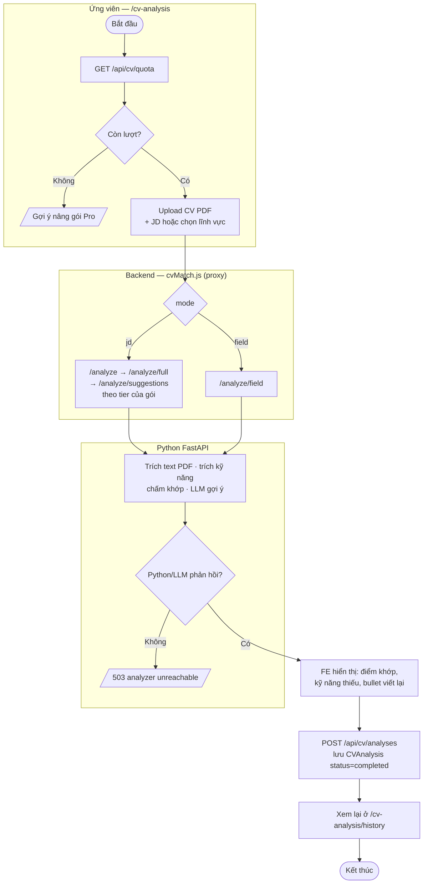
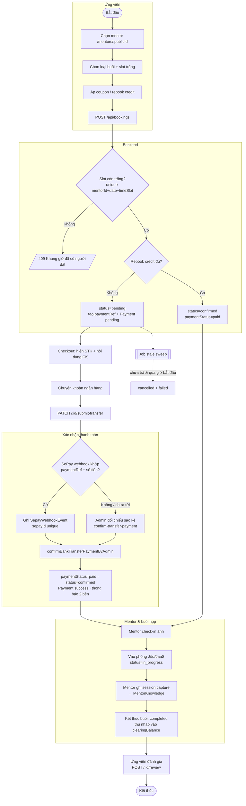
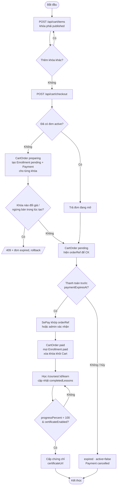
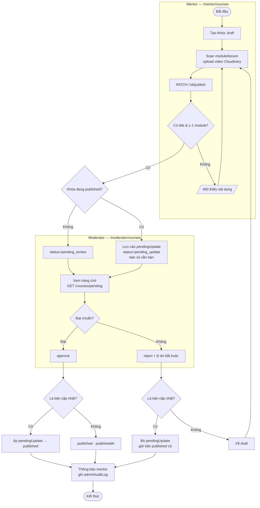
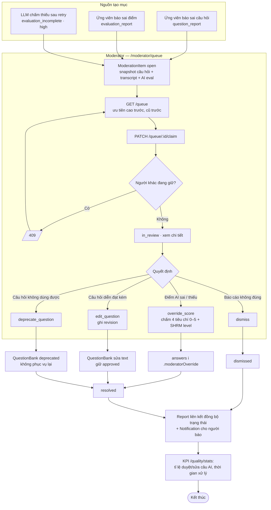
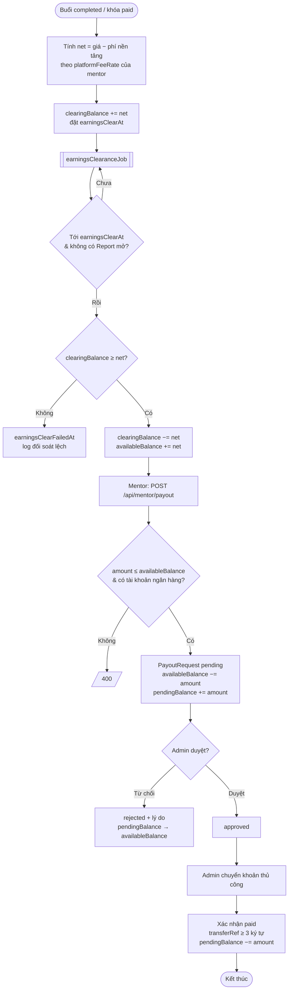
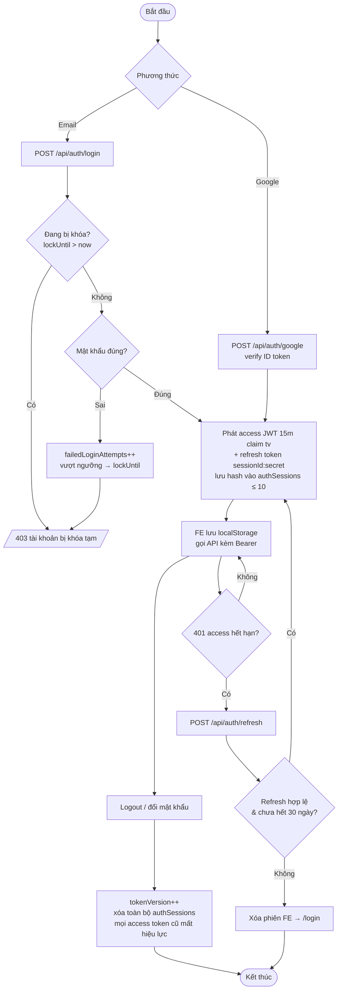

# Activity Diagrams — ProInterview

> Cập nhật: 2026-11-01 · nguồn: `backend/src/controllers`, `services`, `jobs` và các trang FE tương ứng.
> Trạng thái của từng thực thể trong các luồng này: [STATE_MACHINES.md](STATE_MACHINES.md).

Mỗi sơ đồ chia **làn (swimlane)** theo tác nhân bằng `subgraph`. Hình thoi = rẽ nhánh; nhánh lỗi ghi mã HTTP trả về.

| # | Luồng | Tác nhân chính |
|:-:|:------|:---------------|
| 1 | [Phỏng vấn AI end-to-end](#1-phỏng-vấn-ai-end-to-end) | Ứng viên · Backend · LLM · Moderator |
| 2 | [Sinh video avatar (pregen)](#2-sinh-video-avatar-pregen) | Backend · ElevenLabs · D-ID · Cloudinary · Redis |
| 3 | [Phân tích CV/JD](#3-phân-tích-cvjd) | Ứng viên · Backend · Python |
| 4 | [Đặt lịch mentor + chuyển khoản](#4-đặt-lịch-mentor--thanh-toán-chuyển-khoản) | Ứng viên · Backend · SePay · Admin · Mentor |
| 5 | [Mua khóa học qua giỏ hàng](#5-mua-khóa-học-qua-giỏ-hàng) | Ứng viên · Backend · SePay/Admin |
| 6 | [Soạn & duyệt khóa học](#6-mentor-soạn-khóa-học--moderator-duyệt) | Mentor · Moderator |
| 7 | [Xử lý hàng đợi kiểm định HITL](#7-moderator-xử-lý-hàng-đợi-kiểm-định-hitl) | Moderator · Backend |
| 8 | [Thu nhập & rút tiền mentor](#8-thu-nhập--rút-tiền-mentor) | Job · Mentor · Admin |
| 9 | [Đăng nhập & làm mới phiên](#9-đăng-nhập--làm-mới-phiên) | Người dùng · Backend |

---

## 1. Phỏng vấn AI end-to-end

```mermaid
flowchart TD
    subgraph UV["Ứng viên (FE /interview → /interview/gender → /interview/room)"]
        A0([Bắt đầu]) --> A1[Chọn vị trí / dán CV-JD]
        A1 --> A2[Chọn giọng HR nam/nữ]
        A2 --> A3[Đồng ý quyền camera]
    end

    subgraph BE["Backend /api/interviews"]
        B1{"Còn lượt phỏng vấn?<br/>quota.interviewUsed < limit"}
        B1 -- Không --> B1x[/403 Hết lượt miễn phí/]
        B1 -- Có --> B2[Tạo InterviewSession<br/>status=in_progress<br/>3 câu baseline cố định]
        B2 --> B3[Lấy video avatar pregen<br/>cho 3 câu — xem sơ đồ 2]
    end

    A3 --> B1
    B3 --> R1

    subgraph ROOM["Phòng phỏng vấn"]
        R1[Avatar đọc câu i] --> R2[Ứng viên trả lời<br/>ghi âm + camera]
        R2 --> R3[STT → transcript<br/>analyze-face → behavioralData]
        R3 --> R4[PATCH /sessions/:id<br/>lưu answers i]
        R4 --> R5{"Đã xong 3 câu baseline?"}
        R5 -- Chưa --> R1
        R5 -- Rồi --> R6{"Gói Pro còn hạn?<br/>starter_pro / elite_pro"}
        R6 -- Không --> R9
        R6 -- Có --> R7
        R8{"Còn câu follow-up?"}
        R8 -- Còn --> R1
        R8 -- Hết --> R9[POST /sessions/:id/complete<br/>status=completed]
    end

    subgraph FU["Sinh follow-up (chỉ Pro)"]
        R7[POST generate-followup-questions] --> F1{"Đã có 5 câu?"}
        F1 -- Có --> F4
        F1 -- Chưa --> F2[LLM sinh 2 câu<br/>từ CV/JD + 3 câu trả lời thật]
        F2 --> F3[applyDeprecationPolicy<br/>trùng câu deprecated → sinh lại ≤ 2 lần]
        F3 --> F3b[harvest vào QuestionBank<br/>status=pending_review]
        F3b --> F4[Trả 2 câu + pregen video]
    end
    F4 --> R8

    subgraph EV["Chấm điểm POST /sessions/:id/evaluate"]
        R9 --> E1{"Đã có feedback?"}
        E1 -- Có --> E9
        E1 -- Chưa --> E2[Claim khóa đánh giá<br/>đang chạy → 429]
        E2 --> E3[LLM chấm từng câu<br/>clarity · structure · relevance · credibility]
        E3 --> E4{"Đủ trường?"}
        E4 -- Thiếu --> E5[Retry 1 lần]
        E5 --> E6{"Vẫn thiếu?"}
        E6 -- Có --> E7[evaluationIncomplete=true<br/>upsert ModerationItem<br/>evaluation_incomplete, priority high]
        E6 -- Không --> E8
        E4 -- Đủ --> E8[Ghi feedback + perQuestion]
        E7 --> E8
        E8 --> E9[Trả kết quả]
    end

    subgraph FB["Ứng viên — /interview/feedback"]
        E9 --> G1[Xem điểm tổng + từng câu]
        G1 --> G2{"Thấy câu hỏi/điểm sai?"}
        G2 -- Có --> G3[Báo sai: POST /api/reports<br/>reasonCode + note]
        G3 --> G4[ModerationItem open<br/>→ sơ đồ 7]
        G2 -- Không --> G5([Kết thúc])
        G4 --> G5
    end
```

**Chưa làm (bước 7 của S1):** FE chưa hiện nút "Báo sai", nhãn "Đang chờ kiểm định" khi `evaluationIncomplete`, và điểm moderator thay điểm AI khi có `moderatorOverride`. Backend đã trả đủ các trường này.

---

## 2. Sinh video avatar (pregen)

Khi pregen nhiều câu, `pregenerateVideos` gọi câu đầu trước làm phép thử; chỉ khi thành công mới chạy song song các câu còn lại — D-ID đang lỗi thì không tốn credit cho cả loạt.

---

## 3. Phân tích CV/JD

`CVAnalysis.status` hiện chỉ được ghi `completed` (lúc FE lưu kết quả). `processing` / `failed` có trong schema nhưng chưa dùng — muốn theo dõi job treo cần ghi bản ghi `processing` trước khi gọi Python.

---

## 4. Đặt lịch mentor + thanh toán chuyển khoản

Nhánh hủy/vắng mặt/đổi mentor: xem bảng chuyển trạng thái Booking trong [STATE_MACHINES.md §1](STATE_MACHINES.md#1-booking--bookingstatus).

---

## 5. Mua khóa học qua giỏ hàng

Khóa miễn phí (`isFree`) ghi danh thẳng qua `POST /api/courses/:id/enroll`, không qua giỏ.

---

## 6. Mentor soạn khóa học → Moderator duyệt

---

## 7. Moderator xử lý hàng đợi kiểm định (HITL)

---

## 8. Thu nhập & rút tiền mentor

---

## 9. Đăng nhập & làm mới phiên

