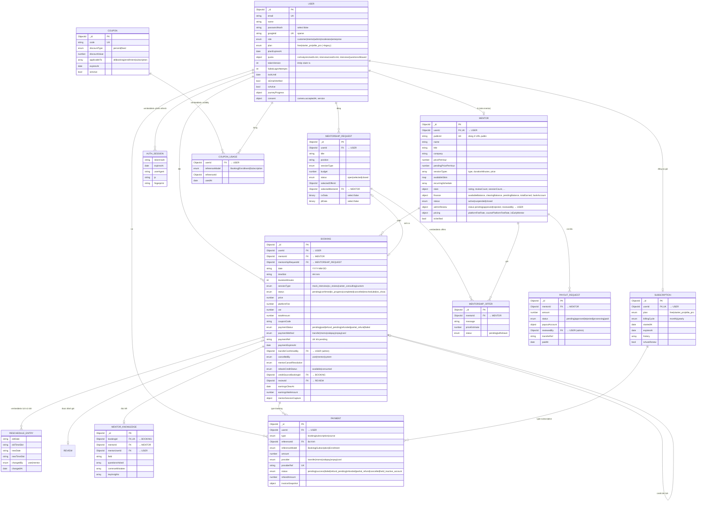
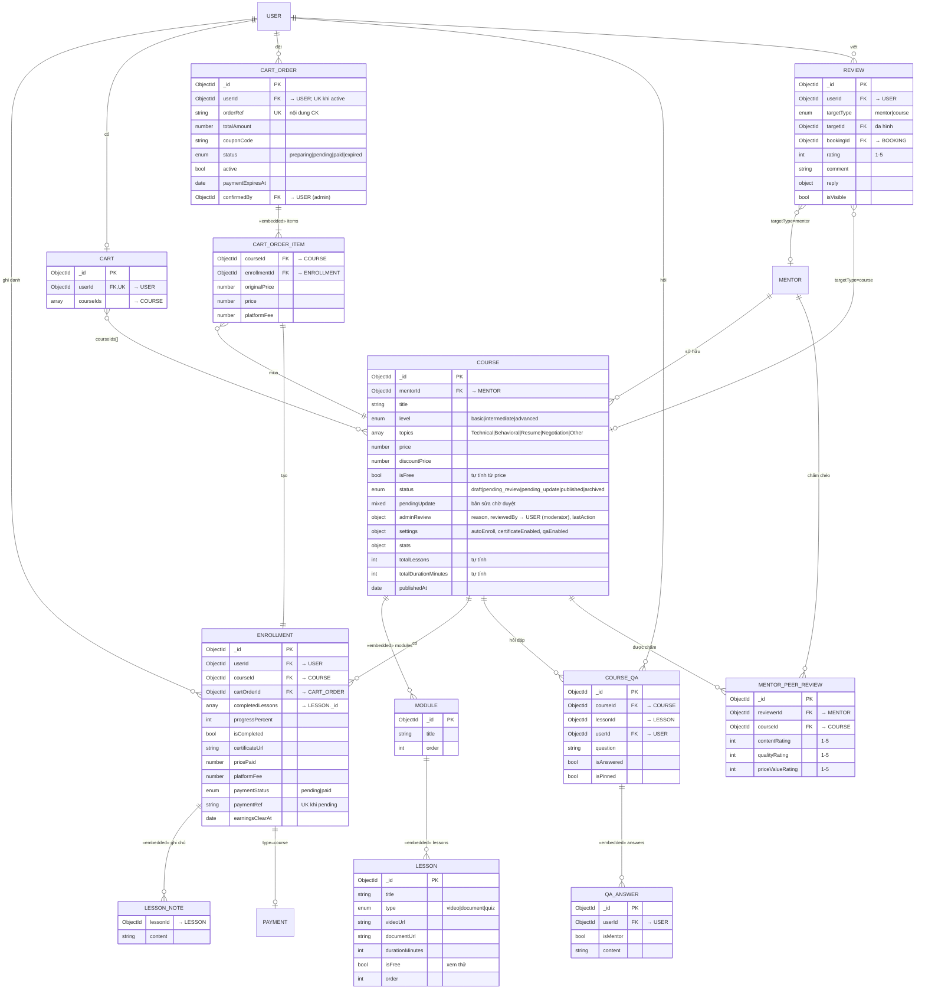
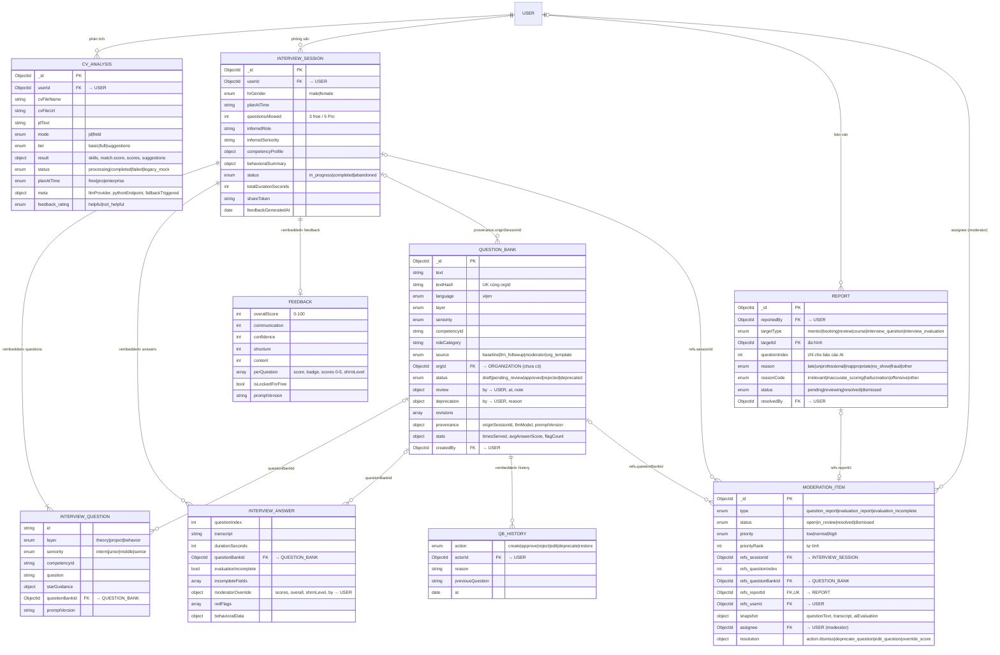
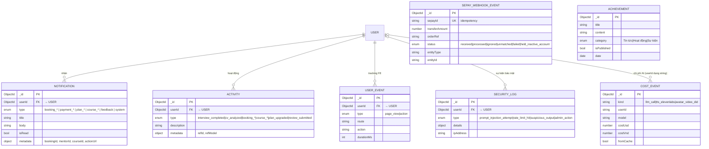

# Logical ERD — ProInterview

> Cập nhật: 2026-11-01 · nguồn: `backend/src/models/*.js` (28 model).
> Script tạo DB tương ứng: [database/prointerview_schema.mongodb.js](database/prointerview_schema.mongodb.js).
> Mức khái niệm (chỉ tên thực thể): [CONCEPTUAL_DIAGRAM_GUIDE.md](CONCEPTUAL_DIAGRAM_GUIDE.md).

## Quy ước

- Hệ quản trị là **MongoDB**: mỗi thực thể chính là một collection, khóa chính `_id` (ObjectId), khóa ngoại là trường `ObjectId` có `ref`.
- **Thực thể yếu (embedded)** — đánh dấu `«embedded»` — là mảng/sub-document lưu bên trong document cha, không có collection riêng (vd. `MODULE`, `LESSON` trong `Course`). Ở mức logic vẫn vẽ tách để thấy bội số.
- Chỉ liệt kê thuộc tính có ý nghĩa nghiệp vụ hoặc ràng buộc; đầy đủ từng trường xem model hoặc `backend/DATABASE.md`.
- `createdAt`, `updatedAt` có ở mọi collection (`timestamps: true`) nên không ghi lại.
- Ký hiệu: `PK` khóa chính · `FK` khóa ngoại · `UK` duy nhất.

---

## A. Tài khoản · Mentor · Đặt lịch · Tài chính

---

## B. Khóa học · Giỏ hàng · Đánh giá

---

## C. AI · Kiểm duyệt (Moderator HITL)

---

## D. Thông báo · Nhật ký · Vận hành

`SEPAY_WEBHOOK_EVENT` và `ACHIEVEMENT` không có khóa ngoại cứng: webhook khớp đối tượng qua `orderRef` → `Booking.paymentRef` / `Enrollment.paymentRef` / `CartOrder.orderRef`, rồi ghi lại `entityType` + `entityId`.

---

## Bảng quan hệ và ràng buộc

| Quan hệ | Bội số | Cài đặt trong code |
|:--------|:------:|:-------------------|
| USER – MENTOR | 1 – 0..1 | `Mentor.userId` unique sparse; hook `User.post("save")` tự tạo/đồng bộ Mentor khi `role=mentor` |
| USER – SUBSCRIPTION | 1 – 0..1 | `Subscription.userId` unique |
| USER – CART | 1 – 0..1 | `Cart.userId` unique |
| USER – CART_ORDER (đang mở) | 1 – 0..1 | Partial unique `{userId}` khi `active: true` |
| MENTOR – BOOKING theo slot | — | Partial unique `{mentorId, date, timeSlot}` khi status ∈ pending/confirmed/in_progress → chống đặt trùng |
| MENTORSHIP_REQUEST – BOOKING | 0..1 – 0..1 | Partial unique `{mentorshipRequestId}` khi booking còn hiệu lực |
| BOOKING – MENTOR_KNOWLEDGE | 1 – 0..1 | `MentorKnowledge.bookingId` unique |
| USER – COURSE (ENROLLMENT) | n – n | Unique `{userId, courseId}` |
| USER – REVIEW – target | — | Unique `{userId, targetType, targetId}`: mỗi người đánh giá một mentor/khóa một lần |
| MENTOR – COURSE (peer review) | n – n | Unique `{reviewerId, courseId}` |
| PAYMENT – đối tượng | n – 1 | Đa hình `type` + `referenceModel` + `referenceId`; unique `{provider, type, referenceId}` |
| Mã chuyển khoản đang chờ | — | Partial unique `paymentRef` khi `paymentStatus=pending` (Booking, Enrollment) |
| REPORT (AI) – câu hỏi | — | Partial unique `{reportedBy, targetType, targetId, questionIndex}` khi có `questionIndex` → mỗi user báo một câu một lần |
| REPORT – MODERATION_ITEM | 1 – 0..1 | Partial unique `refs.reportId` |
| Đánh giá chưa đủ – MODERATION_ITEM | — | Partial unique `{type, refs.sessionId, refs.questionIndex}` khi `type=evaluation_incomplete` → upsert không nhân bản |
| QUESTION_BANK nội dung | — | Unique `{textHash, orgId}`: chuẩn hóa chữ thường, gộp khoảng trắng, bỏ dấu câu cuối |
| SEPAY_WEBHOOK_EVENT | — | Unique `sepayId` → webhook gửi lại không xử lý hai lần |

## Thay đổi so với Conceptual ERD cũ

Conceptual ERD (`PROINTERVIEW_CONCEPTUAL.drawio`) có 17 thực thể và ghi "chưa có role kiểm duyệt viên". Từ đó đến nay đã thêm:

- `User.role` có thêm `moderator`, `enterprise`.
- Collection mới: `QuestionBank`, `ModerationItem`, `MentorshipRequest`, `MentorKnowledge`, `Coupon`.
- `Report` mở rộng `targetType` cho câu hỏi/đánh giá AI (`reasonCode` riêng).
- `InterviewSession.answers` có `evaluationIncomplete`, `moderatorOverride`; `questions`/`answers` trỏ `questionBankId`.
- `Course.adminReview.reviewedBy` giờ là moderator (route chuyển từ `/api/admin` sang `/api/moderator`).
