# State Machine Diagrams — ProInterview

> Cập nhật: 2026-11-18 · nguồn: các hàm ghi `status` trong `backend/src/services`, `controllers`, `jobs`.
> Mỗi sơ đồ kèm bảng "chuyển → hàm/endpoint" để lần ngược về code. Khi thêm giá trị enum mới, cập nhật cả sơ đồ lẫn bảng.

Ký hiệu: `[*]` trạng thái đầu/cuối · nhãn mũi tên = sự kiện `[điều kiện]` / tác nhân.

---

## 1. Booking — `Booking.status`

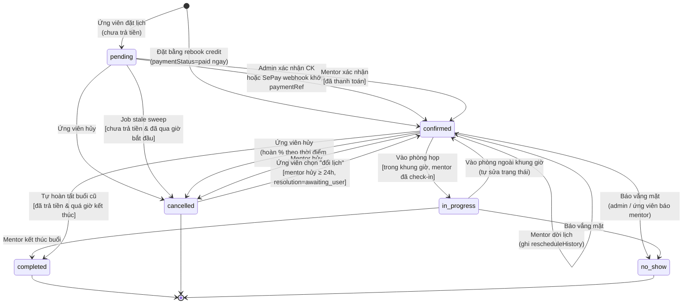

| Chuyển | Hàm (`services/bookingsService.js` trừ khi ghi khác) | Endpoint |
|:-------|:------------------------------------------------------|:---------|
| `[*] → pending / confirmed` | `createBooking` | `POST /api/bookings` |
| `pending → confirmed` (thanh toán) | `confirmBankTransferPaymentByAdmin` (SePay gọi lại cùng hàm qua `sepayWebhookService`) | `PATCH /api/admin/.../confirm-transfer-payment`, `POST /api/payments/webhook/sepay` |
| `pending → confirmed` (mentor) | `confirmMentorBooking` — chặn nếu chưa qua cổng thanh toán | `PATCH /api/bookings/:id/confirm` |
| `confirmed ⇄ in_progress` | `startBookingMeeting` → `prepareBookingForMeetingEntry` | `PATCH /api/bookings/:id/start`, `/mentor/:id/start` |
| `in_progress → completed` | `completeMentorBooking` | `PATCH /api/bookings/:id/complete` |
| `confirmed → completed` (tự động) | `maybeAutoCompleteStaleBooking` | — |
| `* → cancelled` (ứng viên) | `cancelMyBooking` + `applyUserCancellationLedger` | `DELETE /api/bookings/:id` |
| `* → cancelled` (mentor) | `cancelMentorBooking` — đặt `mentorCancelResolution` = `late_cancel_refund` (< 24h) hoặc `awaiting_user` (≥ 24h) | `PATCH /api/bookings/mentor/:id/cancel` |
| `cancelled → confirmed` | `resolveMentorCancelBooking` (choice `reschedule`) | `PATCH /api/bookings/:id/mentor-cancel-resolution` |
| `confirmed → confirmed` (dời) | `rescheduleMentorBooking` | `PATCH /api/bookings/mentor/:id/reschedule` |
| `* → no_show` | `processBookingNoShow` | `POST /api/bookings/:id/report-no-show` |
| `pending → cancelled` (job) | `jobs/bookingStaleSweepJob.js` — đồng thời `Payment` pending → `cancelled` | — |

**Lưu ý:**
- Ứng viên **không** tự đổi lịch: `rescheduleMyBooking` luôn trả 400 theo chính sách (hủy rồi đặt lại).
- Giá trị `rescheduled` còn trong enum nhưng **không hàm nào ghi** — chỉ được đọc ở `dashboardStatsService`. Có thể dọn khi refactor.
- Booking đã trả tiền nhưng quá giờ mà chưa kết thúc: job stale sweep **không đổi status**, chỉ gắn `staleFlaggedAt` để admin xử lý.
- Hai lựa chọn còn lại khi mentor hủy ≥ 24h: `change_mentor` → sinh `rebookCreditStatus=available`; `refund` → `paymentStatus=refund_pending`.
- **Booking lộ trình (`learningPathId`) và buổi đánh giá 0đ (`sessionType: assessment`)** — LP-22: `cancelMyBooking`, `cancelMentorBooking`, `processBookingNoShow` chỉ đổi `status` (`cancelled` / `no_show`) và ghi `cancelledBy`; **không** hoàn tiền, **không** `awaiting_user`, **không** rebook credit, `paymentStatus` giữ `paid`. `LearningPathSession` của buổi quay về `planned` (gỡ `bookingId`) để ứng viên đặt lại. `resolveMentorCancelBooking` trả 400. Hoàn tiền lộ trình chỉ qua hủy cả lộ trình (LP-15). No-show của mentor vẫn tăng `stats.noShowCount`.

---

## 2. Thanh toán booking — `Booking.paymentStatus`

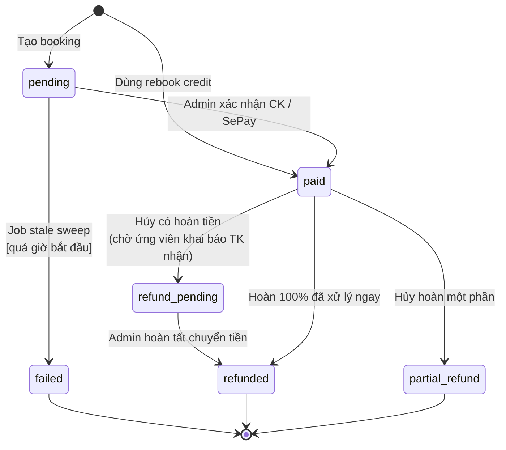

`refund-destination` (`PATCH /api/bookings/:id/refund-destination`) là bước ứng viên khai báo tài khoản nhận hoàn tiền, trạng thái vẫn `refund_pending` cho tới khi admin ghi `refundCompletedAt`.

---

## 3. Giao dịch — `Payment.status`

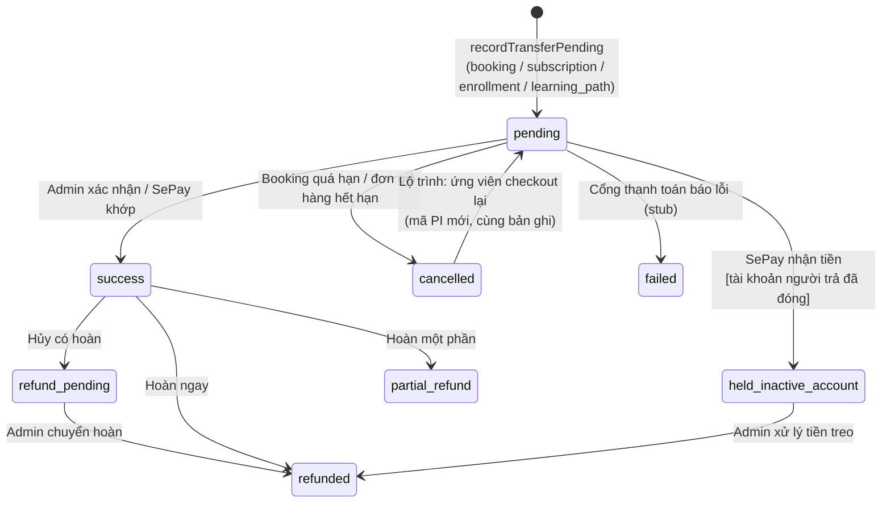

| Chuyển | Code |
|:-------|:-----|
| `pending → held_inactive_account` | `services/heldPaymentService.js`; webhook log ghi `SepayWebhookEvent.status = held_inactive_account` |
| `pending → cancelled` | `jobs/bookingStaleSweepJob.js`, `services/cartService.js` (`expireCartOrder`), `transferPaymentExpiryService.expireLearningPathTransferIfNeeded` (LP-10, gọi khi checkout, poll `transfer-status`, xem lịch sử thanh toán) |
| `cancelled → success` (chỉ `learning_path`, LP-11) | Admin xác nhận ngoại lệ (`force` + lý do) giao dịch đã hết hạn khi tiền đến muộn mà lộ trình vẫn `pending_payment` |
| `cancelled → pending` (chỉ `learning_path`) | `POST /api/learning-paths/:id/checkout` mở lại bản ghi với mã `PI…` mới (unique `{provider, type, referenceId}` không cho tạo bản ghi thứ hai) |
| Idempotent | `SepayWebhookEvent.sepayId` unique — webhook gửi lại → `ignored` |

---

## 4. Đơn giỏ hàng — `CartOrder.status`

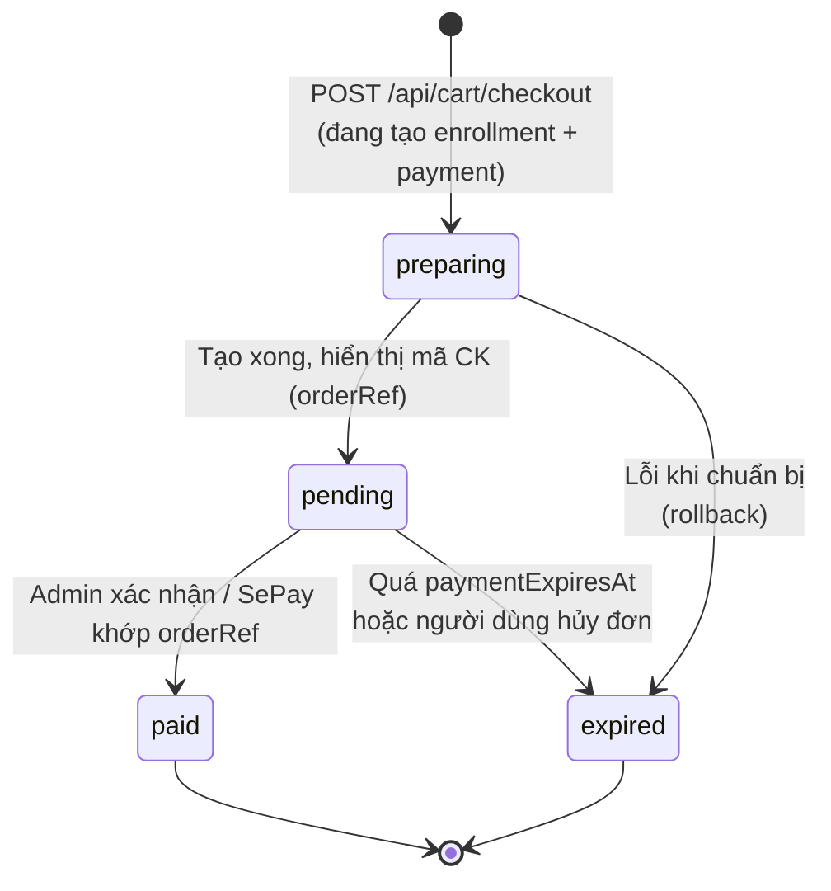

`active=true` chỉ đúng ở `preparing`/`pending` (partial unique index → mỗi user một đơn mở). Khi `expired`, các `Payment` pending của từng enrollment trong đơn chuyển `cancelled`. Khi `paid`, từng `Enrollment.paymentStatus` → `paid` và mở khóa học.

---

## 5. Khóa học — `Course.status` (Mentor soạn, Moderator duyệt)

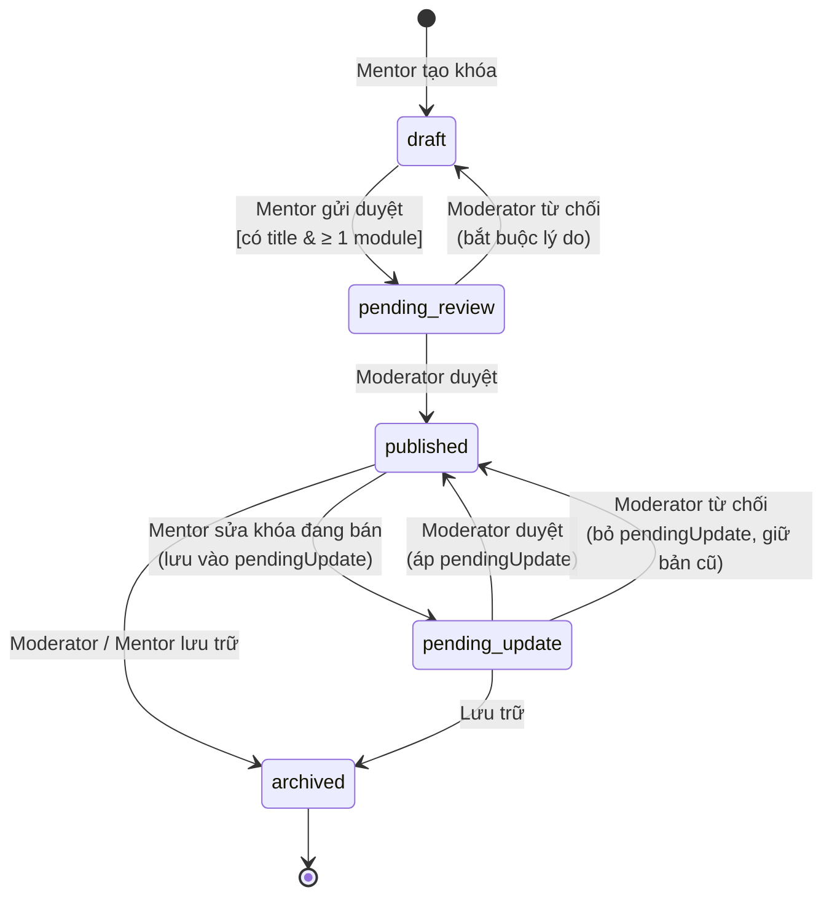

| Chuyển | Code | Endpoint |
|:-------|:-----|:---------|
| `published → pending_update` (sửa) | `CoursesController.update` | `PUT /api/courses/:id` |
| `draft → pending_review` / `→ pending_update` (gửi duyệt) | `CoursesController.publish` | `PATCH /api/courses/:id/publish` |
| Mentor lưu trữ | `CoursesController.archive` | `DELETE /api/courses/:id` |
| Duyệt / từ chối / lưu trữ | `adminController.approveCourse/rejectCourse/archiveCourse` (mount dưới moderator router) | `PATCH /api/moderator/courses/:id/approve`, `/reject`, `/archive` |

Khóa học chỉ bán được (`cartService`, `reviewsService`) khi `status = published`; khóa `pending_update` vẫn bán bản đang public.

---

## 6. Ngân hàng câu hỏi — `QuestionBank.status`

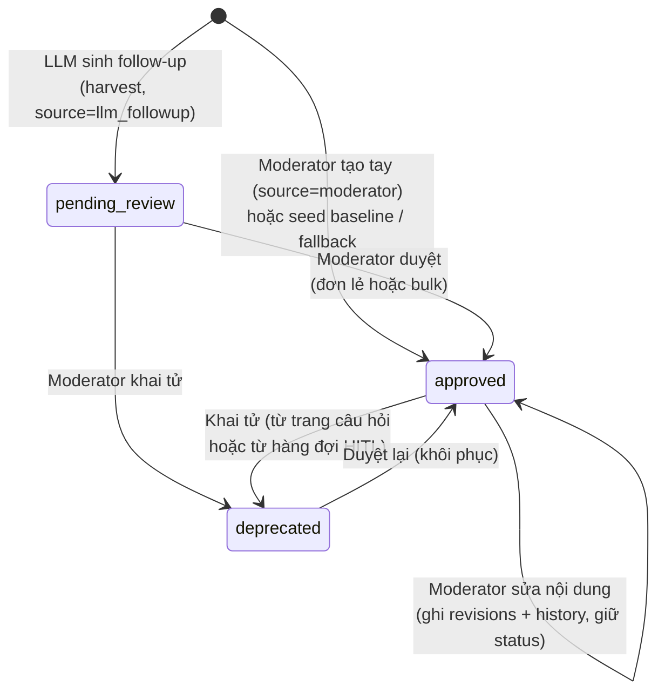

| Chuyển | Hàm (`services/questionBankService.js`) | Endpoint |
|:-------|:----------------------------------------|:---------|
| `[*] → pending_review` | `harvest` (upsert theo `textHash`; trùng → giữ nguyên bản cũ) | gọi nội bộ từ `generateFollowUpQuestions` |
| `[*] → approved` | `createQuestion`, `syncFallbackQuestions` | `POST /api/moderator/questions` |
| `→ approved` | `approveQuestion`, `bulkUpdateQuestions` | `PATCH /api/moderator/questions/:id/approve`, `POST .../questions/bulk` |
| `→ deprecated` | `deprecateQuestion`, `bulkUpdateQuestions` | `PATCH /api/moderator/questions/:id/deprecate` |
| Sửa nội dung | `editQuestion` | `PATCH /api/moderator/questions/:id` |

**Tác động lúc chạy phỏng vấn:** chỉ câu `approved` (và `orgId=null`) được phục vụ làm fallback; `applyDeprecationPolicy` loại câu LLM vừa sinh nếu trùng `textHash` một câu `deprecated` và sinh lại tối đa `REGENERATE_ATTEMPTS = 2` lần.

Các route duyệt của pool chung (`PATCH /api/moderator/questions/:id/approve`, `POST .../questions/bulk`) chỉ tác động câu `orgId=null`; câu doanh nghiệp đi luồng 6b.

### 6b. Câu hỏi doanh nghiệp (`orgId != null`, CO-04, CO-05, CO-16)

Quyết định CO-16 (23/11/2026): câu Company Moderator đã duyệt phải qua Platform Moderator duyệt mới được dùng.

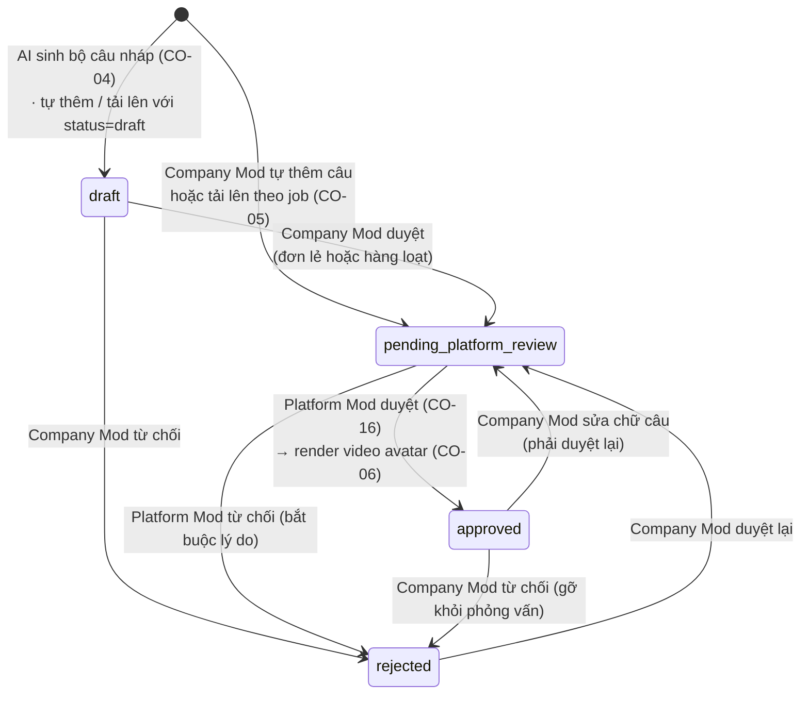

| Chuyển | Hàm | Endpoint |
|:-------|:----|:---------|
| `[*] → draft` | `generateCompanyQuestionDrafts` | `POST /api/company/questions/generate` |
| `[*] → pending_platform_review` (hoặc `draft`) | `createQuestion`, `uploadQuestions` (`companyWorkspaceController.js`) | `POST /api/company/questions`, `/questions/upload` |
| `draft \| rejected → pending_platform_review` | `approveQuestion`, `batchApproveQuestions` | `POST /api/company/questions/:id/approve`, `/batch-approve` |
| `→ rejected` (Company Mod) | `rejectQuestion`, `batchRejectQuestions` | `POST /api/company/questions/:id/reject`, `/batch-reject` |
| `approved → pending_platform_review` | `editQuestion` (khi đổi chữ) | `PATCH /api/company/questions/:id` |
| `pending_platform_review → approved \| rejected` | `approveCompanyQuestion`, `rejectCompanyQuestion`, `bulkReviewCompanyQuestions` (`services/companyQuestionReviewService.js`) | `POST /api/moderator/company-questions/:id/approve`, `/:id/reject`, `/bulk` |

**Tác động:** chỉ câu `approved` vào phỏng vấn (JB-06) và được render video avatar (`scheduleCompanyQuestionVideoWarm`, CO-06). Rubric công ty gắn được câu `pending_platform_review` hoặc `approved`.

Giá trị `draft`, `rejected` chỉ dùng cho câu doanh nghiệp; pool chung chưa có luồng nào ghi hai giá trị này.

---

## 7. Hàng đợi kiểm định — `ModerationItem.status` (+ `Report.status` đồng bộ)

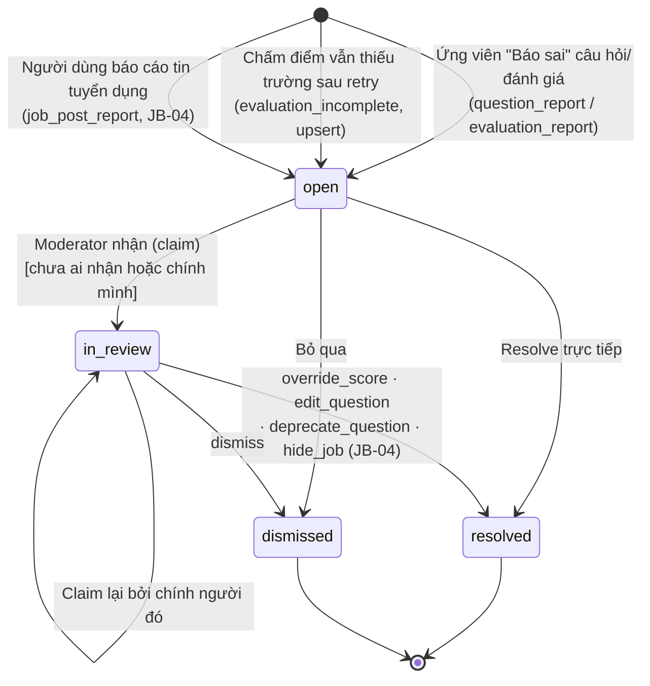

| Sự kiện | Hàm (`services/moderationQueueService.js`) | Endpoint |
|:--------|:-------------------------------------------|:---------|
| Tạo từ báo cáo | `createItemForReport` (unique theo `refs.reportId`) | `POST /api/reports` (targetType `interview_question` / `interview_evaluation`) |
| Tạo từ đánh giá thiếu | `upsertIncompleteEvaluationItem` (unique theo session + questionIndex) | gọi trong `POST /api/interviews/sessions/:id/evaluate` |
| Nhận | `claimItem` — người khác đang giữ → 409 | `PATCH /api/moderator/queue/:id/claim` |
| Xử lý | `resolveItem` — mục đã đóng → 409 | `PATCH /api/moderator/queue/:id/resolve` |
| Tạo từ báo cáo tin tuyển dụng (JB-04) | `createJobPostReport` (`services/jobPostModerationService.js`) | `POST /api/reports` (targetType `job_post`) |
| Xử lý báo cáo tin (JB-04) | `resolveJobItem`: `dismiss` hoặc `hide_job` (ẩn tin qua `setJobVisibility`, đóng mọi item mở của tin qua `resolveOpenJobReports`) | `PATCH /api/moderator/queue/:id/resolve` |

Khi resolve: `Report` liên kết → `resolved`/`dismissed` + `resolvedBy`; `override_score` ghi `InterviewSession.answers[i].moderatorOverride`; người báo cáo nhận `Notification` (link `/interview/feedback?sessionId=`).

**`course_prescreen` (AI-08):** không vào hàng đợi trên (`listQueue`, `getQueueItem`, `claimItem`, `resolveItem` và KPI hàng đợi chỉ xét 3 loại phỏng vấn, `HITL_QUEUE_TYPES`). `coursePrescreenService.prescreenCourse` upsert 1 item / khóa ở `open` mỗi lần mentor gửi duyệt (`PATCH /api/courses/:id/publish`, hoặc `PUT /api/courses/:id` với khóa đang bán); `closePrescreenItem` chuyển `resolved` khi moderator duyệt / từ chối khóa (`resolution.action: null`, `note` bắt đầu bằng `approve` hoặc `reject`).

Trạng thái `Report` cho báo cáo mentor/booking/review/course (không qua hàng đợi): `pending → reviewing → resolved | dismissed`, do admin xử lý ở `/api/admin`.

**JB-04:** `/api/moderator/queue` không truyền `type` chỉ trả 3 loại phỏng vấn; `job_post_report` hiện ở màn riêng (JB-17, `?type=job_post_report`). KPI hàng đợi của Quality Dashboard cũng chỉ đếm 3 loại phỏng vấn. Report `job_post` không hiện ở trang support admin (`MODERATOR_REPORT_TARGET_TYPES`).

---

## 8. Buổi phỏng vấn AI — `InterviewSession.status` và đánh giá từng câu

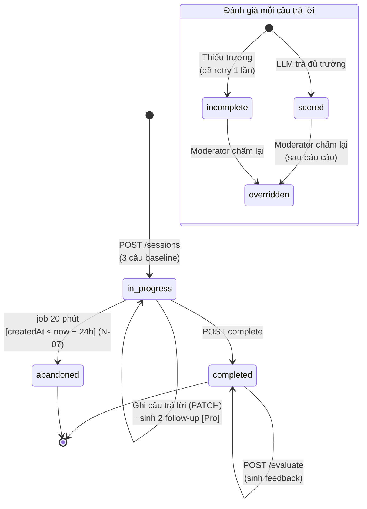

- `abandoned` (N-07): `markAbandonedInterviewSessions` (`services/interviewSessionCleanupService.js`) chạy trong nhịp 20 phút của `jobs/bookingStaleSweepJob.js`, đánh buổi `in_progress` có `createdAt ≤ now − 24h` (`INTERVIEW_ABANDON_AFTER_MS`), ghi `abandonedAt`. Cập nhật có điều kiện theo `status`, chạy lại không đổi gì; không hoàn lượt `interviewUsed`. `POST /sessions/:id/complete` trả 409 với buổi `abandoned`; `PATCH /sessions/:id` vốn chỉ nhận `in_progress`. Thống kê (`/api/admin/content/stats`, `/api/admin/interview-metrics` trừ bảng theo trạng thái, `/api/public/home-data`) trải `EXCLUDE_ABANDONED_SESSIONS`; hồ sơ năng lực chỉ đọc `completed`.
- `incomplete` = `answers[i].evaluationIncomplete = true`; `overridden` = `answers[i].moderatorOverride != null`. FE phải ưu tiên `moderatorOverride.overall` khi hiển thị (bước 7 của S1 — chưa làm).

---

## 9. Rút tiền mentor — `PayoutRequest.status` và số dư

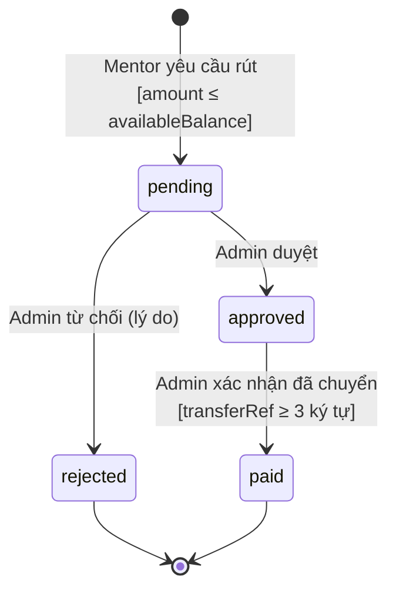

Số dư mentor đi theo chiều: buổi/khóa đã thanh toán → `finance.clearingBalance` → job `earningsClearanceJob` khi tới `earningsClearAt` và không có Report mở → `finance.availableBalance` (guard `clearingBalance >= net`, `mentorEarningsService.js`). Tạo payout: `availableBalance → pendingBalance`; `rejected` trả lại `availableBalance`; `paid` trừ hẳn `pendingBalance` (`payoutService.js`). `processing` có trong enum nhưng `payoutService` chỉ dùng `approve / reject / paid`.

---

## 10. Yêu cầu mentorship — `MentorshipRequest.status` / `offers[].status`

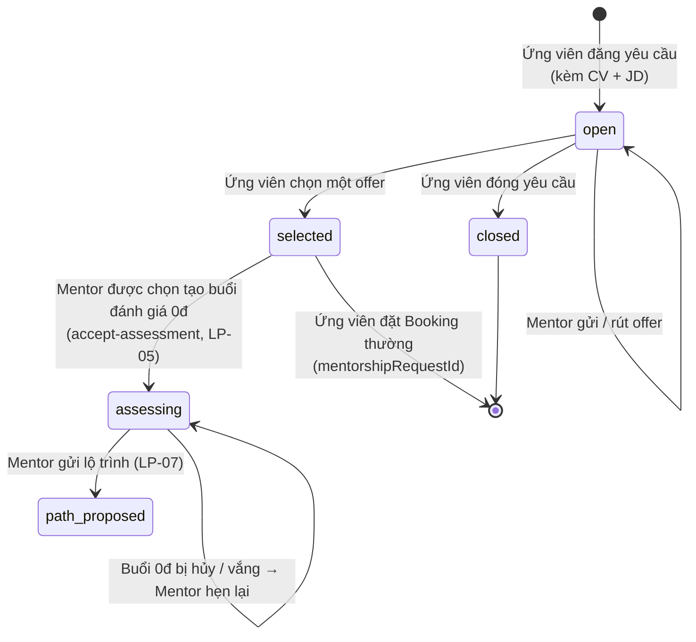

Offer: `pending → withdrawn` (mentor rút). Chọn offer chỉ thành công khi request còn `open` và offer còn `pending` (`findOneAndUpdate` có điều kiện — chống chọn hai lần).

| Chuyển | Hàm / endpoint |
|:-------|:---------------|
| `open → selected` | `selectOffer` — `POST /:id/offers/:offerId/select` |
| `open → closed` | `closeRequest` — `POST /:id/close` |
| `selected / assessing → assessing` | `acceptAssessment` — `POST /:id/accept-assessment`: tạo Booking `assessment`, ghi `assessmentBookingId` (cập nhật có điều kiện, lỗi thì xóa booking vừa tạo). Chặn khi buổi 0đ hiện tại còn `pending/confirmed/in_progress` hoặc đã `completed` |
| `assessing → path_proposed` | LP-07 |

Ở `selected`, `assessing`, `path_proposed` ứng viên vẫn đặt được booking thường (`resolveRequestBooking` dùng `REQUEST_MENTOR_CHOSEN_STATUSES`). Giới hạn số buổi 0đ (quyết định 13) làm ở LP-06.

---

## 11. Hồ sơ mentor — `Mentor.adminReview.status` và `Mentor.status`

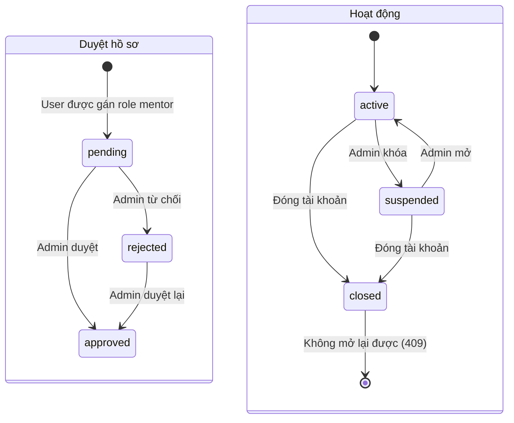

---

## 12. Tài khoản người dùng

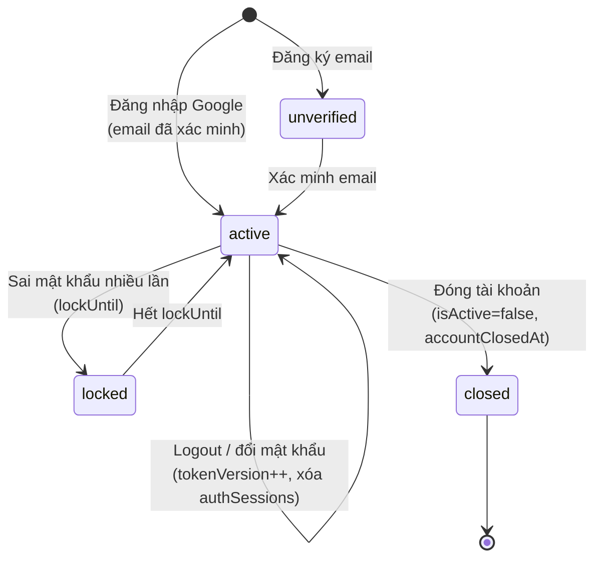

Đây là trạng thái **suy ra** từ các trường (`isEmailVerified`, `lockUntil`, `isActive`), không có field `status` riêng trên `User`. Tiền chuyển tới sau khi tài khoản đóng → `Payment.held_inactive_account`.

---

## 13. Lộ trình học — `LearningPath.status` (capstone FA26)

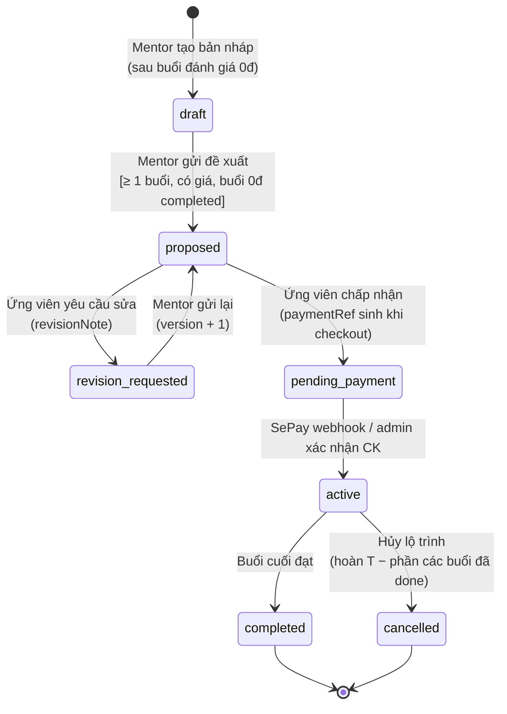

| Chuyển | Hàm / endpoint | Task |
|:-------|:---------------|:-----|
| → `draft` | `POST /api/learning-paths` | LP-07 |
| `draft` / `revision_requested` → `proposed` | `POST /api/learning-paths/:id/propose` | LP-07, LP-08 |
| `proposed` → `revision_requested` | `POST /api/learning-paths/:id/request-revision` | LP-08 |
| `proposed` → `pending_payment` | `POST /api/learning-paths/:id/accept` | LP-08 |
| `pending_payment` → `active` | SePay webhook (`confirmLearningPathTransfer`) / admin `PATCH /api/admin/payments/:id/confirm-learning-path-transfer` (`adminConfirmLearningPathTransfer`) | LP-10, LP-11 |
| `active` → `completed` | `PATCH /api/learning-paths/:id/sessions/:sid/outcome` (buổi cuối `passed`) | LP-13 |
| `active` → `cancelled` | `POST /api/learning-paths/:id/cancel` | LP-15 |

Model và enum có từ LP-03. **Đã code (LP-07):** `→ draft` (`createLearningPathDraft`), `draft / revision_requested → proposed` (`proposeLearningPath`, cập nhật có điều kiện theo `status` + `version`; gửi lại thì `version + 1`; yêu cầu mentor → `path_proposed`). **LP-08:** `proposed → revision_requested` (`requestLearningPathRevision`, lưu `revisionNote`) và `proposed → pending_payment` (`acceptLearningPath`, ghi `acceptedAt`, chặn chấp nhận phiên bản cũ qua `version`); cả hai cập nhật có điều kiện `status: proposed` + `version`, nên chấp nhận và yêu cầu sửa cùng lúc chỉ một thao tác thắng. **LP-10:** `pending_payment → active` (`confirmLearningPathTransfer` trong `learningPathPaymentService.js`): ghi Payment `learning_path` `success` rồi cập nhật có điều kiện `status: pending_payment` (cùng transaction nếu DB hỗ trợ), ghi `paidAt`, thông báo `learning_path_paid` cho mentee và mentor. Hết hạn mã CK **không** đổi trạng thái lộ trình (vẫn `pending_payment`, checkout lại có mã mới). Lộ trình `pending_payment` không bị job nào quét. Các chuyển còn lại làm ở task ghi trong bảng. Mỗi yêu cầu mentor chỉ có 1 lộ trình chưa `cancelled` (partial unique index).

---

## 14. Buổi trong lộ trình — `LearningPathSession.status` / `outcome`

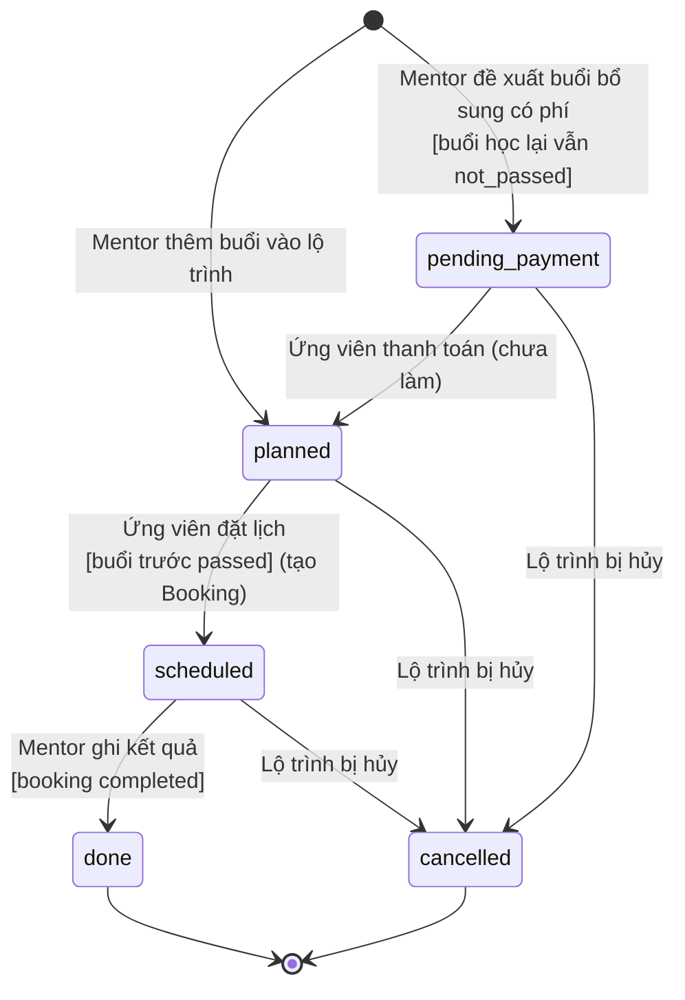

`outcome` khi `done`: `passed` → mở buổi `order` kế tiếp; `not_passed` → tạo document mới cùng `order`, `attempt` + 1, `retakeOf` = buổi vừa xong. Lần học lại đầu tiên (`attempt = 2`) miễn phí (`shareAmount = 0`); từ lần sau mentor đề xuất buổi bổ sung có phí (quyết định 2).

| Chuyển | Hàm / endpoint | Task |
|:-------|:---------------|:-----|
| `planned` → `scheduled` | `POST /api/learning-paths/:id/sessions/:sid/schedule` | LP-12 |
| `scheduled` → `planned` | Hủy / vắng mặt booking của buổi (`closeLearningPathOrAssessmentBooking`) | LP-22 |
| `scheduled` → `done` (+ `outcome`) | `PATCH /api/learning-paths/:id/sessions/:sid/outcome` (`recordLearningPathSessionOutcome`) | LP-13 |
| → `planned` (buổi học lại 0đ, `attempt` 2) | Tự tạo khi lần đầu `not_passed` | LP-13 |
| → `pending_payment` (buổi bổ sung, `attempt ≥ 3`) | `POST /api/learning-paths/:id/sessions/:sid/supplementary` (`proposeSupplementarySession`) | LP-13 |
| `pending_payment` → `planned` | Thanh toán buổi bổ sung — chưa làm, đề xuất (s) | — |
| → `cancelled` | Hủy lộ trình | LP-15 |

**Đã code (LP-13):** mentor ghi kết quả khi booking của buổi đã `completed`; ghi có điều kiện (`status: scheduled`) nên chỉ một lần thắng. Bước kế tính bằng `resolveOutcomeNextStep` (`utils/learningPathOutcome.js`): đạt và mọi `order` có lần học mới nhất đạt → `LearningPath` `active → completed`; lần đầu chưa đạt → tạo buổi học lại 0đ ở `planned` (mở đặt lịch ngay); từ lần học lại trở đi chưa đạt → không tạo gì, mentor đề xuất buổi bổ sung có phí ở `pending_payment` (`findSchedulableSession` không mở buổi đó và chặn mọi buổi sau).

**Đã code (LP-12):** `planned → scheduled` (`scheduleLearningPathSession` trong `learningPathSessionsService.js`). Buổi mở đặt lịch tính bằng `findSchedulableSession` (`utils/learningPathSchedule.js`): lộ trình `active`; đi theo `order`, mỗi `order` lấy lần học mới nhất (bỏ `cancelled`); gặp buổi `planned` đầu tiên chưa đạt thì mở buổi đó, gặp buổi `scheduled` hoặc `not_passed` thì không mở buổi nào. Nên mỗi lúc chỉ có tối đa 1 buổi `scheduled`. Giữ buổi bằng cập nhật có điều kiện (`status: planned`, `bookingId: null`) trước khi tạo Booking; tạo Booking lỗi thì trả buổi về `planned`.

---

## 15. Tin tuyển dụng — `JobPost.status` (capstone FA26)

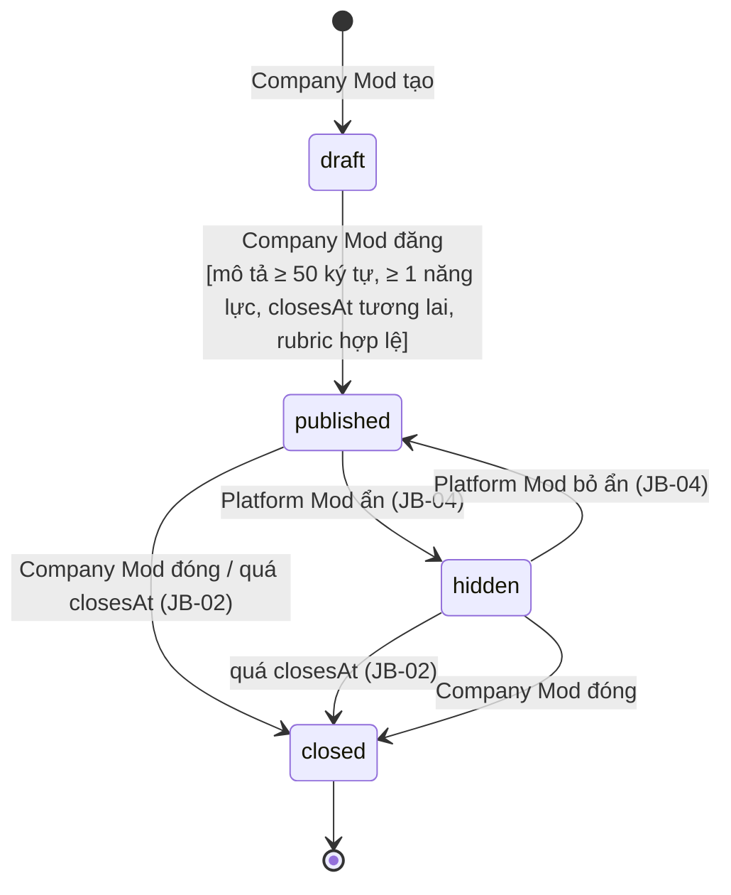

| Chuyển | Hàm / endpoint | Task |
|:-------|:---------------|:-----|
| → `draft` | `POST /api/company/jobs` (`createCompanyJob`) | JB-01 |
| `draft` → `published` | `PATCH /api/company/jobs/:id/status` `{ status: "published" }` (`changeCompanyJobStatus`) | JB-01 |
| `published` / `hidden` → `closed` | `PATCH /api/company/jobs/:id/status` `{ status: "closed" }`, `closedReason: company` | JB-01 |
| `published` / `hidden` → `closed` (hết hạn) | `closeExpiredJobPosts` trong `bookingStaleSweepJob` (20 phút), `closedReason: expired` | JB-02 |
| `published` ↔ `hidden` | `PATCH /api/moderator/jobs/:id/visibility` | JB-04 |

**Đã code (JB-01):** tạo, sửa (chỉ `draft` / `published`; job đang đăng phải vẫn đủ điều kiện đăng), đăng, đóng. Đổi trạng thái cập nhật có điều kiện theo `status` (hai lần đăng cùng lúc chỉ một lần thắng); sửa nội dung có điều kiện theo `status` + `updatedAt`. Company Mod không mở lại job đã đóng và không bỏ ẩn. **JB-02:** `closeExpiredJobPosts` (`jobPostsService.js`) chạy trong nhịp 20 phút của `jobs/bookingStaleSweepJob.js`: job `published` hoặc `hidden` có `closesAt <= now` → `closed`, `closedReason: expired` (cập nhật có điều kiện theo status, chạy lại không đổi gì; bản nháp không bị đóng). **JB-03:** API công khai chỉ trả `published` chưa quá hạn của công ty không bị khóa, nên không phụ thuộc độ trễ của job định kỳ.

## 16. Đề xuất cải tiến AI — `AIImprovementProposal.status` (capstone FA26)

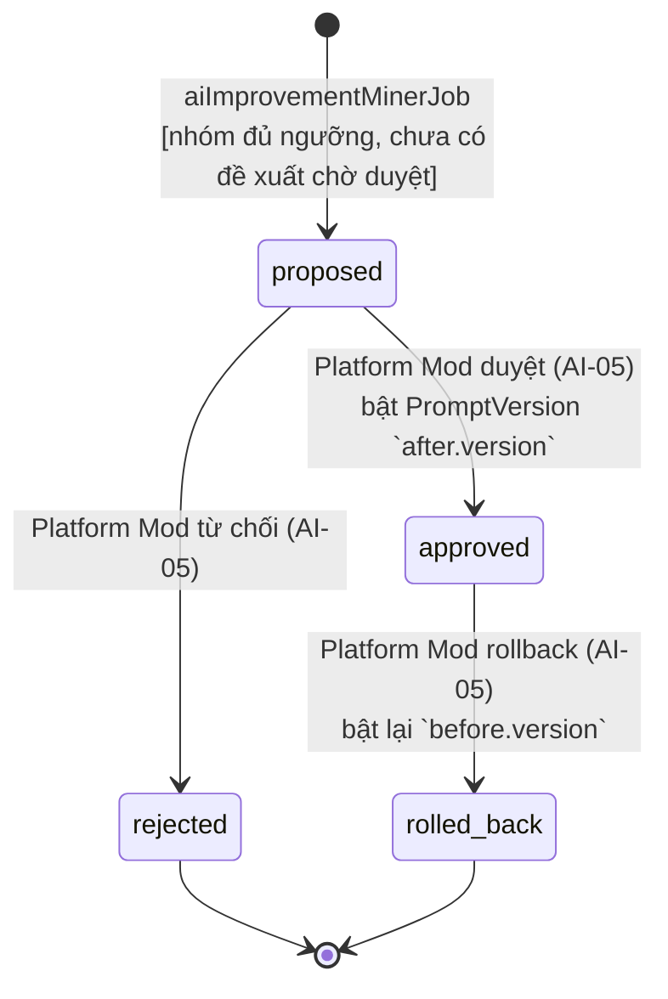

| Chuyển | Hàm / endpoint | Task |
|:-------|:---------------|:-----|
| → `proposed` | `mineImprovementProposals` (`services/aiImprovementMinerService.js`) trong `jobs/aiImprovementMinerJob.js` (mỗi ngày, lượt đầu sau 10 phút) | AI-03 |
| `proposed` → `approved` / `rejected`; `approved` → `rolled_back` | `PATCH /api/moderator/ai-improvements/:id` | AI-05 (chưa code) |

**Đã code (AI-03):** miner gom `ModerationItem` `resolved` có `resolution.action` là `override_score` (target `evaluation`, nhóm theo `competencyId` của câu) hoặc `edit_question` / `deprecate_question` (target `question_gen`, nhóm theo `roleCategory`; bỏ câu công ty có `orgId`). Nhóm có ≥ `AI_IMPROVEMENT_MIN_EVIDENCE` (mặc định 5) item chưa dùng thì tạo PromptVersion mới **chưa bật** (`createVersion`: bản active + tối đa 3 few-shot từ ca lệch nhiều nhất, tổng tối đa 9) và 1 đề xuất `few_shot`, báo `ai_improvement_proposed` cho moderator. Mỗi item chỉ làm bằng chứng một lần; nhóm đang có đề xuất `proposed` thì item mới để lại tới lượt sau khi đề xuất được xử lý. Không job nào khác lọc theo status này.

---

## 17. Phân tích CV — `CVAnalysis.status` (N-11)

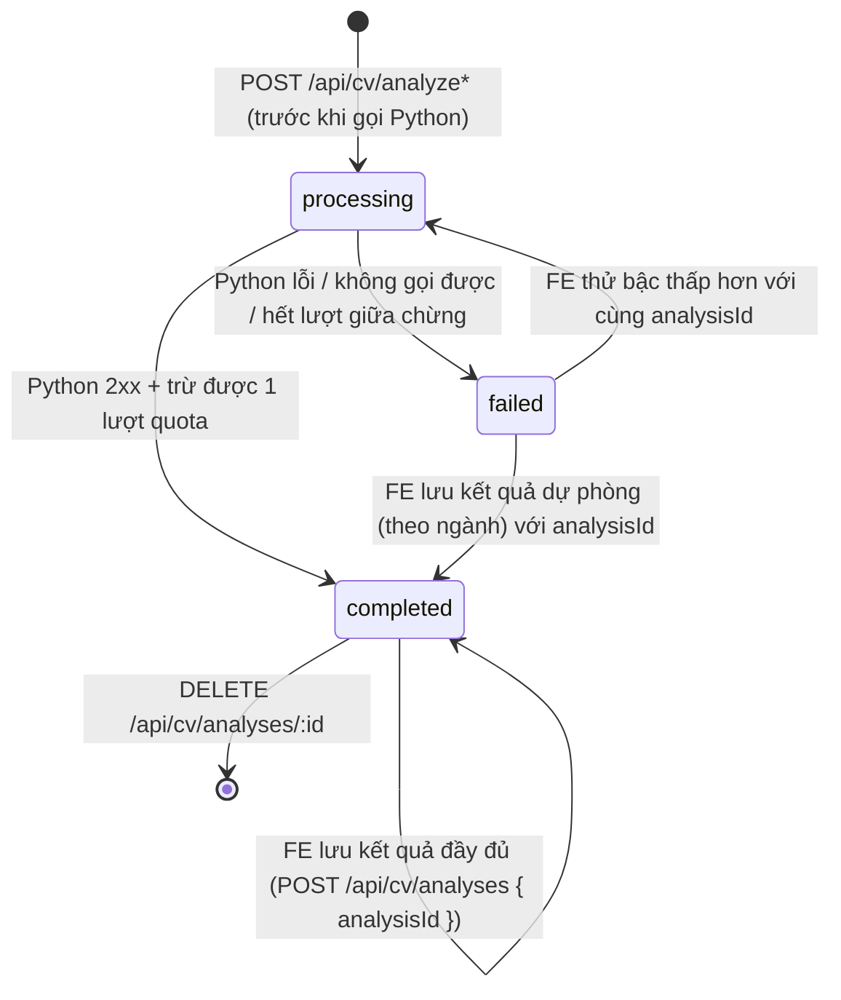

| Chuyển | Hàm / endpoint | Task |
|:-------|:---------------|:-----|
| → `processing` | `startAnalysisRun` (`services/cvAnalysisRunService.js`) trong `proxyToAnalyzer` (`routes/cvMatch.js`) | N-11 |
| `processing` → `completed` / `failed` | `finishAnalysisRun`: ghi `meta.processingTimeMs`, `result.match` (khi thành công), `error` (khi lỗi); log `cv_analysis_timing` | N-11 |
| `failed` → `processing` | `startAnalysisRun` với `analysisId` của chính user, cùng `mode`, đang `processing`/`failed` | N-11 |
| `completed` / `failed` → `completed` | `CVController.createAnalysis` với `analysisId` (ghi đè, không trừ lượt nếu `quotaCharged`) | N-11 |
| → `completed` (không qua Python) | `CVController.createAnalysis` không có `analysisId` (client cũ) | — |
| `legacy_mock` | Script `migrate-cv-analysis.js` gắn cho bản ghi giả cũ; không còn hàm nào ghi | — |

Bản ghi `processing` / `failed` không hiện trong lịch sử ứng viên và không tính vào thống kê (`CV_ANALYSIS_DONE_FILTER`), chỉ dùng để đo thời gian và tỉ lệ lỗi (QA-03). Bản ghi kẹt ở `processing` (server tắt giữa chừng) tìm bằng index `{ status: 1, createdAt: 1 }`.
