# State Machine Diagrams — ProInterview

> Cập nhật: 2026-11-01 · nguồn: các hàm ghi `status` trong `backend/src/services`, `controllers`, `jobs`.
> Mỗi sơ đồ kèm bảng "chuyển → hàm/endpoint" để lần ngược về code. Khi thêm giá trị enum mới, cập nhật cả sơ đồ lẫn bảng.

Ký hiệu: `[*]` trạng thái đầu/cuối · nhãn mũi tên = sự kiện `[điều kiện]` / tác nhân.

---

## 1. Booking — `Booking.status`

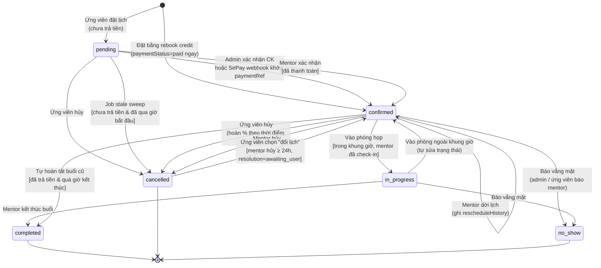

| Chuyển | Hàm (`services/bookingsService.js` trừ khi ghi khác) | Endpoint |
|:-------|:------------------------------------------------------|:---------|
| `[*] → pending / confirmed` | `createBooking` | `POST /api/bookings` |
| `pending → confirmed` (thanh toán) | `confirmBankTransferPaymentByAdmin` (SePay gọi lại cùng hàm qua `sepayWebhookService`) | `PATCH /api/admin/.../confirm-transfer-payment`, `POST /api/payments/webhook/sepay` |
| `pending → confirmed` (mentor) | `confirmMentorBooking` — chặn nếu chưa qua cổng thanh toán | `PATCH /api/bookings/:id/confirm` |
| `confirmed ⇄ in_progress` | `startBookingMeeting` → `prepareBookingForMeetingEntry` | `PATCH /api/bookings/:id/start`, `/mentor/:id/start` |
| `in_progress → completed` | `completeMentorBooking` | `PATCH /api/bookings/:id/complete` |
| `confirmed → completed` (tự động) | `maybeAutoCompleteStaleBooking` | — |
| `* → cancelled` (ứng viên) | `cancelMyBooking` + `applyUserCancellationLedger` | `DELETE /api/bookings/:id` |
| `* → cancelled` (mentor) | `cancelMentorBooking` — đặt `mentorCancelResolution` = `late_cancel_refund` (< 24h) hoặc `awaiting_user` (≥ 24h) | `PATCH /api/bookings/mentor/:id/cancel` |
| `cancelled → confirmed` | `resolveMentorCancelBooking` (choice `reschedule`) | `PATCH /api/bookings/:id/mentor-cancel-resolution` |
| `confirmed → confirmed` (dời) | `rescheduleMentorBooking` | `PATCH /api/bookings/mentor/:id/reschedule` |
| `* → no_show` | `processBookingNoShow` | `POST /api/bookings/:id/report-no-show` |
| `pending → cancelled` (job) | `jobs/bookingStaleSweepJob.js` — đồng thời `Payment` pending → `cancelled` | — |

**Lưu ý:**
- Ứng viên **không** tự đổi lịch: `rescheduleMyBooking` luôn trả 400 theo chính sách (hủy rồi đặt lại).
- Giá trị `rescheduled` còn trong enum nhưng **không hàm nào ghi** — chỉ được đọc ở `dashboardStatsService`. Có thể dọn khi refactor.
- Booking đã trả tiền nhưng quá giờ mà chưa kết thúc: job stale sweep **không đổi status**, chỉ gắn `staleFlaggedAt` để admin xử lý.
- Hai lựa chọn còn lại khi mentor hủy ≥ 24h: `change_mentor` → sinh `rebookCreditStatus=available`; `refund` → `paymentStatus=refund_pending`.

---

## 2. Thanh toán booking — `Booking.paymentStatus`

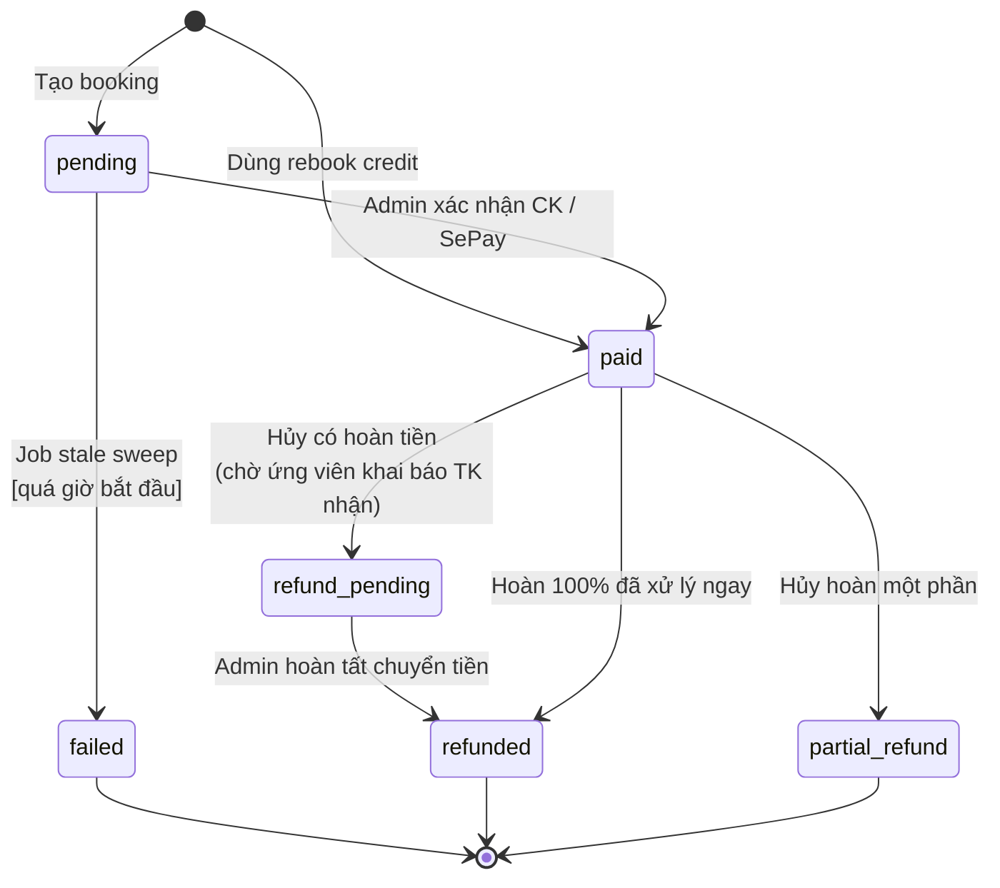

`refund-destination` (`PATCH /api/bookings/:id/refund-destination`) là bước ứng viên khai báo tài khoản nhận hoàn tiền, trạng thái vẫn `refund_pending` cho tới khi admin ghi `refundCompletedAt`.

---

## 3. Giao dịch — `Payment.status`

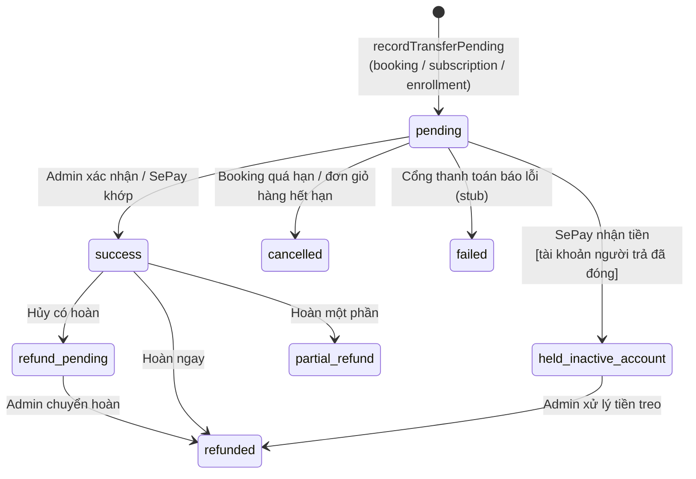

| Chuyển | Code |
|:-------|:-----|
| `pending → held_inactive_account` | `services/heldPaymentService.js`; webhook log ghi `SepayWebhookEvent.status = held_inactive_account` |
| `pending → cancelled` | `jobs/bookingStaleSweepJob.js`, `services/cartService.js` (`expireCartOrder`) |
| Idempotent | `SepayWebhookEvent.sepayId` unique — webhook gửi lại → `ignored` |

---

## 4. Đơn giỏ hàng — `CartOrder.status`

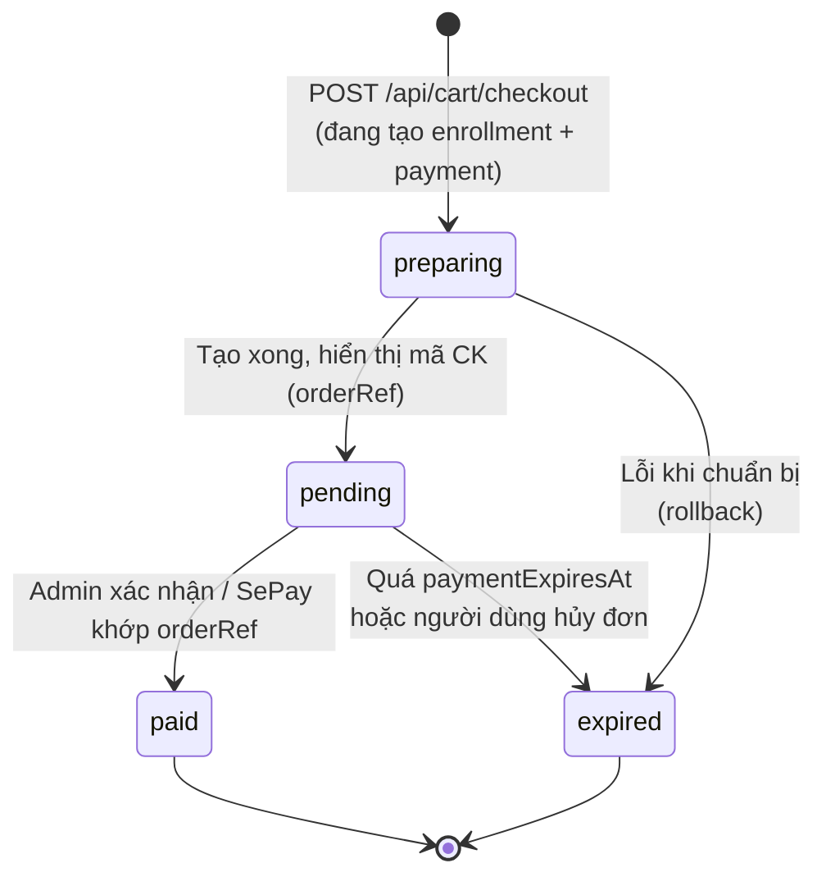

`active=true` chỉ đúng ở `preparing`/`pending` (partial unique index → mỗi user một đơn mở). Khi `expired`, các `Payment` pending của từng enrollment trong đơn chuyển `cancelled`. Khi `paid`, từng `Enrollment.paymentStatus` → `paid` và mở khóa học.

---

## 5. Khóa học — `Course.status` (Mentor soạn, Moderator duyệt)

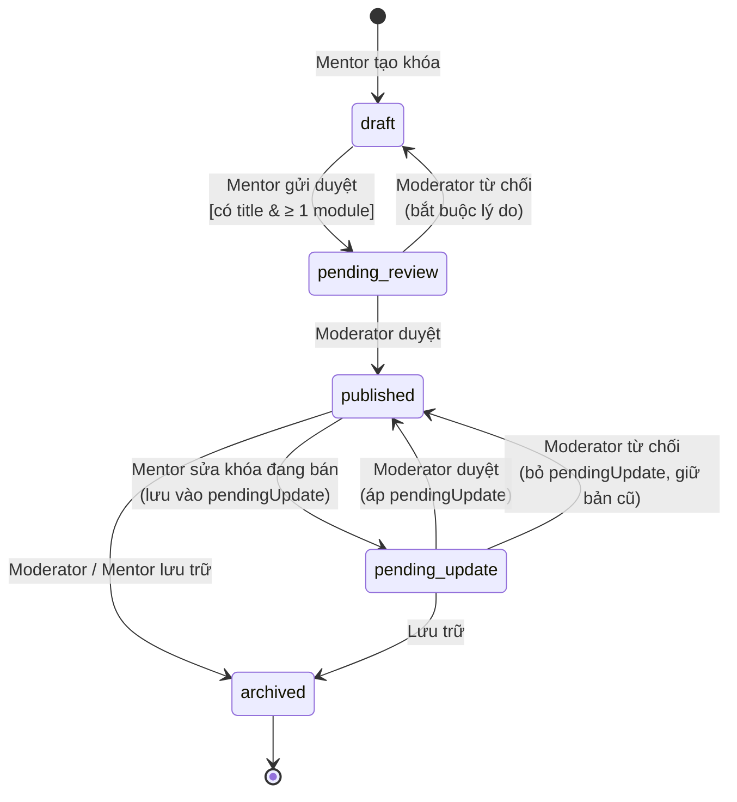

| Chuyển | Code | Endpoint |
|:-------|:-----|:---------|
| `published → pending_update` (sửa) | `CoursesController.update` | `PUT /api/courses/:id` |
| `draft → pending_review` / `→ pending_update` (gửi duyệt) | `CoursesController.publish` | `PATCH /api/courses/:id/publish` |
| Mentor lưu trữ | `CoursesController.archive` | `DELETE /api/courses/:id` |
| Duyệt / từ chối / lưu trữ | `adminController.approveCourse/rejectCourse/archiveCourse` (mount dưới moderator router) | `PATCH /api/moderator/courses/:id/approve`, `/reject`, `/archive` |

Khóa học chỉ bán được (`cartService`, `reviewsService`) khi `status = published`; khóa `pending_update` vẫn bán bản đang public.

---

## 6. Ngân hàng câu hỏi — `QuestionBank.status`

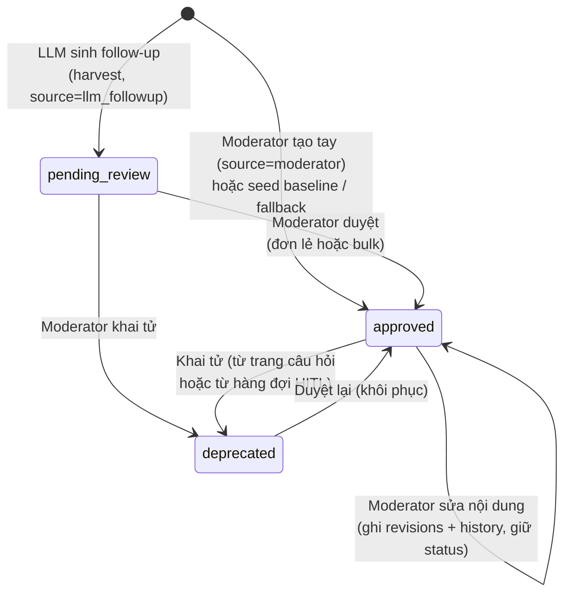

| Chuyển | Hàm (`services/questionBankService.js`) | Endpoint |
|:-------|:----------------------------------------|:---------|
| `[*] → pending_review` | `harvest` (upsert theo `textHash`; trùng → giữ nguyên bản cũ) | gọi nội bộ từ `generateFollowUpQuestions` |
| `[*] → approved` | `createQuestion`, `syncFallbackQuestions` | `POST /api/moderator/questions` |
| `→ approved` | `approveQuestion`, `bulkUpdateQuestions` | `PATCH /api/moderator/questions/:id/approve`, `POST .../questions/bulk` |
| `→ deprecated` | `deprecateQuestion`, `bulkUpdateQuestions` | `PATCH /api/moderator/questions/:id/deprecate` |
| Sửa nội dung | `editQuestion` | `PATCH /api/moderator/questions/:id` |

**Tác động lúc chạy phỏng vấn:** chỉ câu `approved` (và `orgId=null`) được phục vụ làm fallback; `applyDeprecationPolicy` loại câu LLM vừa sinh nếu trùng `textHash` một câu `deprecated` và sinh lại tối đa `REGENERATE_ATTEMPTS = 2` lần.

Giá trị `draft`, `rejected` có trong enum nhưng **chưa có luồng nào ghi** — dành cho Enterprise template sau này.

---

## 7. Hàng đợi kiểm định — `ModerationItem.status` (+ `Report.status` đồng bộ)

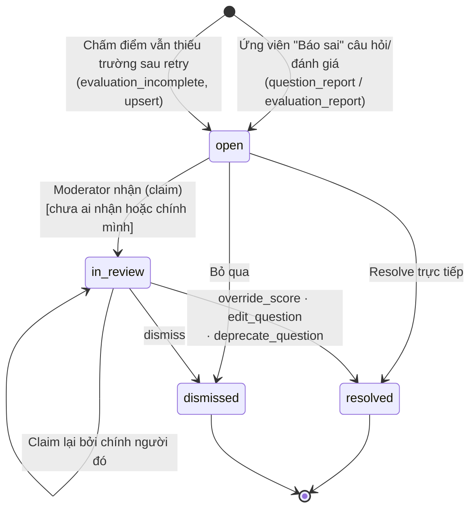

| Sự kiện | Hàm (`services/moderationQueueService.js`) | Endpoint |
|:--------|:-------------------------------------------|:---------|
| Tạo từ báo cáo | `createItemForReport` (unique theo `refs.reportId`) | `POST /api/reports` (targetType `interview_question` / `interview_evaluation`) |
| Tạo từ đánh giá thiếu | `upsertIncompleteEvaluationItem` (unique theo session + questionIndex) | gọi trong `POST /api/interviews/sessions/:id/evaluate` |
| Nhận | `claimItem` — người khác đang giữ → 409 | `PATCH /api/moderator/queue/:id/claim` |
| Xử lý | `resolveItem` — mục đã đóng → 409 | `PATCH /api/moderator/queue/:id/resolve` |

Khi resolve: `Report` liên kết → `resolved`/`dismissed` + `resolvedBy`; `override_score` ghi `InterviewSession.answers[i].moderatorOverride`; người báo cáo nhận `Notification` (link `/interview/feedback?sessionId=`).

Trạng thái `Report` cho báo cáo mentor/booking/review/course (không qua hàng đợi): `pending → reviewing → resolved | dismissed`, do admin xử lý ở `/api/admin`.

---

## 8. Buổi phỏng vấn AI — `InterviewSession.status` và đánh giá từng câu

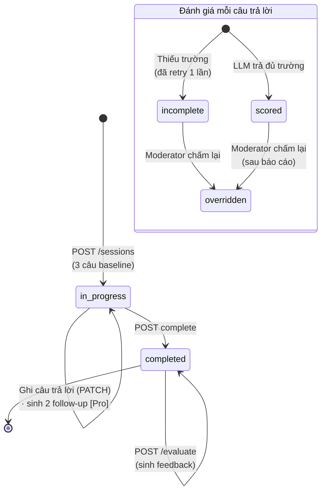

- `abandoned` có trong enum nhưng **chưa có job/handler nào ghi** — buổi bỏ dở hiện nằm mãi ở `in_progress`. Ứng viên cho job dọn dẹp sau này.
- `incomplete` = `answers[i].evaluationIncomplete = true`; `overridden` = `answers[i].moderatorOverride != null`. FE phải ưu tiên `moderatorOverride.overall` khi hiển thị (bước 7 của S1 — chưa làm).

---

## 9. Rút tiền mentor — `PayoutRequest.status` và số dư

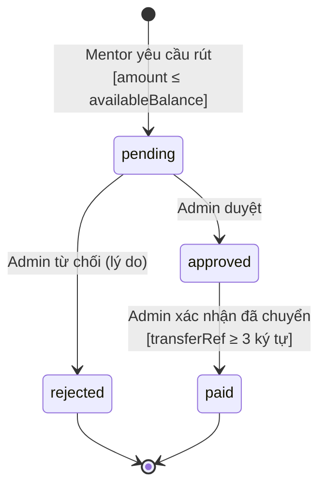

Số dư mentor đi theo chiều: buổi/khóa đã thanh toán → `finance.clearingBalance` → job `earningsClearanceJob` khi tới `earningsClearAt` và không có Report mở → `finance.availableBalance` (guard `clearingBalance >= net`, `mentorEarningsService.js`). Tạo payout: `availableBalance → pendingBalance`; `rejected` trả lại `availableBalance`; `paid` trừ hẳn `pendingBalance` (`payoutService.js`). `processing` có trong enum nhưng `payoutService` chỉ dùng `approve / reject / paid`.

---

## 10. Yêu cầu mentorship — `MentorshipRequest.status` / `offers[].status`

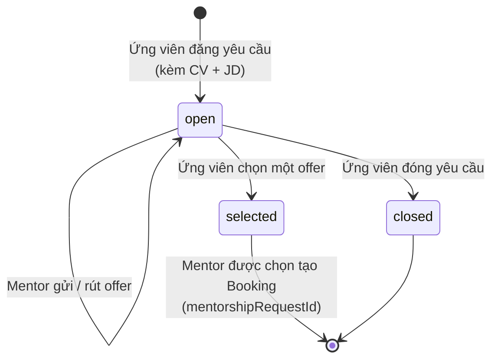

Offer: `pending → withdrawn` (mentor rút). Chọn offer chỉ thành công khi request còn `open` và offer còn `pending` (`findOneAndUpdate` có điều kiện — chống chọn hai lần).

---

## 11. Hồ sơ mentor — `Mentor.adminReview.status` và `Mentor.status`

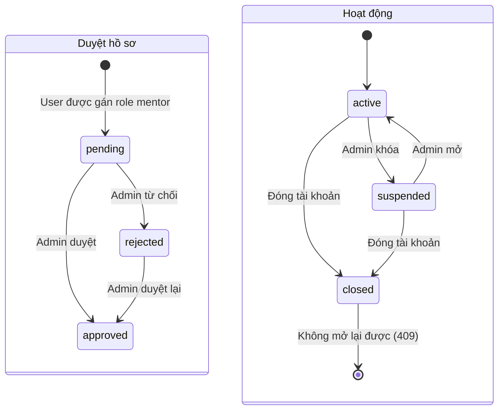

---

## 12. Tài khoản người dùng

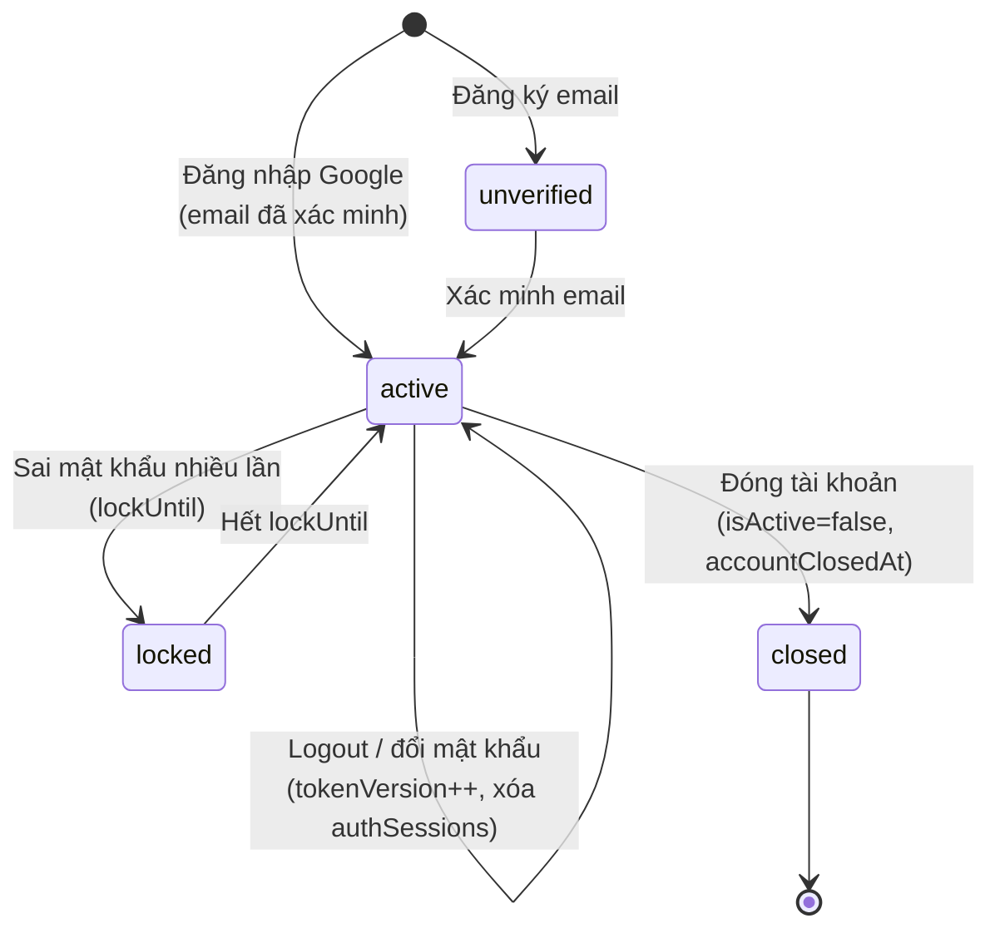

Đây là trạng thái **suy ra** từ các trường (`isEmailVerified`, `lockUntil`, `isActive`), không có field `status` riêng trên `User`. Tiền chuyển tới sau khi tài khoản đóng → `Payment.held_inactive_account`.
