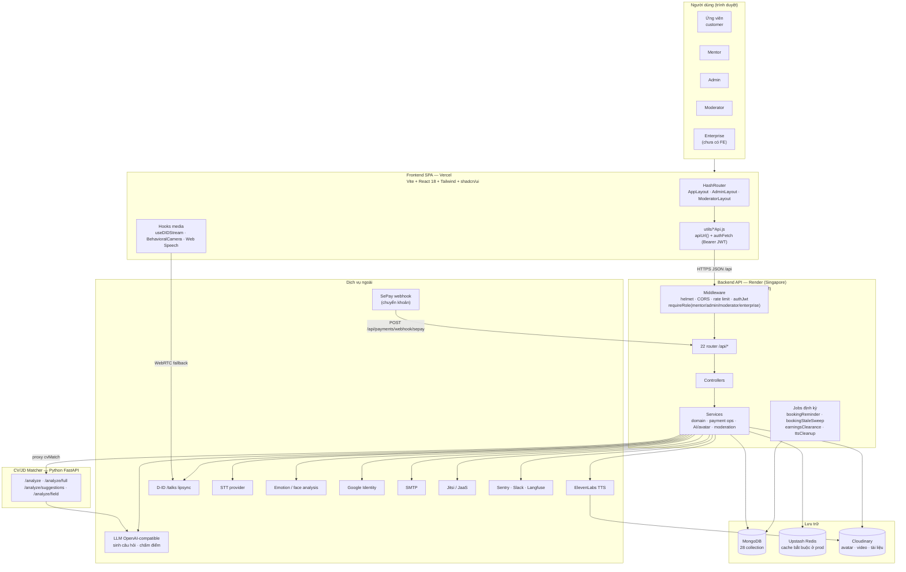
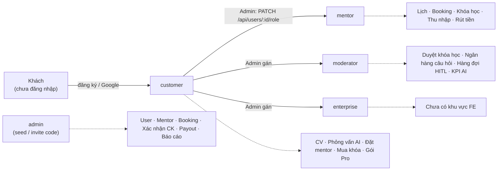

# System Overview — ProInterview

> Cập nhật: 2026-11-01 · nhánh `feat/moderator-hitl` (commit `b9c309c`).
> Bộ tài liệu thiết kế cùng đợt: [Logical ERD](LOGICAL_ERD.md) · [Database script](database/prointerview_schema.mongodb.js) · [State machine](STATE_MACHINES.md) · [Activity diagram](ACTIVITY_DIAGRAMS.md).
> Tài liệu cũ vẫn dùng được: [Context diagram](CONTEXT_DIAGRAM.md), [Conceptual ERD](CONCEPTUAL_DIAGRAM_GUIDE.md), [Business flow](BUSINESS_FLOW_GUIDE.md).

Mọi thông tin dưới đây lấy từ code hiện tại (`backend/src/app.js`, `routes/`, `services/`, `jobs/`, `models/`), không phải từ roadmap.

---

## 1. Sơ đồ kiến trúc tổng quan

### Các lớp và trách nhiệm

| Lớp | Thành phần | Trách nhiệm |
|:----|:-----------|:------------|
| Trình bày | `frontend/src/app/pages`, `components` | Giao diện theo 5 vai trò, route guard (`authGate.js`, `createRoleLoader`) |
| Giao tiếp | `frontend/src/app/utils/*Api.js` | Gọi `/api/*`, gắn Bearer token, tự refresh khi access token hết hạn |
| Bảo vệ | `backend/src/middleware` | Xác thực JWT (claim `tv` khớp `User.tokenVersion`), phân quyền theo role, rate limit, audit log admin/moderator |
| Nghiệp vụ | `backend/src/services` | Booking, thanh toán CK, đối soát thu nhập mentor, kiểm duyệt nội dung, pipeline AI |
| Dữ liệu | `backend/src/models` | 28 Mongoose schema — chi tiết ở [LOGICAL_ERD.md](LOGICAL_ERD.md) |
| Nền | `backend/src/jobs` | Nhắc lịch, hủy booking quá hạn chưa trả tiền, chuyển `clearingBalance → availableBalance`, dọn audio TTS |
| Phân tích CV | `cv_jd_matching/` | Trích kỹ năng, chấm khớp CV–JD, gợi ý viết lại bullet |

### Router đang mount (`backend/src/app.js`)

| Nhóm | Prefix |
|:-----|:-------|
| Tài khoản | `/api/auth`, `/api/users`, `/api/notifications`, `/api/analytics` |
| Mentor & đặt lịch | `/api/mentors`, `/api/mentor`, `/api/bookings`, `/api/mentorship-requests`, `/api/reviews`, `/api/reports` |
| Khóa học & bán hàng | `/api/courses`, `/api/enrollments`, `/api/cart`, `/api/coupons`, `/api/plans`, `/api/payments` |
| AI | `/api/cv` (CRUD + proxy Python), `/api/interviews`, `/api/ai` |
| Vận hành | `/api/admin`, `/api/moderator`, `/api/upload`, `/api/achievements`, `/api/public` |
| Chỉ dev | `/api/mock` (tắt khi `NODE_ENV=production`) |

---

## 2. Phân quyền theo vai trò

Admin **không** đi qua cổng moderator (`requireModerator` không chấp nhận admin) — tách vận hành khỏi kiểm định nội dung.

---

## 3. Tiến độ theo module (2026-11-01)

Ký hiệu: ✅ chạy API thật · 🔧 có nhưng còn phần demo/local · 🚧 đang làm trên nhánh · 📋 chưa làm.

| Module | BE | FE | Ghi chú |
|:-------|:--:|:--:|:--------|
| Xác thực (email, Google, refresh token, reset, xác minh email, đóng tài khoản) | ✅ | ✅ | PR #187 (prod hardening, `REFRESH_TOKEN_PEPPER`) đã duyệt, chờ set env Render rồi mới merge |
| Dashboard ứng viên | ✅ | ✅ | `GET /api/users/dashboard-stats` |
| Phân tích CV/JD | ✅ | 🔧 | Express proxy → Python; nhánh Supabase legacy còn trong `CVAnalysis.jsx` |
| Phỏng vấn AI (3 baseline + 2 follow-up Pro) | ✅ | ✅ | Avatar D-ID pregen + ElevenLabs; fallback Web Speech |
| Chấm điểm phỏng vấn + retry khi thiếu trường | ✅ | ✅ | Đánh giá chưa đủ sau 1 lần retry → vào hàng đợi moderator |
| Mentor: hồ sơ, lịch, booking, check-in, ghi nhận buổi | ✅ | 🔧 | Meeting room còn một phần state local |
| Mentorship request (đăng yêu cầu, mentor gửi offer) | ✅ | ✅ | `/api/mentorship-requests` |
| Thanh toán chuyển khoản + SePay auto-confirm | ✅ | ✅ | Kênh MoMo/ZaloPay/VNPay chỉ là stub, ngoài phạm vi MVP |
| Khóa học, giỏ hàng, coupon, chứng chỉ | ✅ | ✅ | `CartOrder` gom nhiều `Enrollment` vào một mã CK |
| Thu nhập mentor & payout | ✅ | ✅ | Job đối soát chuyển tiền từ clearing sang available |
| Admin (list pages) | ✅ | ✅ | Trang chi tiết (finance, user/:id…) vẫn là placeholder 📋 |
| **Moderator — RBAC + duyệt khóa học** | ✅ | ✅ | PR #186 đã merge |
| **Moderator HITL — ngân hàng câu hỏi** | ✅ | ✅ | 🚧 nhánh `feat/moderator-hitl`, bước 1–6 xong |
| **Moderator HITL — hàng đợi kiểm định + KPI chất lượng AI** | ✅ | ✅ | 🚧 cùng nhánh |
| Moderator HITL — FE Feedback ("Báo sai", nhãn "Đang chờ kiểm định", điểm moderator) | ✅ | 📋 | Bước 7 — kế tiếp |
| Moderator HITL — script backfill câu hỏi cũ | 📋 | — | Bước 8 (`--dry-run`, `--confirm-prod`) |
| Moderator HITL — cập nhật API_INDEX / ROADMAP / CLAUDE.md | 📋 | — | Bước 9 |
| Enterprise (template câu hỏi theo `orgId`) | 📋 | 📋 | Model `Organization` chưa tồn tại; `QuestionBank.orgId` đã chừa sẵn |

---

## 4. Điểm cần nhớ khi phát triển tiếp

- **Thêm API:** route → controller → (service) → model, mount trong `app.js`, cập nhật `ROADMAP.md` + `API_INDEX.md`.
- **Thêm collection:** bổ sung vào [LOGICAL_ERD.md](LOGICAL_ERD.md) và [database script](database/prointerview_schema.mongodb.js) cùng lúc với model.
- **Thêm/đổi enum `status`:** cập nhật [STATE_MACHINES.md](STATE_MACHINES.md); kiểm tra các job trong `backend/src/jobs` có lọc theo status đó không.
- **Gói/thu phí mới:** tái dùng rail chuyển khoản (`recordTransferPending` → `submit-transfer` → admin/SePay xác nhận), không build cổng thanh toán mới.
- **Redis bắt buộc ở prod:** `cacheService.js` throw khi lỗi; server dừng ngay lúc khởi động nếu thiếu cấu hình.
