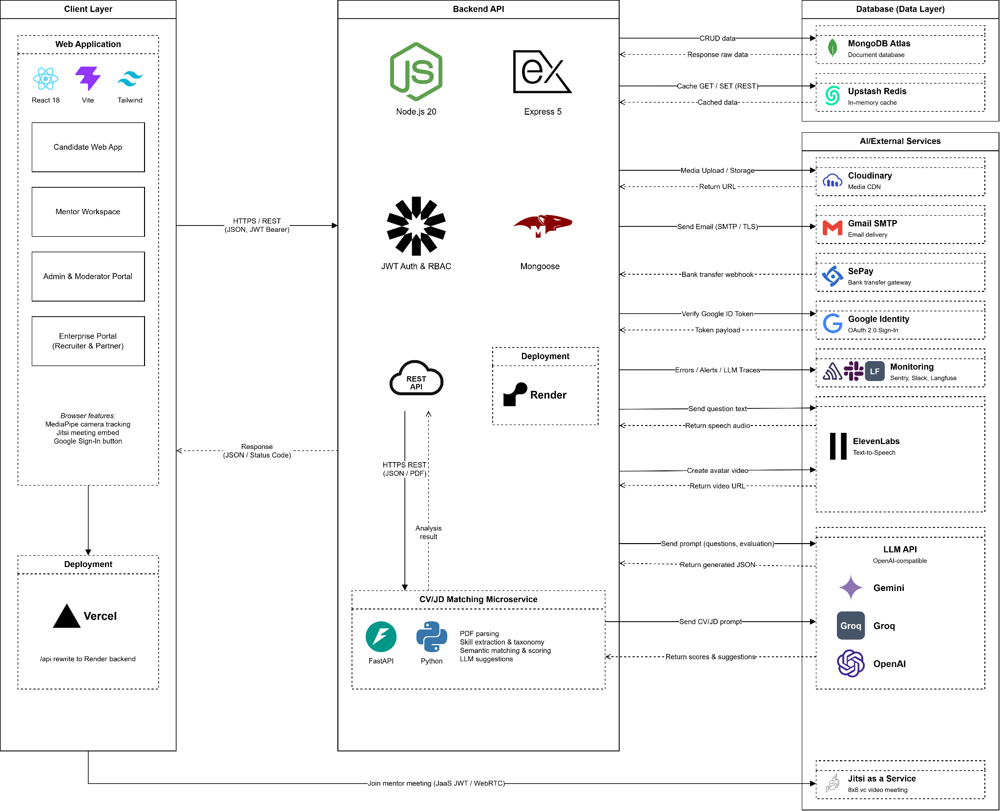
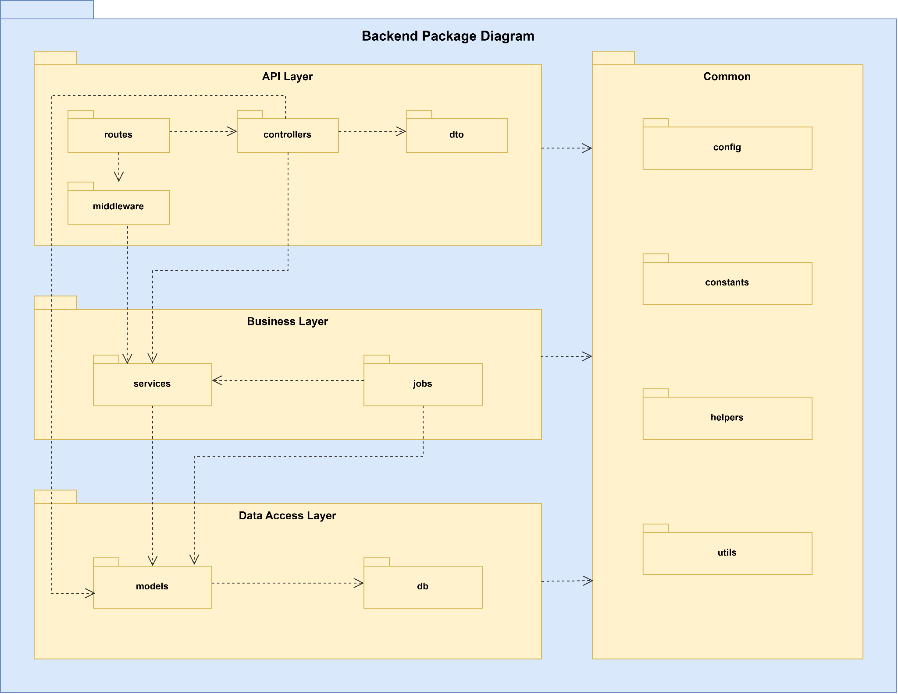
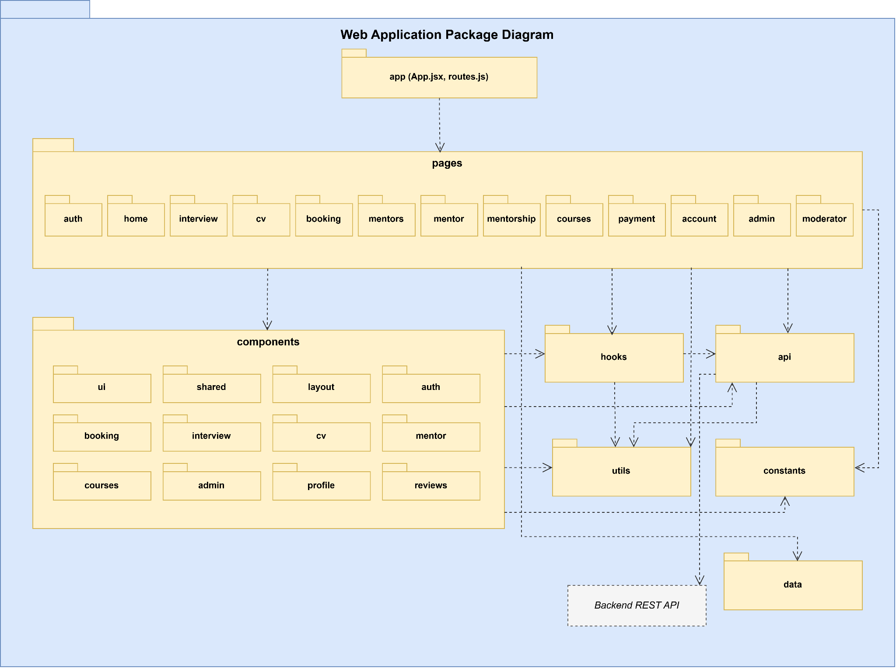
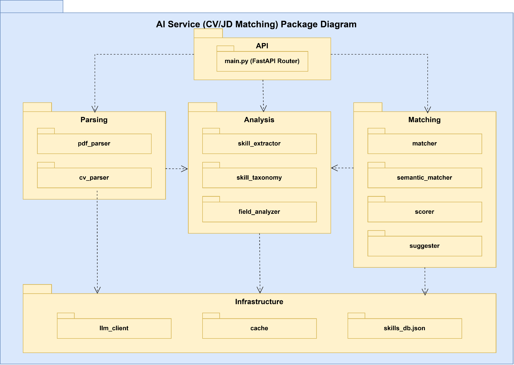
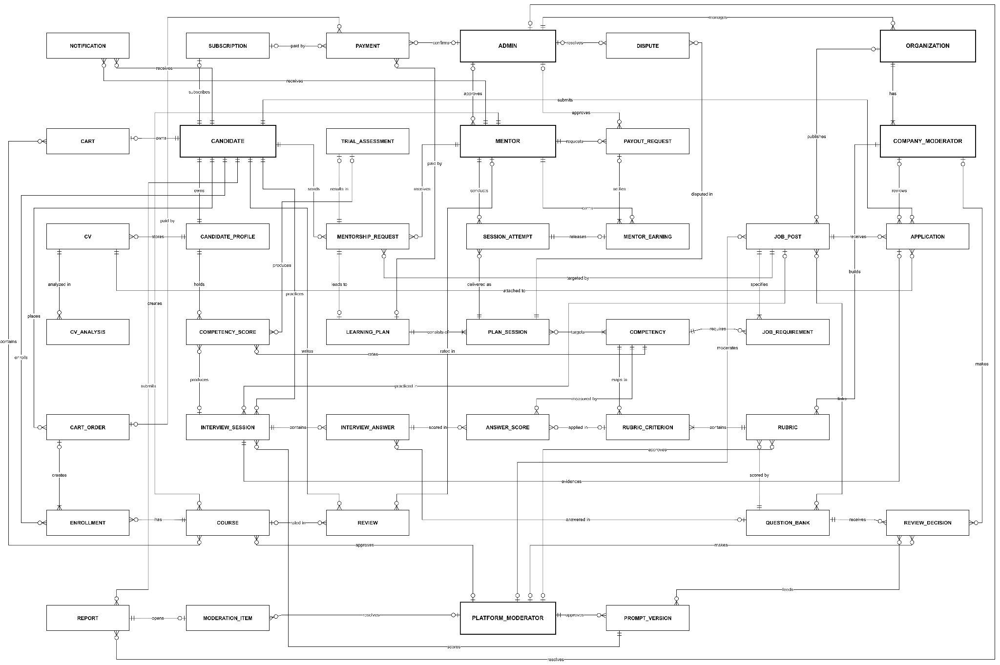
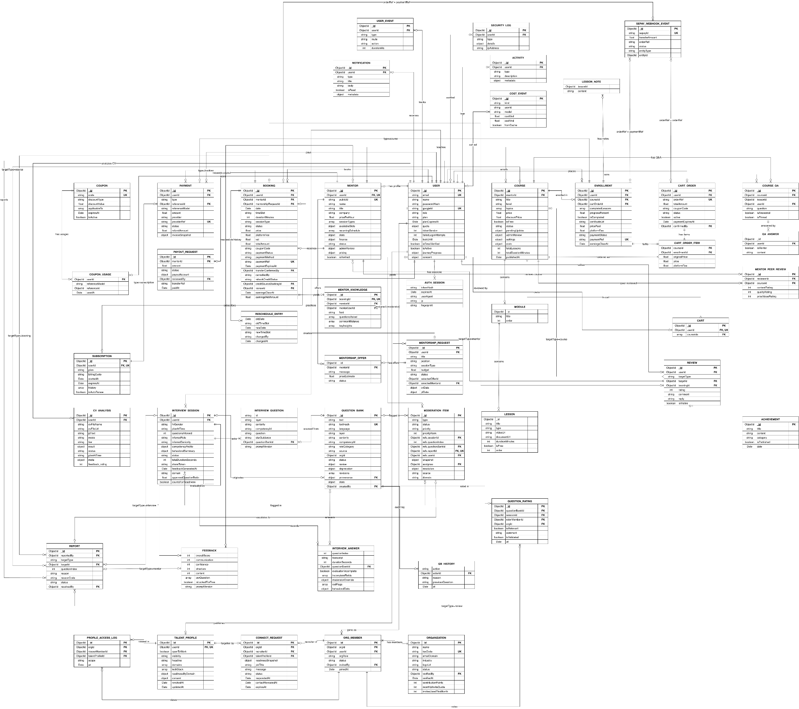
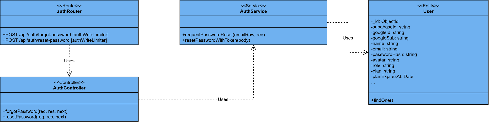
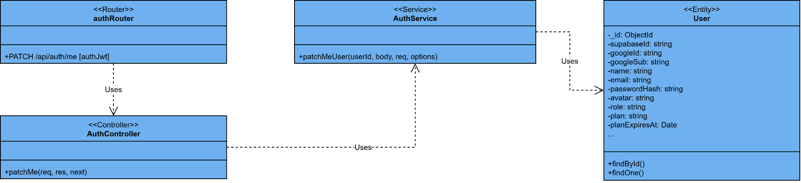

# Software Design Description

> Extracted without changes from the capstone report `FA26SE210_NguyenThiCamHuong_FinalReport.docx` (saved 2026-11-09) for review BM02.
> Diagram figures are stored in `figures/`; screenshots and detailed-design images stay in the report. Editable diagrams: `docs/detailed-design/`.

[Provide final software design information follow the template as part II in the Report  4]

### 1. System Design

#### 1.1 System Architecture

*Figure 4.1.1.1 System Architecture*

#### 1.2 Package Diagram

##### 1.2.1. Backend Package Diagram

*Figure 4.1.2.1 Backend Package Diagram*

##### 1.2.2. Web Application Package Diagram

*Figure 4.1.2.2 Web Application Package Diagram*

##### 1.2.3. AI Service Package Diagram

*Figure 4.1.2.3 AI Service Package Diagram*

### 2. Database Design

Conceptual ERD

*Figure 4.2.1 : Conceptual ERD*

Logical ERD

*Figure 4.2.2 : Logical ERD*

Entities Description

Table 4.2 : Table Descriptions

| No | Table | Type | Description |
| --- | --- | --- | --- |
| 1 | USER | Collection | Stores every account (candidate, mentor, admin, platform moderator, company moderator) with credentials, role, linked organization, plan, verification and active status. |
| 2 | MENTOR | Collection | Stores the mentor profile linked to a user: title, expertise, price per session (200,000–1,000,000 VND), weekly free trial slots, availability, verification, approving admin and violation count. |
| 3 | CANDIDATE_PROFILE | Collection | Stores the single candidate profile every module reads and writes: self-declared position, experience and skills, plus the system-computed Job Readiness Score. |
| 4 | CV | Collection | Stores each CV version in a candidate's portfolio: title, file, parsed content and whether it passed CV validation. |
| 5 | CV_ANALYSIS | Collection | Stores each CV–JD analysis of one CV: JD text, mode, match score, skill and experience gaps, suggestions and status. |
| 6 | COMPETENCY | Collection | Stores the SHRM/DDI competency framework: code, name, framework, description and level descriptors (1–5). |
| 7 | COMPETENCY_SCORE | Collection | Stores a candidate's level on one competency with its source (mentor assessment, AI interview or self-declared), the producing assessment or interview, and date. |
| 8 | ORGANIZATION | Collection | Stores partner companies: name, tax code, industry, status (active or suspended) and the admin who created it. |
| 9 | JOB_POST | Collection | Stores a job post (or a platform template when no organization): position, level, description, requirements, linked approved questions, status (Draft, Published, Closed, Expired, Hidden) and visibility deadline. |
| 10 | JOB_REQUIREMENT | Collection | Stores each competency a job post requires, with target level (1–5) and weight. |
| 11 | APPLICATION | Collection | Stores a candidate's application to a job post: CV used, Job Post interview used as evidence, profile snapshot, consent time, status, weighted rubric score and HR decision. |
| 12 | INTERVIEW_SESSION | Collection | Stores an AI mock interview: candidate, target job post (optional), prompt version used, interviewer voice, status, overall score and behavioral summary. |
| 13 | INTERVIEW_ANSWER | Collection | Stores one answer to one question in a session: source question (empty for live personalized questions), question text, transcript, duration and incomplete-evaluation flag. |
| 14 | ANSWER_SCORE | Collection | Stores the score of one answer on one criterion: competency, company rubric criterion (empty for the standard SHRM/DDI score), score, quoted evidence and scorer (AI or moderator). |
| 15 | QUESTION_BANK | Collection | Stores human-reviewed interview questions by layer, seniority and role category, with source, owning organization, status and creator. |
| 16 | RUBRIC | Collection | Stores a versioned company rubric for one question: version, status, building company moderator and approving platform moderator. |
| 17 | RUBRIC_CRITERION | Collection | Stores each rubric criterion: mapped SHRM/DDI competency, weight (rubric total 100), level descriptors and anchor answers. |
| 18 | REVIEW_DECISION | Collection | Stores each moderator decision on a question (accept, edit, reject) with reason code and edited text, used as AI feedback data. |
| 19 | PROMPT_VERSION | Collection | Stores versioned prompt rules proposed by the nightly job from review decisions, with status and the approving platform moderator. |
| 20 | MENTORSHIP_REQUEST | Collection | Stores a candidate's request to a chosen mentor: target job post, profile snapshot, goals, availability, status and trial schedule. |
| 21 | TRIAL_ASSESSMENT | Collection | Stores the mentor's assessment sheet after the free trial session: strengths, gaps, accept or decline decision and comment. |
| 22 | LEARNING_PLAN | Collection | Stores the personalized plan created from an accepted request: total price, status (Draft to Completed, Paused, Cancelled), revision note and activation date. |
| 23 | PLAN_SESSION | Collection | Stores each ordered session of a plan: objective, targeted competencies, measurable pass criteria, preparation, price and status. |
| 24 | SESSION_ATTEMPT | Collection | Stores one delivery of a plan session (original or retake): mentor, attempt number, free-retake flag, schedule, per-criterion results, Passed or Not Passed verdict, feedback and confirmation time. |
| 25 | MENTOR_EARNING | Collection | Stores mentor income released for one held attempt: gross amount, 20% platform fee, net amount, status (pending, available, held, paid), clearance date and settling payout. |
| 26 | DISPUTE | Collection | Stores a dispute raised on a plan session within 48 hours: reason, status, resolution (refund or dismiss) and resolving admin. |
| 27 | PAYMENT | Collection | Stores each bank-transfer payment for a learning plan, course order or subscription: amount, provider reference, status, confirming admin and refund amount. |
| 28 | PAYOUT_REQUEST | Collection | Stores a mentor's withdrawal request: amount, bank account, status, reviewing admin, transfer reference and paid date. |
| 29 | SUBSCRIPTION | Collection | Stores a user's Pro or Elite plan: billing cycle, start and expiry dates. |
| 30 | COURSE | Collection | Stores a video course authored by a mentor: title, level, price, status and the platform moderator who approved it. |
| 31 | MODULE | Embedded in COURSE | Stores a course section with its title and display order. |
| 32 | LESSON | Embedded in MODULE | Stores a lesson: type, video URL, duration and order. |
| 33 | ENROLLMENT | Collection | Stores a candidate's access to a course: originating order, progress, completion and price paid. |
| 34 | CART | Collection | Stores the list of courses a candidate has added before checkout. |
| 35 | CART_ORDER | Collection | Stores a course checkout order: order reference (bank transfer content), total, status and payment expiry. |
| 36 | CART_ORDER_ITEM | Embedded in CART_ORDER | Stores each course line in an order with original and final price. |
| 37 | REVIEW | Collection | Stores a candidate's rating and comment on a mentor (after completing a plan) or a course, with visibility. |
| 38 | REPORT | Collection | Stores user reports on mentors, content, or AI questions and scores, with reason code, status and resolver. |
| 39 | MODERATION_ITEM | Collection | Stores the moderation queue item opened from a report: type, status, priority, content snapshot, assigned moderator and resolution. |
| 40 | NOTIFICATION | Collection | Stores in-app notifications per user with type, title, body and read flag |

### 3. Detailed Design

#### 3.1 Authentication

##### 3.1.1 Sign Up

3.1.1.1 Sign Up Class

*(Image kept in the report, not stored in this repository.)*

*Figure 3.1.1.1Class Diagram*

3.1.1.2 Sign Up Sequence Diagram

*(Image kept in the report, not stored in this repository.)*

*Figure 3.1.1.2 Sequence Diagram*

##### 3.1.2 Verify Email

3.1.2.1 Verify Email - Class

*(Image kept in the report, not stored in this repository.)*

*Figure 3.1.2.1Class Diagram*

3.1.2.2 Verify Email - Sequence

*(Image kept in the report, not stored in this repository.)*

*Figure 3.1.2.2 Sequence Diagram*

##### 3.1.3 Sign In

*(Image kept in the report, not stored in this repository.)*

*Figure 3.1.3.1Class Diagram*

3.1.3.2 Sign In Sequence

*(Image kept in the report, not stored in this repository.)*

*Figure 3.1.3.2 Sequence Diagram*

##### 3.1.4 Sign In with Google

3.1.4.1 Sign In with Google - Class

*(Image kept in the report, not stored in this repository.)*

*Figure 3.1.4.1Class Diagram*

3.1.4.2 Sign In with Google - Sequence

*(Image kept in the report, not stored in this repository.)*

*Figure 3.1.4.2 Sequence Diagram*

##### 3.1.5 Forgot & Reset Password

3.1.5.1 Forgot & Reset Password - Class

*Figure 3.1.5.1Class Diagram*

3.1.5.2 Forgot & Reset Password - Sequence

*(Image kept in the report, not stored in this repository.)*

*Figure 3.1.5.2 Sequence Diagram*

##### 3.1.6 Refresh Access Token

3.1.6.1 Refresh Access Token - Class

*(Image kept in the report, not stored in this repository.)*

*Figure 3.1.6.1 Class Diagram*

3.1.6.2 Refresh Access Token - Sequence

*(Image kept in the report, not stored in this repository.)*

*Figure 3.1.6.2 Sequence Diagram*

##### 3.1.7 Sign Out

3.1.7.1Sign Out - Class

*(Image kept in the report, not stored in this repository.)*

*Figure 3.1.7.1 Class Diagram*

3.1.7.2 Sign Out - Sequence

*(Image kept in the report, not stored in this repository.)*

*Figure 3.1.7.2 Sequence Diagram*

##### 3.1.8 Manage Login Sessions

3.1.8.1 Manage Login Sessions - Class

*(Image kept in the report, not stored in this repository.)*

*Figure 3.1.8.1 Class Diagram*

3.1.8.2 Manage Login Sessions - Sequence

*(Image kept in the report, not stored in this repository.)*

*Figure 3.1.8.2 Sequence Diagram*

#### 3.2 Account Profile

##### 3.2.1 View Profile

3.2.1.1 View Profile - Class

*(Image kept in the report, not stored in this repository.)*

*Figure 3.2.1.1 Class Diagram*

3.2.1.2 View Profile - Sequence

*(Image kept in the report, not stored in this repository.)*

*Figure 3.2.1.2 Sequence Diagram*

##### 3.2.2 Update Profile

3.2.2.1 Update Profile - Class

*Figure 3.2.2.1 Class Diagram*

3.2.2.2 Update Profile - Sequence

*(Image kept in the report, not stored in this repository.)*

*Figure 3.2.2.2 Sequence Diagram*

##### 3.2.3 Update Camera Consent

3.2.3.1 Update Camera Consent - Class

*(Image kept in the report, not stored in this repository.)*

*Figure 3.2.3.1 Class Diagram*

3.2.3.2 Update Camera Consent - Sequence

*(Image kept in the report, not stored in this repository.)*

*Figure 3.2.3.2 Sequence Diagram*

##### 3.2.4 Close Account

3.2.4.1 Close Account - Class

*(Image kept in the report, not stored in this repository.)*

*Figure 3.2.4.1 Class Diagram*

3.2.4.2 Close Account - Sequence

*(Image kept in the report, not stored in this repository.)*

*Figure 3.2.4.2 Sequence Diagram*

##### 3.3 CV Analysis3.3.1 Upload & Analyze CV

3.3.1.1 Upload & Analyze CV - Class

*(Image kept in the report, not stored in this repository.)*

*Figure 3.3.1.1 Class Diagram*

3.3.1.2 Upload & Analyze CV - Sequence

*(Image kept in the report, not stored in this repository.)*

*Figure 3.3.1.2 Sequence Diagram*

##### 3.3.2 View CV Analysis History

3.3.2.1 View CV Analysis History - Class

*(Image kept in the report, not stored in this repository.)*

*Figure 3.3.2.1 Class Diagram*

3.3.2.2 View CV Analysis History - Sequence

*(Image kept in the report, not stored in this repository.)*

*Figure 3.3.2.2 Sequence Diagram*

##### 3.3.3 View CV Analysis History

3.3.3.1 View CV Analysis History - Class

*(Image kept in the report, not stored in this repository.)*

*Figure 3.3.3.1 Class Diagram*

3.3.3.2 View CV Analysis History - Sequence

*(Image kept in the report, not stored in this repository.)*

*Figure 3.3.3.2 Sequence Diagram*

##### 3.3.4 Delete CV Analysis

3.3.4.1 Delete CV Analysis - Class

*(Image kept in the report, not stored in this repository.)*

*Figure 3.3.4.1 Class Diagram*

3.3.4.2 Delete CV Analysis - Sequence

*(Image kept in the report, not stored in this repository.)*

*Figure 3.3.4.2 Sequence Diagram*

##### 3.3.5 Rate CV Analysis

3.3.5.1 Rate CV Analysis - Class

*(Image kept in the report, not stored in this repository.)*

*Figure 3.3.5.1 Class Diagram*

3.3.5.2 Rate CV Analysis - Sequence

*(Image kept in the report, not stored in this repository.)*

*Figure 3.3.5.2 Sequence Diagram*

##### 3.3.6 Match CV with JD

3.3.6.1 Match CV with JD - Class

*(Image kept in the report, not stored in this repository.)*

*Figure 3.3.6.1 Class Diagram*

3.3.6.2 Match CV with JD - Sequence

*(Image kept in the report, not stored in this repository.)*

*Figure 3.3.6.2 Sequence Diagram*

#### 3.4 AI Mock Interview

##### 3.4.1 Start Interview Session

3.4.1.1 Start Interview Session - Class

*(Image kept in the report, not stored in this repository.)*

*Figure 3.4.1.1 Class Diagram*

3.4.1.2 Start Interview Session - Sequence

*(Image kept in the report, not stored in this repository.)*

*Figure 3.4.1.2 Sequence Diagram*

##### 3.4.2 Answer Interview Question

3.4.2.1 Answer Interview Question - Class

*(Image kept in the report, not stored in this repository.)*

*Figure 3.4.2.1 Class Diagram*

3.4.2.2 Answer Interview Question - Sequence

*(Image kept in the report, not stored in this repository.)*

*Figure 3.4.2.2 Sequence Diagram*

##### 3.4.3 Complete Interview

3.4.3.1 Complete Interview - Class

*(Image kept in the report, not stored in this repository.)*

*Figure 3.4.3.1 Class Diagram*

3.4.3.2 Complete Interview - Sequence

*(Image kept in the report, not stored in this repository.)*

*Figure 3.4.3.2 Sequence Diagram*

##### 3.4.4 Evaluate Interview

3.4.4.1 Evaluate Interview - Class

*(Image kept in the report, not stored in this repository.)*

*Figure 3.4.4.1 Class Diagram*

3.4.4.1 Evaluate Interview - Sequence

*(Image kept in the report, not stored in this repository.)*

*Figure 3.4.4.2 Sequence Diagram*

##### 3.4.5 View Interview History

3.4.5.1 View Interview History - Class

*(Image kept in the report, not stored in this repository.)*

*Figure 3.4.5.1 Class Diagram*

3.4.5.2 View Interview History - Sequence

*(Image kept in the report, not stored in this repository.)*

*Figure 3.4.5.2 Sequence Diagram*

##### 3.4.6 View Interview Detail

3.4.6.1 View Interview Detail - Class

*(Image kept in the report, not stored in this repository.)*

*Figure 3.4.6.1 Class Diagram*

3.4.6.2 View Interview Detail - Sequence

*(Image kept in the report, not stored in this repository.)*

*Figure 3.4.6.2 Sequence Diagram*

#### 3.5 Mentor Discovery

##### 3.5.1 Search Mentors

3.5.1.1 Search Mentors - Class

*(Image kept in the report, not stored in this repository.)*

*Figure 3.5.1.1 Class Diagram*

3.5.1.2 Search Mentors - Sequence

*(Image kept in the report, not stored in this repository.)*

*Figure 3.5.1.2 Sequence Diagram*

##### 3.5.2 View Mentor Profile

3.5.2.1 View Mentor Profile - Class

*(Image kept in the report, not stored in this repository.)*

*Figure 3.5.2.1 Class Diagram*

3.5.2.2 View Mentor Profile

*(Image kept in the report, not stored in this repository.)*

*Figure 3.5.2.2 Sequence Diagram*

##### 3.5.3 View Mentor Availability

3.5.3.1 View Mentor Availability - Class

*(Image kept in the report, not stored in this repository.)*

*Figure 3.5.3.1 Class Diagram*

3.5.3.2 View Mentor Availability - Sequence

*(Image kept in the report, not stored in this repository.)*

*Figure 3.5.3.2 Sequence Diagram*

##### 3.5.4 View Mentor Reviews

3.5.4.1 View Mentor Reviews - Class

*(Image kept in the report, not stored in this repository.)*

*Figure 3.5.4.1 Class Diagram*

3.5.4.2 View Mentor Reviews - Class- Sequence

*(Image kept in the report, not stored in this repository.)*

*Figure 3.5.4.2 Sequence Diagram*

#### 3.6 Booking Customer

##### 3.6.1 Book Mentor

3.6.1.1 Book Mentor - Class

*(Image kept in the report, not stored in this repository.)*

*Figure 3.6.1.1 Class Diagram*

3.6.1.1 Book Mentor - Sequence

*(Image kept in the report, not stored in this repository.)*

*Figure 3.6.1.2 Sequence Diagram*

##### 3.6.2 Submit Bank Transfer for Booking

3.6.2.1 Submit Bank Transfer for Booking - Class

*(Image kept in the report, not stored in this repository.)*

*Figure 3.6.2.1 Class Diagram*

3.6.2.2 Submit Bank Transfer for Booking - Sequence

*(Image kept in the report, not stored in this repository.)*

*Figure 3.6.2.2 Sequence Diagram*

##### 3.6.3 View My Bookings

3.6.3.1 View My Bookings - Class

*(Image kept in the report, not stored in this repository.)*

*Figure 3.6.3.1 Class Diagram*

3.6.3.2 View My Bookings - Sequence

*(Image kept in the report, not stored in this repository.)*

*Figure 3.6.3.2 Sequence Diagram*

##### 3.6.4 Reschedule Booking

3.6.4.1 Reschedule Booking - Class

*(Image kept in the report, not stored in this repository.)*

*Figure 3.6.4.1 Class Diagram*

3.6.4.2 Reschedule Booking - Sequence

*(Image kept in the report, not stored in this repository.)*

*Figure 3.6.4.2 Sequence Diagram*

##### 3.6.5 Cancel Booking

3.6.5.1 Cancel Booking - Class

*(Image kept in the report, not stored in this repository.)*

*Figure 3.6.5.1 Class Diagram*

3.6.5.2 Cancel Booking - Sequence

*(Image kept in the report, not stored in this repository.)*

*Figure 3.6.5.2 Sequence Diagram*

##### 3.6.6 Join Meeting Room

3.6.6.1 Join Meeting Room - Class

*(Image kept in the report, not stored in this repository.)*

*Figure 3.6.6.1 Class Diagram*

3.6.6.2 Join Meeting Room - Sequence

*(Image kept in the report, not stored in this repository.)*

*Figure 3.6.6.2 Sequence Diagram*

##### 3.6.7 Report Mentor No-Show

3.6.7.1 Report Mentor No-Show - Class

*(Image kept in the report, not stored in this repository.)*

*Figure 3.6.7.1 Class Diagram*

3.6.7.2 Report Mentor No-Show- Sequence

*(Image kept in the report, not stored in this repository.)*

*Figure 3.6.7.2 Sequence Diagram*

##### 3.6.8 Download Booking Invoice

3.6.8.1 Download Booking Invoice - Class

*(Image kept in the report, not stored in this repository.)*

*Figure 3.6.8.1 Class Diagram*

3.6.8.2 Download Booking Invoice - Sequence

*(Image kept in the report, not stored in this repository.)*

*Figure 3.6.8.2 Sequence Diagram*

#### 3.7 Booking Mentor

##### 3.7.1 View Mentor Bookings

3.7.1.1 View Mentor Bookings - Class

*(Image kept in the report, not stored in this repository.)*

*Figure 3.7.1.1 Class Diagram*

3.7.1.2 View Mentor Bookings - Sequence

*(Image kept in the report, not stored in this repository.)*

*Figure 3.7.1.2 Sequence Diagram*

##### 3.7.2 Confirm Booking

3.7.2.1 Confirm Booking - Class

*(Image kept in the report, not stored in this repository.)*

*Figure 3.7.2.1 Class Diagram*

3.7.2.2 Confirm Booking - Sequence

*(Image kept in the report, not stored in this repository.)*

*Figure 3.7.2.2 Sequence Diagram*

##### 3.7.3 Start & Check-in Meeting

3.7.3.1 Start & Check-in Meeting - Class

*(Image kept in the report, not stored in this repository.)*

*Figure 3.7.3.1 Class Diagram*

3.7.3.2 Start & Check-in Meeting - Sequence

*(Image kept in the report, not stored in this repository.)*

*Figure 3.7.3.2 Sequence Diagram*

##### 3.7.4 Complete Booking & Save Notes

3.7.4.1 Complete Booking & Save Notes - Class

*(Image kept in the report, not stored in this repository.)*

*Figure 3.7.4.1 Class Diagram*

3.7.4.2 Complete Booking & Save Notes - Sequence

*(Image kept in the report, not stored in this repository.)*

*Figure 3.7.4.2 Sequence Diagram*

##### 3.7.5 Save Mentor Knowledge

3.7.5.1 Save Mentor Knowledge - Class

*(Image kept in the report, not stored in this repository.)*

*Figure 3.7.5.1 Class Diagram*

3.7.5.2 Save Mentor Knowledge - Sequence

*(Image kept in the report, not stored in this repository.)*

*Figure 3.7.5.2 Sequence Diagram*

#### 3.8 Mentorship Request

##### 3.8.1 Post Mentorship Request

3.8.1.1 Post Mentorship Request - Class

*(Image kept in the report, not stored in this repository.)*

*Figure 3.8.1.1 Class Diagram*

3.8.1.2 Post Mentorship Request - Sequence

*(Image kept in the report, not stored in this repository.)*

*Figure 3.8.1.2 Sequence Diagram*

##### 3.8.2 View Mentorship Requests

3.8.2.1 View Mentorship Requests - Class

*(Image kept in the report, not stored in this repository.)*

*Figure 3.8.2.1 Class Diagram*

3.8.2.2 View Mentorship Requests - Sequence

*(Image kept in the report, not stored in this repository.)*

*Figure 3.8.2.2 Sequence Diagram*

##### 3.8.3 Send Offer

##### 3.8.3.1 Send Offer - Class

*(Image kept in the report, not stored in this repository.)*

*Figure 3.8.3.1 Class Diagram*

##### 3.8.3.2 Send Offer - Sequence

*(Image kept in the report, not stored in this repository.)*

*Figure 3.8.3.2 Sequence Diagram*

##### 3.8.4 Withdraw Offer

3.8.4.1 Withdraw Offer - Class

*(Image kept in the report, not stored in this repository.)*

*Figure 3.8.4.1 Class Diagram*

3.8.4.2 Withdraw Offer - Sequence

*(Image kept in the report, not stored in this repository.)*

*Figure 3.8.4.2 Sequence Diagram*

3.9 Subscription Payment

3.10 Course Learning

3.11 Cart Checkout

3.12 Review Report

3.13 Notification

\

3.14 Mentor Profile

3.15 Course Management Mentor

3.16 Mentor Finance

3.17 Moderation

3.18 Admin Users Mentors

3.19 Admin Finance

3.21 Achievement
