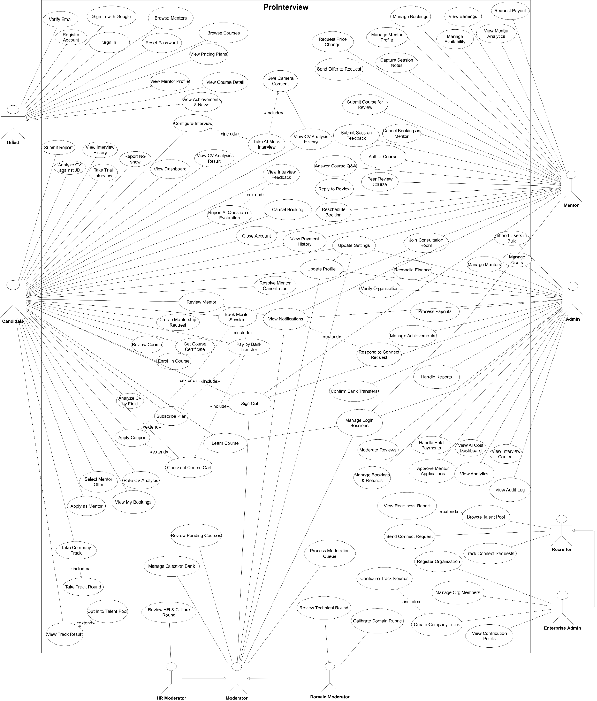
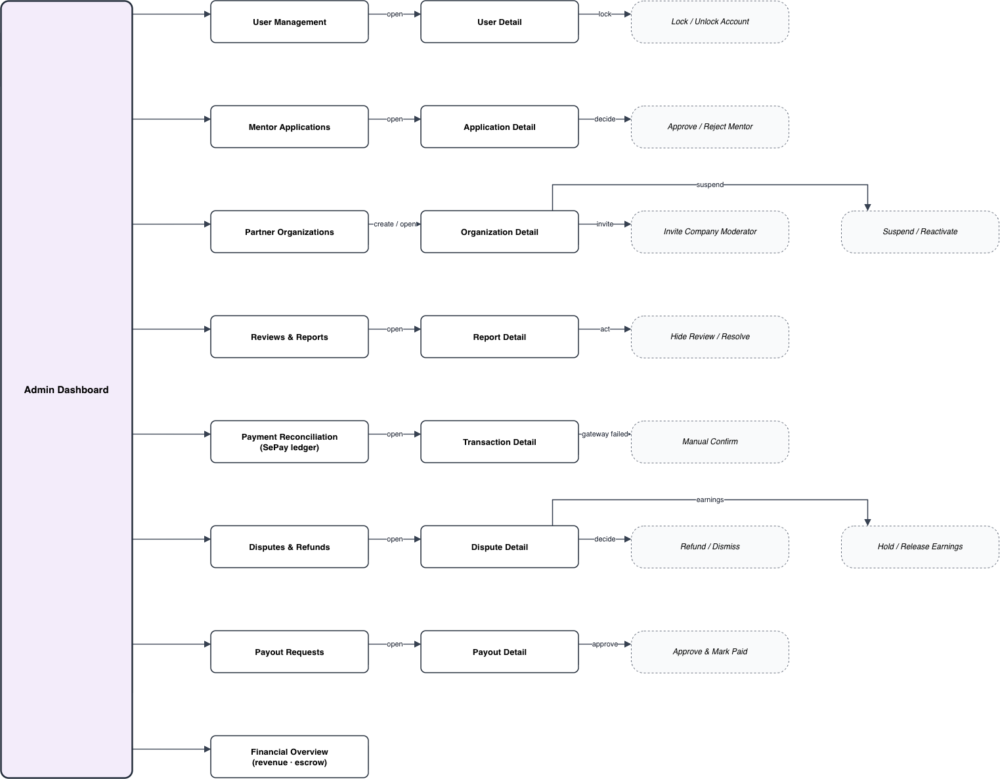
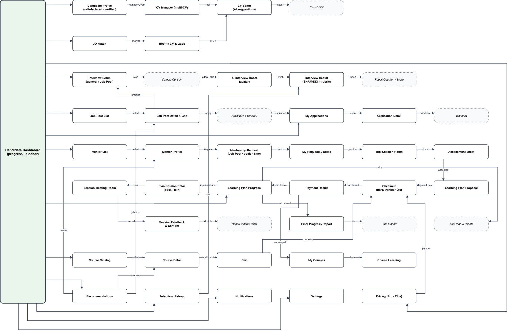
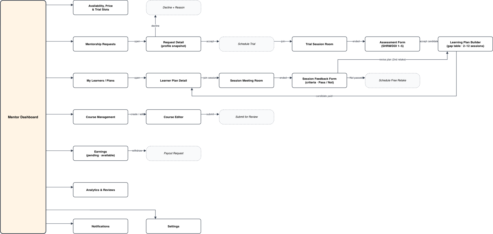
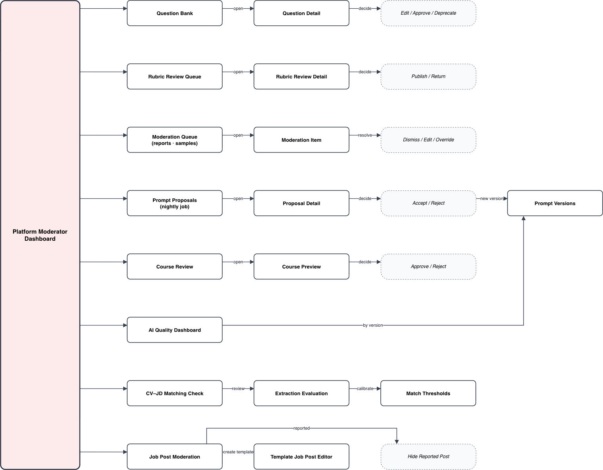
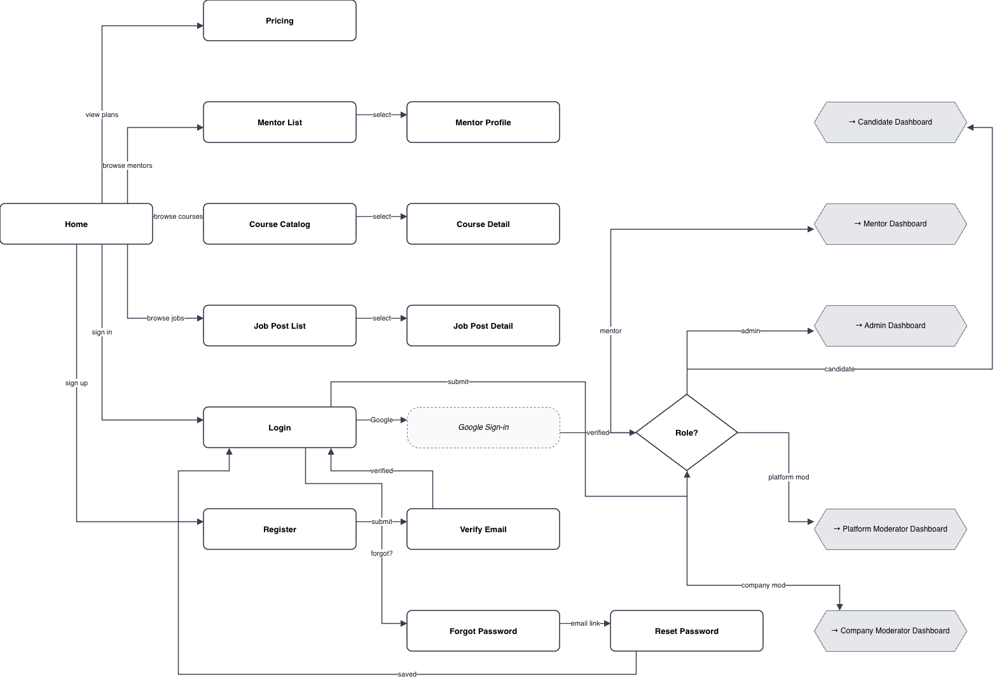

# Software Requirement Specification

> Extracted without changes from the capstone report `FA26SE210_NguyenThiCamHuong_FinalReport.docx` (saved 2026-11-09) for review BM02.
> Diagram figures are stored in `figures/`; screenshots and detailed-design images stay in the report. Editable diagrams: `docs/detailed-design/`.

## Project Scope (report section I.6)

Feature 1: Authentication & Access Control Management

1.1 Sign Up with Email/Password

1.2 Sign In with Email/Password

1.3 Sign In with Google OAuth 2.0

1.4 Send Email Verification

1.5 Verify Email Token

1.6 Sign Out

1.7 Refresh Access Token (JWT Rotation)

1.8 Request Password Reset

1.9 Confirm Password Reset

1.10 Manage Multi-Device Active Sessions

1.11 Remote Revoke Specific Device Session

1.12 Enforce Role-Based Access Control (RBAC Routing)

Feature 2: User Profile & Candidate Portfolio Management

2.1 Get User Profile

2.2 Update Basic Profile (Avatar, Full Name, Phone, Bio)

2.3 Manage Education History (Add/Update/Delete Degree & School)

2.4 Manage Work Experience Timeline (Add/Update/Delete Experience)

2.5 Manage Technical Skill Stack

2.6 Manage External Portfolio Links (GitHub, LinkedIn, Personal Site)

2.7 Update Notification Preferences

2.8 Request Account Deactivation / Closure

Feature 3: Multi-CV Portfolio Management

3.1 Get All CVs in Portfolio

3.2 Get CV Detail by ID

3.3 Upload New CV (PDF/DOCX)

3.4 Validate CV Format & Content Integrity (Reject Non-Resume Files)

3.5 Set Primary/Default CV

3.6 Update CV Meta Info (Target Role, Version Title)

3.7 Delete CV from Portfolio

3.8 Download Stored Original CV File

Feature 4: CV-JD Matching & ATS Gap Analysis

4.1 Parse Job Description (Text Input / Document Upload)

4.2 Extract Technical Skills & Minimum Requirements from JD

4.3 Match Target JD against Entire Multi-CV Portfolio

4.4 Calculate JD Compatibility Match Score

4.5 Recommend Best-Fit CV for Target JD

4.6 Execute Standardized Domain Baseline Analysis (Frontend/Backend/DevOps/AI/Fullstack)

4.7 Extract Missing ATS Keywords & Technical Skill Gaps

4.8 Get CV Analysis History Hub

4.9 Get Detailed Analysis Report by ID

4.10 Submit Candidate Accuracy Feedback / Rating on Analysis Report

Feature 5: In-Browser CV Editor & Resume Export

5.1 Load Selected CV Content into In-Browser Editor

5.2 Generate AI Action-Result / STAR Bullet-Point Suggestions

5.3 Apply AI Optimization Suggestions to CV Section

5.4 Live Preview CV Layout

5.5 Save Edited CV as New Portfolio Version

5.6 Export & Download Formatted CV as PDF

Feature 6: AI Interview Persona & Context Configuration

6.1 Get Available AI Interview Personas (Male: David / Female: Sarah)

6.2 Configure Target Role & Seniority Level (Intern/Fresher/Junior)

6.3 Link Practice Session with Specific CV and JD

6.4 Select Interview Focus Area (Behavioral / Technical / Hybrid)

6.5 Initialize Mock Interview Session & Verify Credit Quota

Feature 7: AI Avatar Pipeline & Mock Interview Simulation

7.1 Generate Baseline Question Set (SHRM & DDI Grounded)

7.2 Fetch Pre-Rendered Avatar Video from Redis Cache

7.3 Generate Dynamic Avatar Speech (ElevenLabs Neural TTS)

7.4 Stream Lip-Synced Avatar Video (D-ID Integration)

7.5 Display Real-Time Question & Response Countdown Timer

7.6 Record Candidate Audio & Video Stream

7.7 Transcribe Candidate Spoken Response (Real-Time STT)

7.8 Generate Context-Aware Adaptive Follow-up Question

7.9 Complete Interview Session & Trigger Evaluation Pipeline

Feature 8: Multi-Modal Behavioral & Speech Analysis

8.1 Track Real-Time Eye Contact & Gaze Stability (MediaPipe FaceMesh)

8.2 Analyze Head Pose & Postural Consistency

8.3 Analyze Facial Expression Variations & Confidence Signals

8.4 Calculate Speaking Pace (Words per Minute)

8.5 Detect Hesitation & Silence Durations

8.6 Identify Filler Words & Hedge Phrases ("ừm", "kiểu như", "tôi nghĩ là")

8.7 Store Behavioral Aggregate Metrics (Discard Raw Video Feeds)

Feature 9: Competency Evaluation & Remedial Recommendation

9.1 Evaluate Spoken Answers against SHRM/DDI Competency Anchors

9.2 Score Responses across Clarity, Structure, Relevance & Credibility

9.3 Generate Comprehensive Evaluation Report by Session ID

9.4 Render Behavioral & Competency Radar Charts

9.5 Recommend Remedial Mentor Sessions based on Weaknesses

9.6 Recommend Remedial Video Courses based on Skill Gaps

9.7 Get Candidate Practice History & Progress Dashboard

Feature 10: Mentor Discovery & Profile Management

10.1 Get All Verified Mentors

10.2 Filter Mentors by Technology Stack, Domain, Company & Rate

10.3 Search Mentors by Keyword

10.4 Get Public Mentor Profile & Bio by ID

10.5 Get Mentor Reviews & Session Ratings

10.6 Update Mentor Public Profile Information

10.7 Update Mentor Hourly Consultation Rate

10.8 Manage Mentor Technical Expertise Tags

Feature 11: Mentor Application & Credential Verification

11.1 Submit Mentor Application Form

11.2 Upload Work Credentials & Identification Documents

11.3 Submit LinkedIn Profile & Employment Verification

11.4 Get Mentor Application Status

11.5 Get All Pending Mentor Applications (Admin)

11.6 Approve Mentor Application (Admin)

11.7 Reject Mentor Application with Explanatory Notes (Admin)

Feature 12: Mentor Availability & Consultation Scheduling

12.1 Get Mentor Weekly Availability Schedule

12.2 Set Weekly Recurring Availability Slots

12.3 Add Blackout Date / Holiday Exceptions

12.4 Check Real-Time Available Time Slots

12.5 Create 1-on-1 Consultation Booking

12.6 Prevent Concurrent Slot Collision (Temporary Lock)

12.7 Confirm Consultation Booking

12.8 Request Booking Rescheduling

12.9 Cancel Booking (Apply Policy Windows & Refund Rule)

12.10 Mark Booking as Completed

Feature 13: Online Video Consultation Room Management

13.1 Initialize Integrated Video Consultation Room (Jitsi/JaaS)

13.2 Check In & Verify Participant Attendance

13.3 Manage In-Meeting Audio, Video & Screen Sharing Controls

13.4 Log Mentor Private Post-Session Notes

13.5 Get Private Session Notes by Booking ID

13.6 Submit Learner Rating & Review for Mentor

13.7 Submit Mentor Peer Review

13.8 Report Consultation Session Dispute

Feature 14: Course Catalog & Video Learning Room

14.1 Get All Courses

14.2 Filter Courses by Skill Level, Topic, Rating & Price

14.3 Get Course Syllabus & Module Details by ID

14.4 Play Free Preview Lecture Video

14.5 Enroll in Free Course

14.6 Stream Full-Screen Video Lecture in Dedicated Player

14.7 Download Supplementary Lecture Resources

14.8 Create Timestamped Personal Note

14.9 Export Course Notes to PDF

14.10 Post Question in Lecture Q&A Forum

14.11 Reply to Lecture Q&A Forum (Mentor/Student)

14.12 Track Course Milestone & Completion Progress

14.13 Generate Digital Course Completion Certificate

14.14 Verify Certificate Authenticity by ID

Feature 15: Course Authoring & Auto-Approval

15.1 Create Course Draft

15.2 Update Course General Information & Pricing

15.3 Add/Update/Reorder Course Modules & Lessons

15.4 Upload Lecture Video & Attachments

15.5 Submit Course for Publication Review

15.6 Automated AI Course Policy & Completeness Inspection

15.7 Auto-Approve & Publish Compliant Course

15.8 Auto-Reject Course with Diagnostic Policy Feedback

15.9 Archive Course

Feature 16: Moderator Human-in-the-Loop Review Management

16.1 Get Human-in-the-Loop Moderation Queue

16.2 Inspect AI-Generated Question and SHRM/DDI Mapping

16.3 Approve AI Question for Production Question Bank

16.4 Edit & Calibrate AI Question before Approval

16.5 Reject & Discard Hallucinated AI Question

16.6 Get Flagged Anomaly & Candidate Discrepancy Queue

16.7 Resolve Candidate Discrepancy Report

16.8 Audit CV-JD Matching Skill Extraction Accuracy

16.9 View Moderator Quality & Approval Throughput Dashboard

Feature 17: AI Question Bank Maintenance & Calibration

17.1 Get All Active Interview Questions in Bank

17.2 Filter Questions by SHRM/DDI Competency & Job Family

17.3 Create Standard Interview Question Manually

17.4 Update Question Content & Rubric Anchor

17.5 Deprecate Outdated Interview Question

17.6 Calibrate NLP Similarity Thresholds & Gap Scoring Weights

17.7 Monitor Prompt Drift & Quality Benchmark Metrics

Feature 18: Enterprise Cohort & Student Group Management

18.1 Get All Enterprise Cohorts

18.2 Create New Cohort (Class, Batch or Hiring Campaign)

18.3 Import Candidate List in Bulk (CSV / External Forms)

18.4 Add / Remove Candidate to/from Cohort

18.5 Get Cohort Candidate Roster & Engagement Status

18.6 Archive Cohort

Feature 19: Practice Credit Allocation & Readiness Analytics

19.1 Get Institutional Practice Credit Balance

19.2 Purchase / Sponsor Practice Credit Package

19.3 Allocate Practice Credits to Specific Cohort / Candidate

19.4 Track Candidate Practice Credit Usage & Balance

19.5 View Aggregate Cohort Readiness Analytics Dashboard

19.6 View Cohort Skill-Gap Trends Report

19.7 Build Custom Enterprise Interview & Rubric Template

19.8 Track Candidate Pipeline Progress

19.9 View Candidate Granular Evaluation Report (Enterprise View)

Feature 20: Pre-Assessed Talent Pool & Direct Sourcing

20.1 Access Pre-Assessed Candidate Talent Pool

20.2 Filter Talent Pool by Interview Readiness Score & Skills

20.3 Search Verified Candidates by Technology Stack

20.4 View Candidate Readiness Profile (Redacted / Consented Info)

20.5 Send Direct Recruitment Invitation / Connection Request

Feature 21: Payment & Webhook Reconciliation Management

21.1 Generate Dynamic VietQR Payment Code for Order

21.2 Receive Automated Payment Webhook (SePay)

21.3 Auto-Reconcile Bank Transfer via Transaction Reference

21.4 Process Integrated Payment via Gateways (MoMo / VNPay)

21.5 Get Failed / Unmatched Payment Queue (Admin)

21.6 Manually Reconcile & Confirm Transaction (Admin Fallback)

Feature 22: Order, Billing & Escrow Payout Management

22.1 Add Item (Plan, Mentor Session, Course) to Cart

22.2 View Cart & Checkout

22.3 Create Unified Order with 15-Minute Expiration Timer

22.4 Cancel Expired Unpaid Order

22.5 Get User Transaction History

22.6 Generate & Download Standardized Electronic Invoice

22.7 Hold Booking Payment in Platform Escrow

22.8 Submit Mentor Payout Request

22.9 Get All Pending Payout Requests (Admin)

22.10 Approve Payout Request & Record Disbursement (Admin)

22.11 Reject Payout Request with Reason (Admin)

Feature 23: System Administration & Platform Telemetry

23.1 Get All Users (Filter by Role, Status, Creation Date)

23.2 Suspend / Lock User Account

23.3 Reactivate Suspended Account

23.4 Assign User Access Role (Customer, Mentor, Moderator, Admin)

23.5 Moderate Public User Reviews (Hide / Restore)

23.6 Handle Platform Abuse Reports & Flags

23.7 View Platform Financial Summary & Revenue Breakdown

23.8 View System Operational Audit Logs

23.9 Track User Conversion Funnels & Platform Engagement

Feature 24: AI Cost & Anomaly Monitoring

24.1 Track LLM Token Usage per Request & Cumulative Cost

24.2 Track D-ID & ElevenLabs API Call Budget & Usage

24.3 Monitor STT/TTS API Latency & Error Rates

24.4 Monitor Redis Video Cache Hit / Miss Ratios

24.5 Trigger Alert on Cost Anomaly or API Outage Spikes

24.6 Get AI Operational Telemetry Dashboard

*Figure 1.6.1 : Major features*

#### 6.2. Project Limitations - khi làm xong rồi mới viết

### 1. Product Overview

ProInterview is a web platform that helps candidates, especially recent graduates, prepare for real interviews and connect with employers. It has five core components: (1) an AI Avatar Interview Module with baseline questions from a human-reviewed question bank and personalized questions generated from the CV, job description and previous answers; (2) a Personalized Mentorship Program, which starts with a free trial assessment and continues as a paid learning plan in which each session must be passed before the next one unlocks; (3) a Multi-CV Portfolio and JD Best-Fit Engine that recommends the best-fit CV and highlights gaps; (4) a Video Course Library created by the platform’s mentors; and (5) Enterprise Collaboration and Job Posts, in which Company Moderators review AI-generated questions, build company rubrics, post real jobs and review applicants.

The key differentiator is two-tier human-in-the-loop evaluation. All scoring is anchored to the SHRM and DDI competency frameworks, and approved company rubrics add each employer’s own criteria on top. Review decisions are stored as feedback that improves question generation and scoring through versioned prompts approved by a Platform Moderator. The Candidate Profile is the core data hub: every activity writes into it, and it separates self-declared data from platform-verified data.

The system has five user roles: Candidate, Mentor, Admin, Platform Moderator and Company Moderator. An AI System layer handles background tasks such as question generation, answer evaluation, feedback aggregation and recommendations.

The main external systems are Google OAuth (sign-in), an LLM provider, a Python FastAPI service (CV-JD matching), D-ID and ElevenLabs (avatar), Google Cloud Vision (facial analysis), Jitsi (video meetings), SePay (payments), Redis (cache) and Langfuse (LLM observability). MongoDB Atlas stores all application data.

Constraints and assumptions:

The product is a responsive web application; no native mobile app is in scope.

Mentoring is delivered only through learning plans, not single sessions.

Payments use bank transfer through SePay and are held in escrow until sessions are confirmed. Refunds are paid manually by an Admin.

Prompt changes require Platform Moderator approval, and models are not fine-tuned.

Company Moderators see only candidates who applied to their Job Posts and consented to share their data.

Facial video files are not stored.

AI features depend on third-party provider quotas and uptime.

*(Image kept in the report, not stored in this repository.)*

*Figure 3.1: ProInterview  An AI-Driven Interview Coaching Platform*

### 2. User Requirements

#### 2.1 Actor

| # | Actor | Description |
| --- | --- | --- |
| 1 | Guest | Unauthenticated visitor. Can browse mentors, courses, pricing and news, and can register or sign in. |
| 2 | Candidate | Registered job seeker. Practices AI interviews, manages CVs and the Candidate Profile, requests mentorship and follows learning plans, takes courses, buys subscription plans, and applies to Job Posts. |
| 3 | Mentor | Verified industry professional approved by an Admin. Manages availability, pricing and trial slots, conducts trial assessments, builds learning plans, delivers sessions with feedback, and manages courses and earnings. |
| 4 | Platform Moderator | Internal quality auditor. Reviews the question bank, approves company rubrics, courses and prompt improvements, processes the review queue, monitors AI quality, and manages Job Post templates. |
| 5 | Company Moderator | HR representative of a partner company. Reviews AI-generated questions, builds company rubrics, creates Job Posts, and reviews, shortlists or rejects applicants. |
| 6 | Admin | System administrator. Manages users, mentors and partner companies, reconciles payments, handles refunds, disputes and payouts, moderates reviews and reports, and monitors platform finance. |
| 7 | AI System | Background intelligence layer. Generates questions and rubric drafts, evaluates answers, aggregates review feedback nightly, analyzes behavior, matches CVs to JDs, updates competency profiles, produces rule-based recommendations, ranks applicants, and monitors AI cost. |
| 8 | System (Scheduler) | Internal background jobs and webhooks: reminders, payment expiry, session auto-confirmation, earnings clearance, request and Job Post expiry, plan pause and cancellation, reconciliation and cleanup. |

#### 2.2 Use Cases

##### 2.2.1 Diagram

*Figure 3.2.2.1: Uses case diagram*

##### 2.2.2 Use Case Description

| ID | Use Case | Actor(s) | Description | Relationship |
| --- | --- | --- | --- | --- |
| UC-01 | Register Account | Guest | Creates a new account with email and password. |  |
| UC-02 | Verify Email | Guest | Confirms ownership of the email address through a verification link. |  |
| UC-03 | Sign In | Guest | Logs in with email and password and receives an authenticated session. |  |
| UC-04 | Sign In with Google | Guest | Logs in or registers through Google OAuth. |  |
| UC-05 | Reset Password | Guest | Requests a reset link and sets a new password. |  |
| UC-06 | Browse Mentors | Guest | Searches and filters verified mentors by domain, tech stack and rate. |  |
| UC-07 | View Mentor Profile | Guest | Views a mentor's bio, expertise, pricing, availability and reviews. |  |
| UC-08 | Browse Courses | Guest | Searches and filters published courses by level and topic. |  |
| UC-09 | View Course Detail | Guest | Views a course's syllabus, modules, price and free preview lessons. |  |
| UC-10 | View Pricing Plans | Guest | Compares Free, Pro and Premium plans and their quotas. |  |
| UC-11 | View Achievements & News | Guest | Reads public achievements and news on the platform. |  |
| UC-12 | Take Trial Interview | Candidate, AI System | Takes a free AI interview with cached baseline questions to try the platform before subscribing. |  |
| UC-13 | Take AI Mock Interview | Candidate, AI System | Answers questions from an AI avatar by voice and receives SHRM/DDI scores, company-rubric scores for company-reviewed questions, and behavioral metrics. | «include» UC-14, UC-15; included by UC-29 |
| UC-14 | Configure Interview | Candidate | Selects target role, level, CV and interview settings before starting a mock interview. | Included by UC-13 |
| UC-15 | Give Camera Consent | Candidate | Grants camera and microphone access for behavioral analysis; no facial video is stored. | Included by UC-13 |
| UC-16 | View Interview Feedback | Candidate | Views per-question scores, per-criterion feedback with evidence, behavioral metrics and improvement tips. | Extended by UC-17 |
| UC-17 | Report AI Question or Evaluation | Candidate | Flags an irrelevant, inaccurate or hallucinated question or score for moderator review. | «extend» UC-16 |
| UC-18 | View Interview History | Candidate | Lists past interview sessions with scores and trends over time. |  |
| UC-19 | View Dashboard | Candidate | Views an overview of progress, upcoming sessions, active learning plans and remaining quotas. |  |
| UC-20 | Analyze CV against JD | Candidate, AI System | Uploads a CV and a job description to get a compatibility score, skill gaps and tailoring suggestions; non-CV files are rejected. |  |
| UC-21 | Analyze CV by Field | Candidate, AI System | Analyzes a CV against the expectations of a chosen field without a specific job description. |  |
| UC-22 | View CV Analysis Result | Candidate | Views the detailed result of one CV analysis. |  |
| UC-23 | View CV Analysis History | Candidate | Lists past CV analyses and compares results across CV versions. |  |
| UC-24 | Rate CV Analysis | Candidate | Rates the usefulness of a CV analysis result. |  |
| UC-25 | Manage Candidate Profile | Candidate | Maintains self-declared data (target roles, experience, skills, CVs) and views platform-verified competency results with their sources. |  |
| UC-26 | View Recommendations | Candidate, AI System | Views suggested mentors, courses, practice questions and job posts based on the competency gap. |  |
| UC-27 | Submit Report | Candidate | Reports a mentor, course, job post or inappropriate content to the moderation team. |  |
| UC-28 | Browse Job Posts | Candidate | Views published job posts from partner companies and the personal gap against each post's required competencies. |  |
| UC-29 | Practice for Job Post | Candidate, AI System | Takes an AI interview using the company's reviewed questions for the job post, scored by the company rubric. | «include» UC-13 |
| UC-30 | Apply to Job Post | Candidate | Applies with a selected CV and consents to share the profile and job post interview results; requires a completed job post interview within the last 30 days. |  |
| UC-31 | Track Applications | Candidate | Follows the status of submitted applications and withdraws an application before a decision. |  |
| UC-32 | Create Mentorship Request | Candidate | Chooses a mentor and a target job post and sends a profile snapshot with goals and availability; requires a validated CV, verified email and at least one completed AI interview. |  |
| UC-33 | View Trial Assessment | Candidate | Views the mentor's assessment from the free trial session: competency levels, strengths, gaps and decision. |  |
| UC-34 | Review Learning Plan | Candidate | Reviews the proposed plan (sessions, objectives, pass criteria, price) and accepts it or requests changes. |  |
| UC-35 | Pay Learning Plan | Candidate | Pays the full plan package, which is held in escrow and released to the mentor per completed session. | «include» UC-61 |
| UC-36 | View Learning Plan Progress | Candidate | Tracks session status, passed and retaken sessions, and competency progress toward the target job post. |  |
| UC-37 | View Session Feedback | Candidate | Views the mentor's feedback and Passed / Not Passed result after each session and confirms the session. |  |
| UC-38 | View My Bookings | Candidate | Lists upcoming and past trial and plan sessions. |  |
| UC-39 | Cancel Booking | Candidate | Cancels a scheduled session; a cancellation within 24 hours counts as a held session. |  |
| UC-40 | Report No-show | Candidate | Reports that the mentor did not attend a scheduled session. |  |
| UC-41 | Resolve Mentor Cancellation | Candidate | Chooses to reschedule or receive a refund after the mentor cancels a session. |  |
| UC-42 | Dispute Session | Candidate | Opens a dispute about a held session within 48 hours; the session payment is held until Admin resolves it. |  |
| UC-43 | Review Mentor | Candidate | Rates and reviews a mentor after completing a learning plan. |  |
| UC-44 | Enroll in Course | Candidate | Enrolls in a free course or a purchased course. |  |
| UC-45 | Learn Course | Candidate | Watches lessons and tracks course progress. |  |
| UC-46 | Review Course | Candidate | Rates and reviews a completed course. |  |
| UC-47 | Get Course Certificate | Candidate | Downloads a certificate after completing a course. |  |
| UC-48 | Checkout Course Cart | Candidate | Pays for the courses in the cart. | «include» UC-61; extended by UC-50 |
| UC-49 | Subscribe Plan | Candidate | Upgrades to a paid subscription plan. | «include» UC-61; extended by UC-50 |
| UC-50 | Apply Coupon | Candidate | Applies a discount code during course checkout or plan subscription. | «extend» UC-48, UC-49 |
| UC-51 | Apply as Mentor | Candidate | Submits a mentor application with expertise and credentials for Admin approval. |  |
| UC-52 | Update Profile | Candidate, Mentor, Admin, Platform Moderator, Company Moderator | Updates personal account information and avatar. |  |
| UC-53 | Update Settings | Candidate, Mentor, Admin, Platform Moderator, Company Moderator | Changes password, language and notification preferences. |  |
| UC-54 | View Notifications | Candidate, Mentor, Admin, Platform Moderator, Company Moderator | Views in-app notifications about sessions, payments, reviews, moderation and applications. |  |
| UC-55 | Manage Login Sessions | Candidate, Mentor, Admin, Platform Moderator, Company Moderator | Views active login sessions and signs out other devices. |  |
| UC-56 | Sign Out | Candidate, Mentor, Admin, Platform Moderator, Company Moderator | Ends the current session. |  |
| UC-57 | Close Account | Candidate, Mentor | Permanently closes the account after pending sessions and payouts are settled. |  |
| UC-58 | View Payment History | Candidate, Mentor | Views the history of payments and refunds (Candidate) or payouts (Mentor). |  |
| UC-59 | Join Consultation Room | Candidate, Mentor | Joins the online room for a trial session or a plan session. |  |
| UC-60 | Reschedule Booking | Candidate, Mentor | Moves a scheduled session to another available slot; free if done 24 hours or more ahead. |  |
| UC-61 | Pay by Bank Transfer | Candidate | Pays by bank transfer, confirmed automatically via the payment webhook or manually by Admin. | Included by UC-35, UC-48, UC-49 |
| UC-62 | Manage Mentor Profile | Mentor | Updates bio, expertise, experience and session price. |  |
| UC-63 | Manage Availability | Mentor | Sets available time slots and the number of free trial slots per week. |  |
| UC-64 | Request Price Change | Mentor | Requests a change of session price for Admin approval. |  |
| UC-65 | Manage Bookings | Mentor | Views and manages upcoming trial and plan sessions. |  |
| UC-66 | Cancel Booking as Mentor | Mentor | Cancels a scheduled session; the candidate is offered a reschedule or refund. |  |
| UC-67 | Review Mentorship Request | Mentor | Accepts a mentorship request and schedules the free trial, or declines it with a reason. |  |
| UC-68 | Submit Trial Assessment | Mentor | Rates the candidate's SHRM/DDI competencies after the trial, notes strengths and gaps, and accepts or declines the candidate. |  |
| UC-69 | Build Learning Plan | Mentor | Creates 2 to 12 ordered sessions from the gap between the job post and the assessed level, each with objective, pass criteria and price; revises it on request. |  |
| UC-70 | Capture Session Notes | Mentor | Records private notes during or after a session. |  |
| UC-71 | Submit Session Feedback | Mentor | Marks each pass criterion, scores target competencies and sets the session result Passed or Not Passed. | Extended by UC-72 |
| UC-72 | Schedule Retake | Mentor | Schedules a retake of a Not Passed session; the first retake is free, later ones require a plan revision approved by the candidate. | «extend» UC-71 |
| UC-73 | Author Course | Mentor | Creates and edits course content, modules and lessons. |  |
| UC-74 | Submit Course for Review | Mentor | Submits a course for AI pre-screening and Platform Moderator approval. |  |
| UC-75 | Answer Course Q&A | Mentor | Answers learners' questions on a course. |  |
| UC-76 | Reply to Review | Mentor | Replies publicly to a learner's review. |  |
| UC-77 | View Earnings | Mentor | Views pending and available earnings per completed session. |  |
| UC-78 | Request Payout | Mentor | Requests withdrawal of available earnings. |  |
| UC-79 | View Mentor Analytics | Mentor | Views session statistics, ratings and course performance. |  |
| UC-80 | Manage Users | Admin | Views, suspends and reactivates user accounts. |  |
| UC-81 | Import Users in Bulk | Admin | Imports multiple user accounts from a file. |  |
| UC-82 | Manage Mentors | Admin | Views, suspends and reactivates mentor accounts. |  |
| UC-83 | Approve Mentor Applications | Admin | Reviews mentor applications and approves or rejects them. |  |
| UC-84 | Manage Partner Companies | Admin | Creates, suspends and reactivates partner companies. |  |
| UC-85 | Invite Company Moderator | Admin | Invites an HR representative of a partner company as its Company Moderator. |  |
| UC-86 | Confirm Bank Transfers | Admin | Manually confirms bank transfers when automatic reconciliation fails. |  |
| UC-87 | Reconcile Finance | Admin | Reconciles revenue from learning plans, courses and subscriptions, and funds held in escrow. |  |
| UC-88 | Process Payouts | Admin | Approves and pays mentor payout requests from available earnings. |  |
| UC-89 | Handle Held Payments | Admin | Reviews payments held because of disputes or suspended mentors and releases or refunds them. |  |
| UC-90 | Manage Bookings & Refunds | Admin | Manages sessions and processes refunds for sessions not held. |  |
| UC-91 | Handle Disputes | Admin | Resolves session disputes by refunding the session or rejecting the claim. |  |
| UC-92 | Handle Reports | Admin | Handles abuse reports escalated from users. |  |
| UC-93 | Moderate Reviews | Admin | Hides or shows mentor and course reviews. |  |
| UC-94 | Manage Achievements | Admin | Creates and publishes achievements and news. |  |
| UC-95 | View AI Cost Dashboard | Admin | Monitors AI service cost and anomaly alerts. |  |
| UC-96 | View Interview Content | Admin | Views interview sessions and AI evaluations for auditing. |  |
| UC-97 | View Analytics | Admin | Views platform usage and revenue analytics. |  |
| UC-98 | View Audit Log | Admin | Views the log of administrative actions. |  |
| UC-99 | Manage Question Bank | Platform Moderator | Inspects, edits, approves or deprecates questions in the shared question bank. |  |
| UC-100 | Approve Company Rubrics | Platform Moderator | Checks that each company criterion maps to a SHRM/DDI competency and is non-discriminatory, then publishes or returns the rubric. |  |
| UC-101 | Review Pending Courses | Platform Moderator, AI System | Gives final approval to courses that passed AI pre-screening. |  |
| UC-102 | Approve Prompt Improvements | Platform Moderator, AI System | Approves or rejects prompt rules proposed from review feedback; each approval creates a new prompt version. |  |
| UC-103 | Process Moderation Queue | Platform Moderator | Handles flagged items and a random sample of personalized questions and evaluations. |  |
| UC-104 | Moderate Job Posts | Platform Moderator | Hides reported job posts and manages generic job post templates. |  |
| UC-105 | View Quality Dashboard | Platform Moderator | Monitors approval rate, edit rate, AI-HR scoring agreement and rejection reasons per prompt version. |  |
| UC-106 | Review Interview Questions | Company Moderator, AI System | Approves, edits or rejects AI-generated questions for the company's job roles, with a reason code. |  |
| UC-107 | Build Company Rubric | Company Moderator | Defines company criteria mapped to SHRM/DDI with weights, level descriptors and anchor answers, and submits the rubric for approval. |  |
| UC-108 | Manage Job Posts | Company Moderator | Publishes and closes job posts with required competencies, target levels and weights. |  |
| UC-109 | Review Applications | Company Moderator | Views applicants' CV, verified profile and answers scored against the company rubric, ranked by rubric score. | Extended by UC-110 |
| UC-110 | Shortlist or Reject Applicant | Company Moderator | Sets the decision on an application; shortlisting notifies the candidate and shares contact details. | «extend» UC-109 |
| UC-111 | View Review History | Company Moderator | Views past question decisions and rubric versions. |  |

### 3. Functional Requirements

#### 3.1 System Functional Overview

##### 3.1.1 Screens Flow

Admin

*Figure 3.1.1.a : Admin Flow*

Candidate

*Figure 3.1.1.b : Candidate Flow*

Mentor

*Figure 3.1.1.c : Mentor Flow*

Platform Moderator

*Figure 3.1.1.d : Platform Moderator Flow*

Company Moderator (HR)

*Figure 3.1.1.e : Company Moderator (HR) Flow*

Public & Authentication

##### 3.1.2 Screen Descriptions

Table 3.1.2: Screen Descriptions

|  | Feature | Screen | Description |
| --- | --- | --- | --- |
| 1 | Public | Home | Landing page with product introduction, featured mentors and courses. |
| 2 | Public | About / Terms / Privacy / Blog | Static information pages. |
| 3 | Public | Achievements, Achievement Detail | List and detail of news, activities and events. |
| 4 | Public | Pricing | Compare Free, Pro and Elite plans; start subscription checkout. |
| 5 | Authentication | Login | Email/password and Google sign-in. |
| 6 | Authentication | Register | Create a new account. |
| 7 | Authentication | Forgot Password, Reset Password | Request reset link; set a new password. |
| 8 | Authentication | Verify Email | Show verification result; resend email. |
| 9 | Account | Dashboard | Customer overview: quota, upcoming bookings, recent activity. |
| 10 | Account | Profile | View and edit personal and career information. |
| 11 | Account | Settings | Password, notification preferences, login sessions, camera consent, account closure. |
| 12 | Account | Payment History | List transactions and download invoices. |
| 13 | CV Analysis | CV Analysis Hub | Entry point to CV-JD and field analysis, with quota display. |
| 14 | CV Analysis | Analyze CV-JD | Upload CV and JD files and start analysis. |
| 15 | CV Analysis | Analyze by Field | Upload CV and choose a target field. |
| 16 | CV Analysis | Analysis Result | Match score, skill gaps, suggestions and accuracy rating. |
| 17 | CV Analysis | Analysis History | List of previous analyses by type. |
| 18 | AI Interview | Interview Landing | Introduction, plan quota and entry to trial or full interview. |
| 19 | AI Interview | Trial Interview, Trial Done | Baseline 3-question practice and its summary. |
| 20 | AI Interview | Interviewer Selection | Choose male or female AI interviewer; link CV/JD. |
| 21 | AI Interview | Interview Room | Avatar video, countdown timer, recording, live transcript and follow-up questions. |
| 22 | AI Interview | Interview Feedback | Scores, per-question evaluation, behavioural metrics, red flags, recommendations. |
| 23 | Mentor | Mentor List | Search and filter mentors. |
| 24 | Mentor | Mentor Profile | Mentor details, services, available slots, reviews. |
| 25 | Booking | Booking | Select service type and time slot. |
| 26 | Booking | My Bookings | List of customer bookings by status. |
| 27 | Booking | Session Detail | Booking information, reschedule, cancel, refund destination, invoice. |
| 28 | Booking | Meeting Room | Webcam check-in and embedded Jitsi meeting. |
| 29 | Booking | Mentor Review | Rate and comment after a completed session. |
| 30 | Mentorship Request | Mentorship Requests (customer) | Create requests, view and select mentor offers. |
| 31 | Course | Course Catalog | Search and filter published courses. |
| 32 | Course | Course Detail | Syllabus, preview, reviews, add to cart or enroll. |
| 33 | Course | My Courses | Enrolled courses with progress. |
| 34 | Course | Course Learning | Video player, lesson notes, Q&A, progress, certificate. |
| 35 | Payment | Cart | Selected courses, coupon, checkout. |
| 36 | Payment | Checkout | VietQR code, transfer reference, countdown, transfer status. |
| 37 | Payment | Payment Success / Failure / Return | Payment result pages. |
| 38 | Mentor Area | Mentor Dashboard | Upcoming sessions, earnings summary, notifications. |
| 39 | Mentor Area | Mentor Schedule | Weekly availability and blocked dates. |
| 40 | Mentor Area | Mentor Requests | Browse customer requests and send offers. |
| 41 | Mentor Area | Mentor Meeting Detail | Booking details, check-in, start, complete, notes. |
| 42 | Mentor Area | Session Feedback | Post-session feedback for the mentee. |
| 43 | Mentor Area | Mentor Course Management | List of own courses by status. |
| 44 | Mentor Area | Mentor Course Edit | Course information, modules, lessons, media upload, submit for review. |
| 45 | Mentor Area | Mentor Peer Review | Review other mentors’ courses. |
| 46 | Mentor Area | Mentor Reviews | Received reviews and replies. |
| 47 | Mentor Area | Mentor Finance | Earnings, fees, balance, payout account, payout requests, price change. |
| 48 | Mentor Area | Mentor Analytics | Booking, course and rating statistics. |
| 49 | Moderator | Moderator Courses | Pending and published courses; approve, reject, archive. |
| 50 | Moderator | Moderation Queue, Question Bank | Review reported AI content and manage questions. [In progress] |
| 51 | Admin | Admin Dashboard | System overview and key metrics. |
| 52 | Admin | Admin Analytics | User behaviour and user journey analytics. |
| 53 | Admin | Users, User Detail, Import Users | User management and bulk import. |
| 54 | Admin | Mentors, Mentor Detail, Pending Mentors | Mentor management and application approval. |
| 55 | Admin | Bookings, Booking Detail, Booking Check-ins | Booking management, refunds, check-in evidence. |
| 56 | Admin | Course Payments, Subscription Payments | Confirm transfers for courses and subscriptions. |
| 57 | Admin | Finance, Finance Operations, Transactions, Payouts | Financial summary, reconciliation, held payments, payouts. |
| 58 | Admin | Content Questions, Content Videos | Interview content statistics and course media. |
| 59 | Admin | Reviews, Support | Review visibility and report handling. |
| 60 | Admin | Achievements | Manage news, activities and events. |
| 61 | Admin | Audit Log, System Settings | Administrative action log and system configuration. |

3.1.3 Screen Authorization

Screen Authorization (G = Guest, C = Customer, Me = Mentor, Mo = Moderator, A = Admin)

##### Table 3.1.3.Screen Authorization

| Screen / Activity | G | C | Me | Mo | A |
| --- | --- | --- | --- | --- | --- |
| Home, About, Pricing, Achievements, Mentor List/Profile, Course Catalog/Detail | X | X | X | X | X |
| Login, Register, Forgot/Reset Password, Verify Email | X |  |  |  |  |
| Profile, Settings, Notifications, Payment History |  | X | X | X | X |
| Dashboard |  | X |  |  |  |
| CV Analysis (all screens) |  | X |  |  |  |
| Interview (Trial, Room, Feedback) |  | X |  |  |  |
| Booking, Checkout, Cart, My Bookings, Session Detail, Mentor Review |  | X |  |  |  |
| Mentorship Requests: create, select offer |  | X |  |  |  |
| Mentorship Requests: send offer |  |  | X |  |  |
| Meeting Room |  | X | X |  |  |
| My Courses, Course Learning |  | X | X |  |  |
| Apply as Mentor |  | X |  |  |  |
| Mentor Area (all screens) |  |  | X |  |  |
| Moderator Courses, Moderation Queue, Question Bank |  |  |  | X | X |
| Admin Area (all screens) |  |  |  |  | X |
| Query own data (profile, bookings, analyses, sessions, payments) |  | X | X | X | X |
| Query managed data (mentor: own bookings, mentees, courses) |  |  | X |  |  |
| Query all data |  |  |  |  | X |
| Add new data (analyses, bookings, reviews, reports, requests) |  | X |  |  |  |
| Add new data (courses, offers, availability, payouts) |  |  | X |  |  |
| Update own data |  | X | X | X | X |
| Update content status (course approve/reject, question bank) |  |  |  | X | X |
| Update all data (user status, role, refunds, payouts) |  |  |  |  | X |
| Delete own data (CV analysis, review, notification) |  | X | X |  |  |

3.1.4 Non-Screen Functions

Table 3.1.4: Non-Screen Functions

|  | Feature | System Function | Description |
| --- | --- | --- | --- |
| 1 | Authentication | Refresh Token Rotation | Issues a new short-lived access token from a refresh token and rotates the refresh token; supports per-device sessions and revocation. |
| 2 | Authentication | Email Delivery | Sends verification, password reset, booking and payment emails via SMTP. |
| 3 | Subscription | Plan Expiry & Quota Reset | On each quota check, downgrades expired plans to Free and resets monthly CV and interview usage when the reset date is reached. |
| 4 | CV Analysis | CV-JD Analyzer Service | Python FastAPI service that parses CV/JD (PDF/DOCX, with OCR fallback), extracts skills, calculates match scores and generates suggestions using an LLM. |
| 5 | AI Interview | Question Generation | Generates personalised interview questions from CV/JD using an LLM, grounded in SHRM/DDI competencies (layers: theory, project, behaviour). |
| 6 | AI Interview | Follow-up Generation | Generates adaptive follow-up questions from the candidate’s transcript. |
| 7 | AI Interview | Avatar Video Generation & Cache | Generates interviewer speech (ElevenLabs) and lip-synced video (D-ID); caches videos by question hash in Redis; pre-generates baseline question videos; circuit breaker on D-ID failures. |
| 8 | AI Interview | Speech-to-Text | Transcribes recorded answers via AssemblyAI, falling back to browser speech recognition. |
| 9 | AI Interview | Face & Emotion Analysis | Receives face metrics computed in the browser (MediaPipe) and one snapshot per question for emotion analysis (Hume AI or Google Vision). |
| 10 | AI Interview | Evaluation Pipeline | Scores answers against SHRM/DDI rubric anchors and computes overall, communication, confidence, structure, content and timing scores. |
| 11 | Booking | Booking Reminder Job | Sends reminders to customers and mentors before upcoming sessions. |
| 12 | Booking | Stale Booking Sweep Job | Cancels or cleans bookings left unpaid or unconfirmed past their deadline. |
| 13 | Booking | Video Meeting Token | Issues JaaS JWT tokens to join the meeting room of a booking. |
| 14 | Payment | Transfer Payment Expiry | Expires pending transfer payments and cart orders after the payment window. |
| 15 | Payment | SePay Webhook Reconciliation | Receives bank transfer notifications, matches them by transfer reference and confirms payments idempotently; unmatched events go to the Admin queue. |
| 16 | Payment | Invoice Generation | Generates PDF invoices for bookings, enrollments, cart orders and subscriptions. |
| 17 | Mentor Finance | Earnings Clearance Job | Runs hourly; moves mentor earnings from held to available after the hold period. |
| 18 | System | TTS Cleanup Job | Removes expired temporary audio files. |
| 19 | System | Notification Delivery | Creates in-app notifications according to each user’s preferences. |
| 20 | System | AI Cost Ledger & Alerts | Records token and API usage cost per request; sends Slack alerts on cost or error-rate anomalies. |
| 21 | System | Prompt Injection Guard | Detects injection attempts in user text sent to LLMs, rate-limits offenders and writes security logs. |
| 22 | System | Admin Audit Logging | Records every administrative action with actor, target and time. |
| 23 | Moderation | Auto-create Moderation Item | Creates a high-priority moderation item when the LLM evaluation is incomplete after retries; harvests follow-up questions into the question bank. [In progress] |

3.1.5 Entity Relationship Diagram

*Figure 3.1.5.1: Conceptual ERD*

Table 3.1.5 : Entity Description

|  | Entity | Description |
| --- | --- | --- |
| 1 | User | Account of every role (customer, mentor, moderator, admin, enterprise); profile, plan, quota, login security and notification preferences. |
| 2 | Mentor | Mentor profile linked to a User: bio, expertise, services and prices, availability, application status, account status (active, suspended, closed), commission and payout account. |
| 3 | CVAnalysis | Result of a CV-JD or field analysis: scores, matched and missing skills, suggestions, LLM provider and user accuracy feedback. |
| 4 | InterviewSession | One mock interview: interviewer gender, questions with competency metadata, answers with transcripts, behavioural data, red flags, feedback scores and status. |
| 5 | QuestionBank | Interview question with competency, layer, seniority, source (AI-generated, baseline, moderator-authored) and review status. |
| 6 | ModerationItem | Moderator queue item from user reports or incomplete AI evaluations, with a snapshot of the question and transcript. [In progress] |
| 7 | Subscription | Plan purchase: plan, billing cycle, amount and validity period. |
| 8 | Booking | Consultation booking: customer, mentor, session type, time slot, price, platform fee, VAT, payment status, status, reschedule and cancellation history. |
| 9 | MentorshipRequest | Customer request with needs and documents; contains mentor offers and the selected offer. |
| 10 | MentorKnowledge | Knowledge notes captured by the mentor from a session. |
| 11 | Course | Mentor-authored course: information, price, level, topics, modules and lessons, status (draft, pending review, pending update, published, archived). |
| 12 | Enrollment | Customer enrollment in a course: payment status, progress, lesson notes and certificate. |
| 13 | CourseQA | Questions and answers inside a lesson. |
| 14 | MentorPeerReview | Review of a course by another mentor. |
| 15 | Cart | Courses selected by a customer before checkout. |
| 16 | CartOrder | Checkout order for cart items with transfer reference and expiry (preparing, pending, paid, expired). |
| 17 | Payment | Payment ledger entry for a booking, subscription or course: amount, provider, status, refund information. |
| 18 | SepayWebhookEvent | Raw bank transfer notification from SePay and its processing result. |
| 19 | PayoutRequest | Mentor withdrawal request and its status (pending, approved, rejected, processing, paid). |
| 20 | Coupon | Discount code: percent or fixed value, scope and expiry. |
| 21 | Review | Rating (1 to 5) and comment on a mentor or course, with mentor reply and visibility. |
| 22 | Report | User report on a mentor, booking, review or course with reason and resolution status. |
| 23 | Notification | In-app notification for a user. |
| 24 | Achievement | News, activity or event published by Admin. |
| 25 | Activity | User activity record used for dashboards and streaks. |
| 26 | UserEvent | Page-view and action events for analytics. |
| 27 | CostEvent | Usage and cost of one AI provider call. |
| 28 | SecurityLog | Security events: prompt injection attempts, rate limit hits, admin actions. |

#### 3.2 Authentication

This feature lets visitors create an account, sign in with email/password or Google, recover a forgotten password and manage their signed-in devices.

##### 3.2.1 Register Account

Function trigger: Guest clicks “Đăng ký” on the header or on the Login screen. Navigation path: Home > Register (/register).

Function description:

Actor: Guest.

Purpose: create a new Customer account.

Interface: Register screen with a registration form and a Google sign-in button.

Data processing: the system validates the input, stores the user with a hashed password (bcrypt) and role Customer on the Free plan, generates an email verification token valid for 3 days and sends a verification email.

Screen layout:

*(Image kept in the report, not stored in this repository.)*

*Figure 3.2.1 : Register screen*

Function details:

Table 3.2.1 : Register Account fields

| # | Field | Type | Required | Validation |
| --- | --- | --- | --- | --- |
| 1 | Full name (Họ và tên) | Text box | Yes | Not empty after trimming |
| 2 | Email | Text box | Yes | Valid email format; stored in lower case; must not exist |
| 3 | Password (Mật khẩu) | Password box with show/hide | Yes | At least 6 characters |
| 4 | Terms agreement | Checkbox | Yes | Must be ticked; links to Terms of Service and Privacy Policy |
| 5 | Register (Đăng ký) | Button |  | Submits the form |
| 6 | Sign in with Google | Button |  | See 3.2.4 |

Normal flow:

Guest fills in the form and clicks Register.

The system creates the account (role Customer, plan Free with the quota in BR-05).

The system sends a verification email containing a link to /verify-email.

The user is signed in and redirected to the Dashboard.

Abnormal cases:

A required field is empty: show MSG01 (server message MSG17).

Password shorter than 6 characters: show MSG18.

Email already registered: show MSG04.

Too many requests from the same client: the request is rejected by the authentication rate limit (BR-33).

Registering directly as Mentor is not allowed; a Customer must use “Apply as Mentor” and be approved by Admin (BR-04).

Related rules: BR-01, BR-02, BR-04, BR-05.

##### 3.2.2 Verify Email

Function trigger: user clicks the link in the verification email (/verify-email?token=…), or clicks “Resend verification email” in Settings.

Function description:

Actor: Customer, Mentor.

Purpose: confirm ownership of the email address.

Interface: Verify Email screen showing the result; resend option in Settings > Security.

Data processing: the system hashes the token, finds the matching unexpired token, marks the email as verified and clears the token.

Screen layout:

*(Image kept in the report, not stored in this repository.)*

*Figure 3.2.2 : Verify Email result screen*

Function details:

Valid token: show a success message and a button to go to the Dashboard.

Missing token: show “Thiếu token xác thực.” (MSG19).

Invalid or expired token (older than 3 days): show MSG20 and offer to resend.

Resend for an already verified email: show MSG05.

Resend for an email that does not exist: the system returns success without revealing whether the email exists.

Related rules: BR-01.

##### 3.2.3 Sign In

Function trigger: Guest clicks “Đăng nhập” on the header, or opens a protected page and is redirected. Navigation path: Login (/login).

Function description:

Actor: Guest.

Purpose: authenticate and open the area that matches the user’s role.

Interface: Login screen with email, password, “Quên mật khẩu?” link and Google sign-in.

Data processing: the system checks the password hash, lock status and account status, then issues an access token (15 minutes) and a refresh token (30 days) bound to the current device session.

Screen layout:

*(Image kept in the report, not stored in this repository.)*

*Figure 3.2.3 : Login screen*

Function details:

Table 3.2.3 : Sign In fields

| # | Field | Type | Required | Validation |
| --- | --- | --- | --- | --- |
| 1 | Email | Text box | Yes | Valid email format |
| 2 | Password | Password box with show/hide | Yes | Not empty |
| 3 | Quên mật khẩu? | Link |  | Opens Forgot Password |
| 4 | Đăng nhập | Button |  | Submits the form |
| 5 | Sign in with Google | Button |  | See 3.2.4 |

Normal flow:

User enters email and password and clicks Sign in.

The system resets the failed-login counter and creates a new device session.

The user is redirected by role: Customer to /dashboard, Mentor to /mentor/dashboard, Admin to /admin, Moderator to /moderator. If the user came from a protected page, they return to that page.

Abnormal cases:

Email or password empty: show MSG21.

Wrong email or password: show MSG02 and increase the failed-login counter.

Fifth consecutive failure: the account is locked for 15 minutes; show MSG03 (BR-03).

Account deactivated by Admin: show MSG22.

Account created with Google only (no password): show MSG23.

Related rules: BR-03, BR-33.

##### 3.2.4 Sign In with Google

Function trigger: user clicks the Google button on the Login or Register screen.

Function description:

Actor: Guest.

Purpose: sign in or register with a Google account in one step.

Interface: Google Identity Services pop-up.

Data processing: the system verifies the Google ID token on the server. If a user with the same Google ID exists, it signs them in; if an account with the same email exists, it links Google to that account; otherwise it creates a new Customer account with the Google name and avatar, marked as email-verified.

Screen layout:

*(Image kept in the report, not stored in this repository.)*

*Figure 3.2.4.1:The Login screens*

*(Image kept in the report, not stored in this repository.)*

*Figure 3.2.4.2: The register screens*

Function details:

Google not configured on the server: show a configuration message; user can use email/password.

Google token cannot be verified: show MSG24.

Google account without a public email: show MSG25.

Email already linked to another Google account: show MSG26.

##### 3.2.5 Reset Password

Function trigger: user clicks “Quên mật khẩu?” on the Login screen (/forgot-password), then opens the link in the reset email (/reset-password?token=…).

Function description:

Actor: Guest.

Purpose: set a new password when the user forgets it.

Interface: Forgot Password screen (email field) and Reset Password screen (new password field).

Data processing: the system creates a reset token valid for 20 minutes and emails the link. On reset, it hashes the new password, clears the lock, signs the user out of all devices and invalidates existing tokens.

Screen layout:

*(Image kept in the report, not stored in this repository.)*

*Figure 3.2.5 : Forgot Password and Reset Password screens*

Function details:

The Forgot Password screen always shows the same success message, whether or not the email exists, so that account existence is not revealed.

New password shorter than 6 characters: show MSG18.

New password empty: show MSG27.

Invalid or expired link (older than 20 minutes): show MSG28.

After a successful reset the user is redirected to Login.

Related rules: BR-02, BR-34.

##### 3.2.6 Manage Login Sessions and Sign Out

Function trigger: user opens Settings > Security > Login sessions, or clicks “Đăng xuất” in the account menu.

Function description:

Actor: all signed-in users.

Purpose: view devices currently signed in and revoke access remotely.

Interface: list of sessions (device, browser, IP, last active time, current device marker) with a Revoke button per row.

Data processing: revoking deletes the session and its refresh token; the access token of that device stops working at the next refresh.

Screen layout:

*(Image kept in the report, not stored in this repository.)*

*Figure 3.2.6 : Login sessions in Settings*

Function details:

Sign Out revokes only the current device session.

Revoking a session that no longer exists: show MSG29.

An expired refresh token forces the user to sign in again.

#### 3.3 CV Analysis

This feature analyses a candidate’s CV against a job description (JD) or against the expectations of a target field, using the Python FastAPI analyzer and an LLM.

##### 3.3.1 View CV Analysis Hub

Function trigger: Customer clicks “Phân tích CV” on the header or Dashboard. Navigation path: /cv-analysis.

Function description:

Actor: Customer.

Purpose: choose the analysis mode and see the remaining quota.

Interface: two cards (“CV vs JD” and “CV theo ngành”), remaining analyses for the current plan, and links to history.

Data processing: the system reads the quota (GET /api/cv/quota), applying plan expiry and monthly reset first (BR-09, BR-11).

Screen layout:

*(Image kept in the report, not stored in this repository.)*

*Figure 3.3.1 : CV Analysis Hub*

Function details:

When remaining quota is 0, the analyse buttons are disabled and the hub shows “Đã hết lượt miễn phí, nâng cấp để tiếp tục” (Free) or the upgrade/reset message for Pro and Elite (MSG06, MSG07).

##### 3.3.2 Analyze CV against JD

Function trigger: Customer selects “CV vs JD” on the hub. Navigation path: /cv-analysis/jd.

Function description:

Actor: Customer.

Purpose: measure how well a CV matches a specific job description and find skill gaps.

Interface: two upload areas (CV and JD) with drag and drop, a progress bar during analysis.

Data processing: the backend checks quota, then forwards both files to the analyzer. The analyzer extracts text (with OCR for scanned PDFs), extracts and normalises skills, computes a semantic match and, when the LLM is available, scores the CV and generates suggestions. If the LLM is unavailable, the system falls back to basic skill matching so the user still receives a result.

Screen layout:

*(Image kept in the report, not stored in this repository.)*

*Figure 3.3.2 : Analyze CV against JD screen*

Function details:

Table 3.3.1 : Analyze CV against JD inputs

| # | Field | Type | Required | Validation |
| --- | --- | --- | --- | --- |
| 1 | CV file | File upload | Yes | .pdf, .doc, .docx, .txt; maximum 10 MB |
| 2 | JD file | File upload | Yes | .pdf, .doc, .docx, .txt; maximum 10 MB |
| 3 | Analyse (Phân tích) | Button |  | Enabled when both files are selected and quota remains |

Analysis tiers (the system uses the highest tier that succeeds):

Table 3.3.2 : CV analysis result tiers

| Tier | Content of the result |
| --- | --- |
| Suggestions | Match score, matched and missing skills, dimension scores, rewritten CV bullets (STAR), missing-skill learning suggestions, executive summary |
| Full | Match score, matched and missing skills, dimension scores (clarity, structure, relevance, credibility, each 0 to 5) |
| Basic | Match score with matched and missing skills only (used when the LLM is unavailable) |

Normal flow:

Customer uploads CV and JD and clicks Analyse.

The system shows progress while the analysis runs.

The result is saved to history, one analysis is deducted from the quota, and the Analysis Result screen opens.

Abnormal cases:

One of the files is missing: show MSG30.

Unsupported file type or file too large: show MSG31.

Quota exceeded: show MSG06 or MSG07 (BR-05 to BR-07).

Analyzer unavailable or timeout: show MSG32; quota is not deducted (BR-11).

More than 5 analyses per minute: rejected by rate limit (BR-33).

The file is not a CV (no resume content detected): the analyzer returns an error and the user is asked to upload a valid CV.

Related rules: BR-05 to BR-07, BR-09, BR-11, BR-33.

##### 3.3.3 Analyze CV by Field

Function trigger: Customer selects “CV theo ngành” on the hub. Navigation path: /cv-analysis/field.

Function description:

Actor: Customer.

Purpose: evaluate a CV against the general expectations of a career field when the user has no specific JD.

Interface: CV upload area and a field selector.

Data processing: same as 3.3.2 but the analyzer compares the CV with a field baseline instead of a JD.

Screen layout:

*(Image kept in the report, not stored in this repository.)*

*Figure 3.3.3 : Analyze CV by Field screen*

Function details:

Table 3.3.3 : Analyze CV by Field inputs

| # | Field | Type | Required | Validation |
| --- | --- | --- | --- | --- |
| 1 | CV file | File upload | Yes | .pdf, .doc, .docx, .txt; maximum 10 MB |
| 2 | Target field (Ngành) | Dropdown | Yes | One of: IT / Công nghệ (default), Marketing, Tài chính / Kế toán, Nhân sự, Quản lý sản phẩm, Thiết kế / UX, Kinh doanh, Vận hành, Biên - Phiên dịch / Ngoại ngữ |
| 3 | Analyse | Button |  | Enabled when a CV is selected and quota remains |

Abnormal cases are the same as 3.3.2, except that a missing CV shows MSG30.

##### 3.3.4 View CV Analysis Result

Function trigger: automatically after an analysis, or by opening an item in history. Navigation path: /cv-analysis/jd/result/:id or /cv-analysis/field/result/:id.

Function description:

Actor: Customer.

Purpose: understand the score, skill gaps and how to improve the CV.

Interface: overall match score (0 to 100), matched and missing skills, dimension scores, rewritten bullet suggestions, missing-skill suggestions with priority (high, medium, low) and estimated learning time, and recommended mentors and courses.

Data processing: reads the saved analysis (GET /api/cv/analyses/:id).

Screen layout:

*(Image kept in the report, not stored in this repository.)*

*Figure 3.3.4 : CV Analysis Result screen*

Function details:

Sections that belong to a higher tier are hidden when the analysis was produced at a lower tier.

Rate accuracy: the user can submit a rating and comment on how accurate the analysis was (PATCH /api/cv/analyses/:id/feedback). This feedback is used by the team to evaluate AI quality.

Opening an analysis that belongs to another user returns “not found”.

##### 3.3.5 View CV Analysis History

Function trigger: Customer clicks “Lịch sử” on the hub. Navigation path: /cv-analysis/history.

Function description:

Actor: Customer.

Purpose: review and compare previous analyses.

Interface: list of analyses with type (JD or field), CV file name, score and date; filter by type; open and delete actions.

Data processing: lists only the current user’s analyses (GET /api/cv/analyses).

Screen layout:

*(Image kept in the report, not stored in this repository.)*

*Figure 3.3.5 : CV Analysis History screen*

Function details:

Delete requires confirmation and does not restore the used quota.

An empty list shows an empty state with a button to start a new analysis.

#### 3.4 AI Mock Interview

This feature lets candidates practise a video interview with an AI avatar interviewer. Questions are generated from the candidate’s CV and JD and grounded in SHRM and DDI competencies; answers are transcribed and evaluated, and behavioural signals are measured in the browser.

##### 3.4.1 Take Trial Interview

Function trigger: Customer clicks “Phỏng vấn thử” on the Interview Landing page. Navigation path: /interview > /interview/trial.

Function description:

Actor: Customer.

Purpose: let new users experience the AI interviewer before using their quota.

Interface: avatar video, question text, record controls; Trial Done screen with a short summary and a call to start a full interview.

Data processing: loads the 3 fixed baseline questions (BR-12) and their pre-generated avatar videos from the cache. The trial does not create a saved interview session and does not consume interview quota.

Screen layout:

*(Image kept in the report, not stored in this repository.)*

*Figure 3.4.1 :  Interview and  Done screens*

Function details:

Camera and microphone permission is requested; if denied, the user can still read and answer but face analysis is disabled.

Requests to generate trial videos are limited to 20 per 5 minutes per client (BR-33).

### 4. Non-Functional Requirements

#### 4.1 External Interfaces

Table 4.1 : External Interfaces

|  | System | Purpose | Interface | Failure Handling |
| --- | --- | --- | --- | --- |
| 1 | Google Identity Services | Sign in with Google | OAuth 2.0 ID token, verified on the server | User can sign in with email/password |
| 2 | SMTP mail service | Transactional emails | SMTP (Nodemailer) | Error logged; user can resend |
| 3 | LLM provider (Groq / Gemini / Anthropic) | Question generation, follow-up, evaluation, CV suggestions | HTTPS REST, OpenAI-compatible or Anthropic API | Retry; incomplete evaluations flagged; usage not charged on error |
| 4 | CV-JD Analyzer (FastAPI) | CV/JD parsing and matching | Internal HTTPS REST (multipart upload) | 502 with error detail; quota not consumed |
| 5 | ElevenLabs | Text-to-speech | HTTPS REST | Fallback to D-ID built-in voice |
| 6 | MediaPipe Face Landmarker | Eye contact and head pose | Runs in browser | Skipped if camera consent is not given |
| 7 | Cloudinary | Avatars, CVs, course media, videos | HTTPS REST, signed upload | Upload error shown to user |
| 8 | Jitsi as a Service (8x8) | Consultation video room | Embedded iframe with JWT | Paid bookings blocked in production if not configured |
| 9 | SePay | Bank transfer notifications | Inbound webhook with API key | Unmatched events queued for Admin |
| 10 | VietQR | Payment QR code | Image URL | Bank account details shown as text |
| 11 | Upstash Redis | Video and response cache, rate limiting | HTTPS REST | Fail-fast; falls back to direct generation |
| 12 | Langfuse | LLM tracing | HTTPS SDK | Non-blocking |
| 16 | Sentry | Error tracking | SDK | Non-blocking; sensitive request bodies removed |
| 17 | Slack | Operational alerts | Incoming webhook | Non-blocking |
| 18 | MongoDB Atlas | Primary database | MongoDB driver (Mongoose) | Application returns 5xx; no partial writes for payments |

#### 4.2 Quality Attributes

##### 4.2.1 Usability

The interface is in Vietnamese; currency is displayed in VND.

A new customer can start a trial interview within 3 steps from the Interview page.

All screens are responsive from 360 px width.

Every form shows inline validation messages under the related field.

##### 4.2.2 Reliability

Availability: 99% monthly, excluding third-party outages.

AI provider failures must not consume user quota or credits.

Payment confirmation is idempotent: a duplicated webhook or admin confirmation never credits twice.

D-ID calls are protected by a circuit breaker; cached videos are served when D-ID is unavailable.

Critical defect: payment or refund amount error, data loss, or inability to sign in, book or start an interview.

##### 4.2.3 Performance

Standard API response time: under 1 second for 95% of requests.

CV-JD analysis result: under 30 seconds.

Interview evaluation report: under 60 seconds after session completion.

Cached avatar video starts playing within 2 seconds.

File upload limit: 50 MB per file.

##### 4.2.4 Security

Access token lifetime 15 minutes; refresh token lifetime 30 days with rotation; per-device session revocation.

Account locked for 15 minutes after 5 consecutive failed logins.

Role-based access control on every protected API and route.

Rate limits: authentication writes 40 requests per 15 minutes; CV analysis 5 per minute; face analysis 10 per minute; trial interview 20 per 5 minutes.

Security headers (Helmet), HTTP parameter pollution protection, CORS whitelist.

Prompt injection detection on user text sent to LLMs.

Production refuses to start without required secrets; seed scripts and mock routes are disabled in production. [In progress]

##### 4.2.5 Privacy

Raw interview video is not stored; only aggregate behavioural metrics are saved.

Camera and face analysis require explicit user consent, which can be withdrawn in Settings. [In progress]

Sensitive request bodies (face, CV, authentication) are removed from error tracking.

### 5. Requirement Appendix

[List out other requirements, appendix information etc. in this part]

#### 5.1 Business Rules

| ID | Rule Definition |
| --- | --- |
| BR-01 | A new account must verify its email before using protected features. |
| BR-02 | Passwords must have at least 6 characters. |
| BR-03 | After 5 consecutive failed logins, the account is locked for 15 minutes. |
| BR-04 | Only an Admin can approve Mentor applications, assign the Platform Moderator role, and invite Company Moderators of partner companies. |
| BR-05 | Free plan quota: 3 CV analyses, 1 interview session with 3 questions. |
| BR-06 | Pro plan (99,000 VND/month): 10 CV analyses and 3 interview sessions per month, 5 questions per session. |
| BR-07 | Elite plan (199,000 VND/month): 30 CV analyses and 8 interview sessions per month, 5 questions per session. |
| BR-08 | Yearly plans cost 12 times the monthly price; quotas still reset monthly. |
| BR-09 | When a plan expires, the account is downgraded to Free automatically. |
| BR-10 | Pro and Elite members receive 5% and 10% discount on learning plans and courses; the discount is borne by the platform, not the mentor. |
| BR-11 | Quota is checked before an analysis or interview starts and is consumed only when the result is saved successfully. |
| BR-12 | Trial interviews use 3 fixed baseline questions shared by all users. |
| BR-13 | Some feedback details are locked for Free users. |
| BR-14 | A mentor can be reviewed once per completed learning plan; only purchased published courses can be reviewed. Rating ranges from 1 to 5. |
| BR-15 | Rescheduling a session 24 hours or more before it starts is free; cancelling within 24 hours or not attending counts as a held session and is not refunded. |
| BR-16 | Platform-verified profile data (AI interview scores, mentor assessments, session results) cannot be edited by the candidate. |
| BR-17 | A competency level is taken from the mentor assessment first, then the AI score, then self-declared data. |
| BR-18 | An uploaded file must pass CV validation before analysis; a rejected file does not consume quota. |
| BR-19 | Facial video is never stored; only behavioral analysis metrics are kept. |
| BR-20 | A mentorship request requires a verified email, a validated CV, at least one completed AI interview and a selected job post or job post template. |
| BR-21 | A candidate may have only one open trial request and at most 2 trials per month; a trial no-show blocks new trial requests for 14 days. |
| BR-22 | A mentorship request expires if the mentor does not respond within 72 hours. |
| BR-23 | The trial session is free and lasts 30 to 45 minutes; the mentor is not paid for it. The candidate receives the trial assessment whether accepted or declined. |
| BR-24 | A learning plan has 2 to 12 sessions and must cover every competency gap against the target job post; each session has measurable pass criteria. |
| BR-25 | The mentor sets a session price from 200,000 to 1,000,000 VND; the plan price is the sum of its session prices. |
| BR-26 | A learning plan is paid in full before it starts; the payment is held in escrow. |
| BR-27 | The next session unlocks only after the current session is Passed. |
| BR-28 | The first retake of a Not Passed session is free; further retakes require a plan revision that the candidate approves and pays for. |
| BR-29 | A session is confirmed by the candidate or automatically 48 hours after feedback; the mentor then earns the session price minus a 20% platform fee, whether the result is Passed or Not Passed. |
| BR-30 | Mentor earnings become available for payout 3 days after confirmation if no dispute is open. |
| BR-31 | A mentor's first no-show leads to a free reschedule and no pay until the make-up session; a second no-show in the same plan cancels the plan with a 100% refund of sessions not held. |
| BR-32 | If the candidate or mentor stops a plan, or the mentor is suspended, the candidate receives a 100% refund of sessions not held; held sessions are not refunded. |
| BR-33 | A plan with no activity for 30 days is Paused; after 60 days paused it is cancelled with a 100% refund of sessions not held. |
| BR-34 | A dispute must be opened within 48 hours after a session; the session payment is held until Admin resolves it. Refunds are made by manual bank transfer. |
| BR-35 | A mentorship request stores a snapshot of the candidate profile, and a learning plan stores a snapshot of its job post; later changes do not affect them. |
| BR-36 | Each partner company has one primary Company Moderator, invited by Admin. |
| BR-37 | Every company rubric criterion maps to exactly one SHRM/DDI competency; criterion weights total 100 and levels range from 1 to 5. |
| BR-38 | A company rubric is used only after Platform Moderator approval; editing a published rubric creates a new version, and past evaluations keep the version they used. |
| BR-39 | Every decision on an AI-generated question (approve, edit, reject) must include a reason code. |
| BR-40 | Company-reviewed questions are scored by both the company rubric and SHRM/DDI; personalized questions are scored by SHRM/DDI only. |
| BR-41 | A job post must list at least one required competency with a target level and weight; closed or expired job posts accept no applications. |
| BR-42 | Applying requires a completed interview for that job post within the last 30 days and explicit consent to share the profile and results with the company. |
| BR-43 | A Company Moderator can see only candidates who applied to the company's job posts; contact details are shown only after shortlisting. |
| BR-44 | A candidate can withdraw an application only before a decision is made. |
| BR-45 | AI prompt changes take effect only after Platform Moderator approval; each approved change creates a new prompt version. |

#### 5.2 Common Requirements

Date and time are displayed in Vietnam time (UTC+7), format dd/MM/yyyy HH:mm.

Currency is displayed in VND with thousand separators.

Lists support pagination, search and filtering where applicable.

Accepted upload types: JPG, PNG, WEBP, PDF, DOC, DOCX, MP4, MOV, WEBM; maximum 50 MB.

All API responses use a standard shape: success, data or error, message.

Destructive actions (cancel, delete, close account) require a confirmation dialog.

Every protected page redirects unauthenticated users to Login and returns them after sign-in.

#### 5.3 Application Messages List

| # | Message code | Message Type | Context | Content |
| --- | --- | --- | --- | --- |
| 1 | MSG01 | In red, under the text box | Required field is empty | Trường * là bắt buộc. |
| 2 | MSG02 | In line | Wrong email or password at sign-in | Email hoặc mật khẩu không đúng. |
| 3 | MSG03 | In line | Account locked after failed logins | Tài khoản tạm khóa. Vui lòng thử lại sau 15 phút. |
| 4 | MSG04 | In line | Registering with an existing email | Email này đã được đăng ký. Vui lòng đăng nhập. |
| 5 | MSG05 | Toast | Verifying an already verified email | Email này đã được xác thực trước đó. |
| 6 | MSG06 | Popup | CV analysis quota exceeded (Free/Pro) | Bạn đã hết lượt phân tích CV. Vui lòng nâng cấp gói. |
| 7 | MSG07 | Popup | CV analysis quota exceeded (Elite) | Bạn đã dùng hết lượt phân tích CV tháng này. Quota sẽ làm mới vào {reset_date}. |
| 8 | MSG08 | In red, under the upload box | File too large | File quá lớn (tối đa 50MB). |
| 9 | MSG09 | Toast | Selected slot taken by another user | Khung giờ này vừa được đặt bởi người khác. Chọn giờ khác. |
| 10 | MSG10 | Toast | Rescheduling to a slot outside mentor availability | Khung giờ mới không nằm trong lịch mentor mở. |
| 11 | MSG11 | Toast | Entering meeting without check-in | Hoàn tất check-in webcam trước khi vào phòng họp. |
| 12 | MSG12 | Toast | Reporting no-show too early | Chỉ báo no-show sau khi buổi đã bắt đầu (tối thiểu 15 phút). |
| 13 | MSG13 | Toast | Rating a mentor before the session is completed | Chỉ có thể đánh giá sau khi buổi học đã hoàn thành. |
| 14 | MSG14 | Toast | Reviewing the same target twice | Bạn đã gửi đánh giá cho mục tiêu này rồi. |
| 15 | MSG15 | Toast | Reviewing a course not purchased | Bạn cần mua khóa học và thanh toán trước khi đánh giá. |
| 16 | MSG16 | Toast | Accessing a protected function without sign-in | Vui lòng đăng nhập để tiếp tục. |

#### 5.4 Other Requirements…

| # | Item | Reason |
| --- | --- | --- |
| 1 | Cohort and credit sponsorship, enterprise analytics dashboards | Separate B2B flow, not needed for the practice and application flows |
| 2 | Searching candidates who did not apply (Talent Pool) | Privacy; HR only sees candidates who applied and consented |
| 3 | Recruitment steps after shortlisting (interview scheduling, offers, in-app messaging) | Handled by the company outside the platform |
| 4 | Single mentor sessions outside a learning plan | Replaced by the Mentorship Program to keep one booking flow |
| 5 | MoMo, ZaloPay, VNPay, card payments and automated refunds | Payments use bank transfer through SePay, which only receives payments; refunds are manual via Admin |
| 6 | Model fine-tuning and machine-learning recommendations | Too little data; versioned prompts and rule-based recommendations are used instead |
| 7 | Native mobile applications | Web responsive only |
